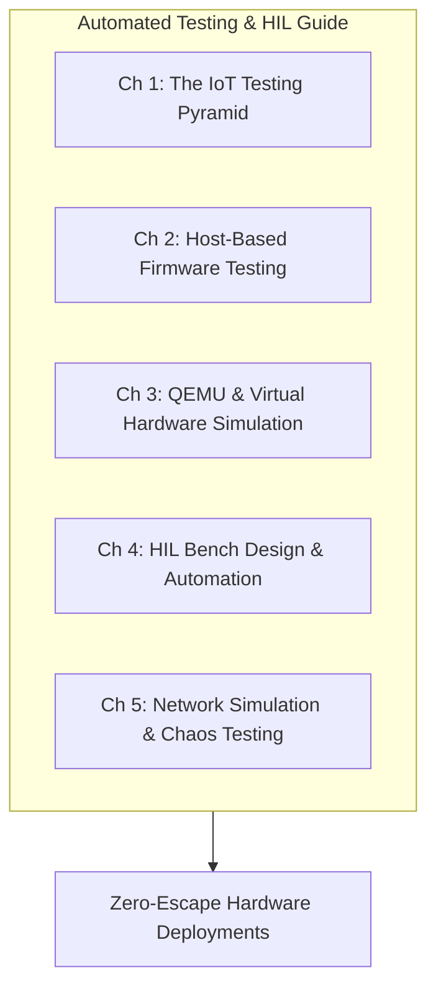

# Hardware-in-the-loop and automated testing

## Executive Overview

Developing firmware for physical connected products presents a unique verification challenge: software interacts continuously with physical analog circuits, silicon errata, fluctuating power supplies, and lossy wireless channels. Testing firmware solely on developer benches or relying on manual button-pressing before release leads to severe defect escapes, intermittent field crashes, and expensive recalls.

This guide sets out how to build an automated, multi-tier testing strategy for connected devices. It covers host-native unit testing, virtual system emulation, physical Hardware-in-the-Loop (HIL) test racks and network chaos engineering.

[[CAPTION:Figure]] The five pillars of automated embedded testing and HIL validation.

## Target Audience & Guide Structure

This guide is designed for embedded firmware engineers, test automation engineers, hardware designers, and quality assurance architects:

- **[Chapter 1: The IoT Testing Pyramid](01-the-iot-testing-pyramid.md)**: Four-layer verification model, defect escape economics, and test execution velocity.
- **[Chapter 2: Host-Based Firmware Testing](02-host-based-firmware-testing.md)**: Hardware Abstraction Layer (HAL) mocking, Ceedling, Unity, CMock, and AddressSanitizer execution in cloud CI.
- **[Chapter 3: QEMU & Virtual Hardware Simulation](03-qemu-virtual-hardware-simulation.md)**: Simulating multi-task RTOS applications, virtual peripheral buses, and network interfaces using QEMU and Renode.
- **[Chapter 4: HIL Bench Design & Automation](04-hil-bench-design-and-automation.md)**: Pogo-pin fixtures, SCPI instrument automation, PyVISA controllers, dynamic current profiling, and pytest orchestration.
- **[Chapter 5: Network Simulation & Chaos Testing](05-network-simulation-and-chaos-testing.md)**: Injecting brownouts, RF fading, cellular packet loss, bus lockups, and chaos engineering scenarios.
