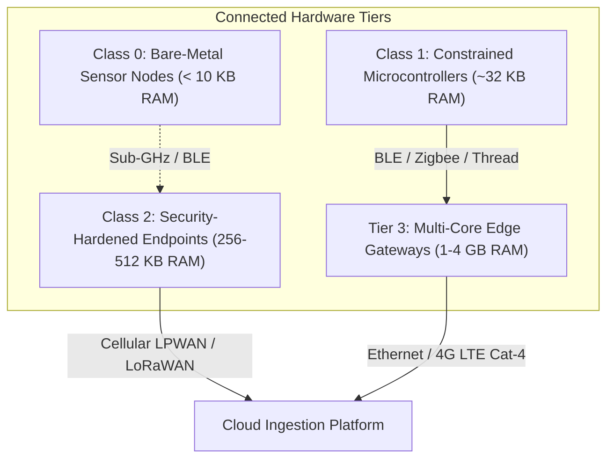
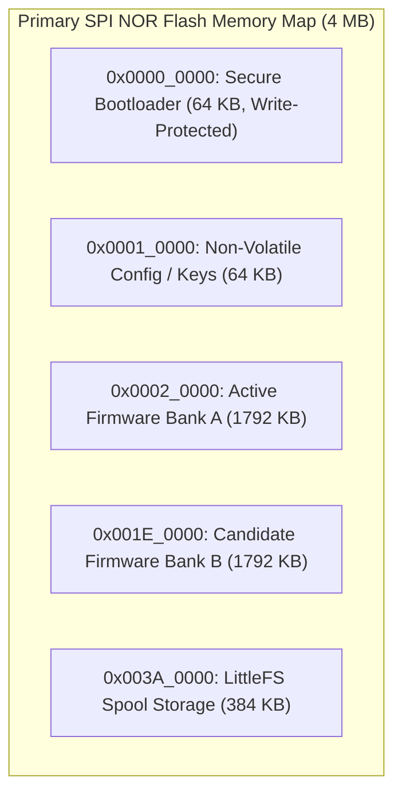
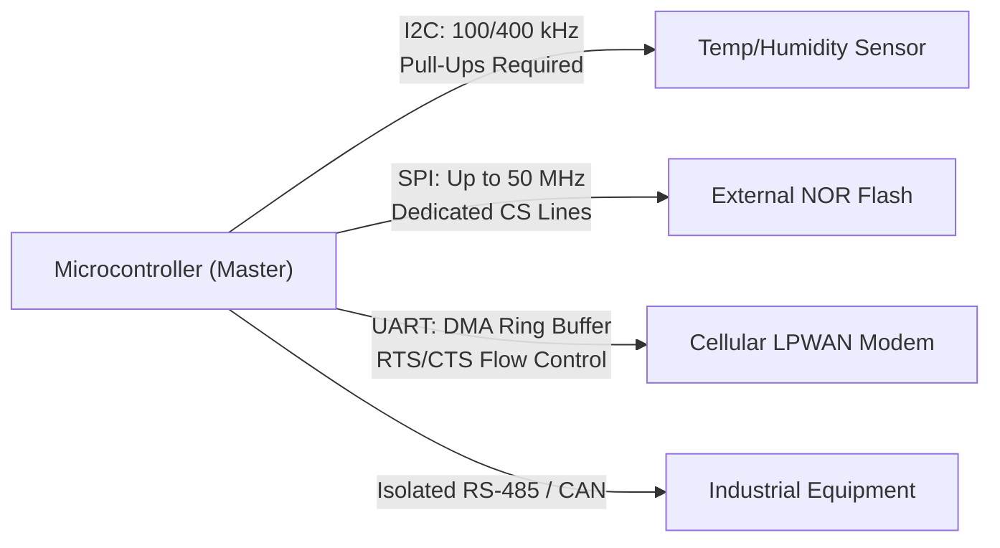

# Device tiers and hardware architecture

Selecting the appropriate silicon architecture, memory hierarchy, and peripheral interconnects forms the foundation of any connected device engineering programme. Inadequate compute capacity prevents future security updates, while over-specifying hardware inflates bill-of-materials (BOM) cost and accelerates battery drain.

This chapter establishes a systematic hardware categorization framework, contrasts modern silicon execution engines, details memory partitioning strategies, and provides architectural rules for robust peripheral bus integration.

## 1. Connected Device Classification Framework

Hardware architectures are categorized across four distinct performance and resource tiers, extending the IETF RFC 7228 classification to encompass modern edge gateways:

| Tier | Typical Hardware | Volatile Memory (RAM) | Non-Volatile (Flash) | Operating Environment | Primary Functionality |
| :--- | :--- | :--- | :--- | :--- | :--- |
| **Class 0 (Sub-Constrained)** | 8-bit / 16-bit MCU, Cortex-M0+ | < 10 KB | < 100 KB | Bare-metal super-loop | Simple beacon, water leak detector, push button |
| **Class 1 (Constrained Node)** | ARM Cortex-M0+/M3, RISC-V | ~10 KB to 32 KB | ~100 KB to 256 KB | Ultra-light RTOS (FreeRTOS) | Battery environmental sensor, BLE tracker |
| **Class 2 (Connected Endpoint)**| ARM Cortex-M4F/M33, ESP32 | ~64 KB to 512 KB | ~512 KB to 4 MB | Full RTOS (Zephyr / FreeRTOS) | Cellular LPWAN sensor, asset tracker, smart valve |
| **Tier 3 (Edge Gateway)** | ARM Cortex-A53 / A7, NXP `i.MX` | 512 MB to 4 GB | 4 GB to 32 GB eMMC | Embedded Linux / RT-Linux | Protocol translation, local CV/ML, container host |

[[CAPTION:Table]] Taxonomy of connected device hardware tiers and capabilities.

[[CAPTION:Figure]] Interconnection topology across device tiers from ultra-constrained nodes to edge gateways.

## 2. Silicon Architecture Evaluation

1. **ARM Cortex-M Series (M0+, M4F, M33)**: The de facto standard for low-power connected microcontrollers. The ARM Cortex-M33 incorporates **ARM TrustZone-M**, establishing hardware-enforced isolation between Secure and Non-Secure processing environments on a single core. This allows cryptographic keys and root-of-trust operations to execute in an isolated enclave shielded from application bugs.
1. **RISC-V Architectures (RV32IMAC)**: Gaining widespread traction for vendor neutrality, low royalty costs, and custom hardware accelerators. Microcontrollers such as the ESP32-C3/C6 provide robust silicon options for wireless nodes combining Wi-Fi 6, BLE 5, and IEEE 802.15.4 (Thread/Zigbee).
1. **ARM Cortex-A Multi-Core Application Processors**: Essential for Tier 3 Edge Gateways requiring full Linux operating systems, networking stacks, memory management units (MMU), and hardware cryptographic engines (ARM CryptoCell / CAAM).

## 3. Memory Subsystem & Flash Partitioning

Robust connected endpoints require explicit non-volatile memory layout partitioning to support atomic, fail-safe Firmware Over-The-Air (FOTA) updates and wear-leveled application storage.

[[CAPTION:Figure]] Dual-bank flash partitioning layout for atomic A/B firmware updates.

### 3.1 Dual-Bank A/B Partitioning Rules

1. **Symmetric Bank Sizing**: Active Bank A and Candidate Bank B must possess identical capacity, each sufficient to store the maximum allowable compressed firmware binary.
1. **Zero Overwrite During Ingestion**: Incoming FOTA chunks must be streamed and verified directly into the inactive candidate bank (Bank B) without touching active execution memory (Bank A).
1. **Atomic Swap Pointer**: Switching from Bank A to Bank B must be executed through an atomic flag update in write-protected Non-Volatile Storage (NVS). If the candidate binary crashes during its trial run, the hardware watchdog forces a reset, and the bootloader automatically reverts to Bank A.

## 4. Hardware Bus Topologies & Signal Integrity

Microcontrollers coordinate local sensors, actuators, and communication transceivers through serial peripheral buses. Field reliability demands defensive electrical and firmware design:

[[CAPTION:Figure]] Peripheral bus interfaces linking microcontroller to transceivers and transducers.

### 4.1 I2C Bus Reliability and Bus-Lockup Clearance

I2C open-drain lines (SDA and SCL) are susceptible to bus lockups if a slave device experiences a power dip while holding the SDA line low. If SDA remains stuck low, the master cannot generate a START or STOP condition:

> [!IMPORTANT]
> Firmware must implement a hardware I2C recovery routine. Prior to initializing the hardware I2C peripheral, the MCU GPIO driver must inspect the SDA pin. If SDA is low, the master must manually toggle the SCL pin up to 9 consecutive clock cycles until the slave releases the SDA line, followed by asserting a valid STOP condition.

### 4.2 UART Interconnects & DMA Ring Buffers

Communication between the application microcontroller and external cellular or satellite modems must use UART with **Hardware Flow Control (RTS/CTS)**:
- High-speed cellular modems can burst several kilobytes of data when receiving network packets. Without hardware flow control, receiver buffer overruns cause silent packet loss.
- Firmware must use **Direct Memory Access (DMA)** configured as a circular ring buffer to offload UART reception from the CPU, preventing dropped characters during high interrupt loads.

### 4.3 Industrial Fieldbuses: RS-485 and CAN

For Tier 3 gateways and industrial nodes interfacing with third-party factory machinery:
- **RS-485 (Modbus RTU)**: Requires galvanic isolation (optocouplers or digital isolators) and differential termination resistors ($120\,\Omega$) to reject high-voltage ground loops and industrial electrical transients.
- **CAN-FD (Controller Area Network Flexible Data-Rate)**: Provides deterministic arbitration, hardware cyclic redundancy checks (CRC), and automatic retransmission for critical machinery control.
