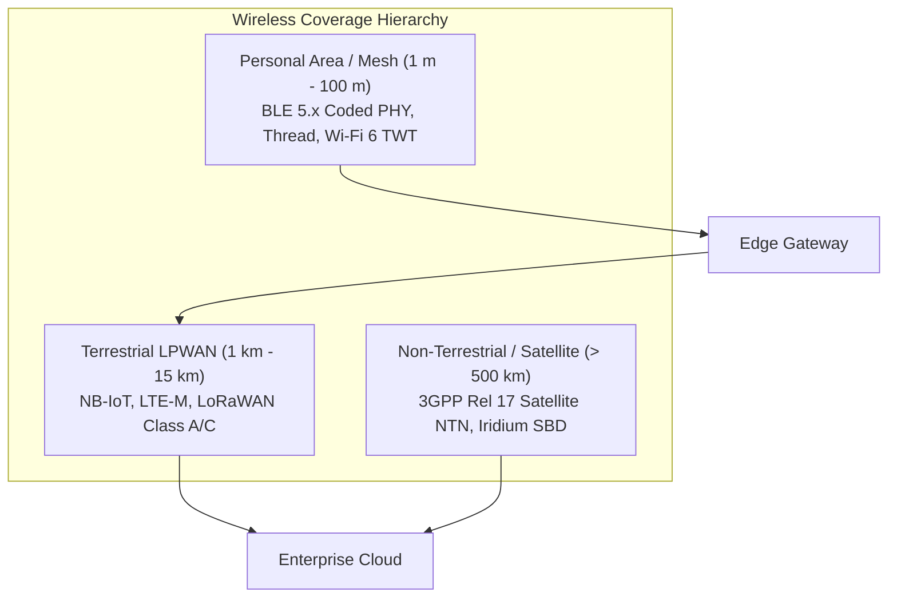
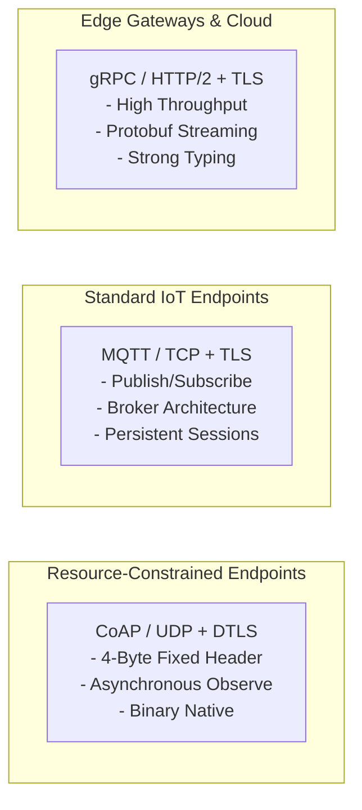
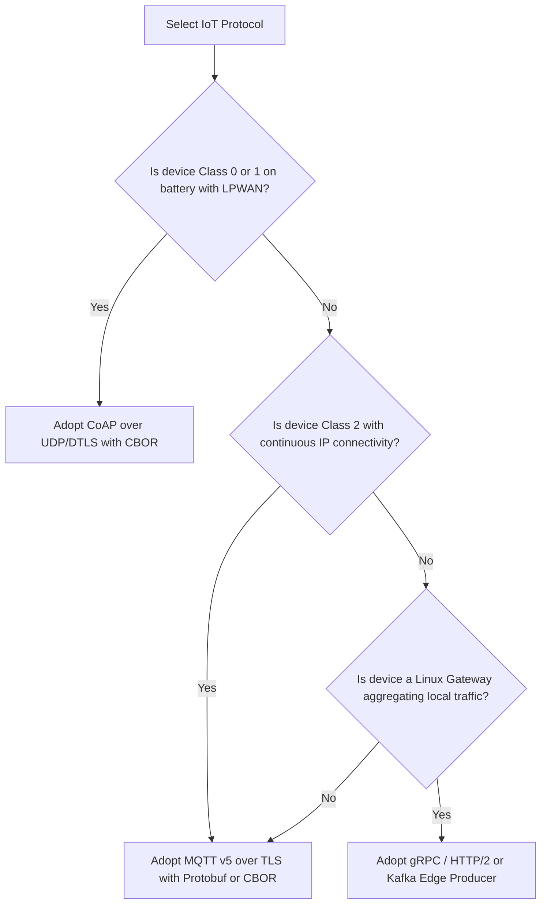

# Connectivity & Protocol Trade-Offs

Connected endpoints and edge gateways rely on wireless and wired communication protocols to exchange telemetry, receive configuration updates, and report critical alarms. Selecting the optimal combination of physical layer (PHY), medium access control (MAC), transport, and application layer protocols dictates network scalability, battery longevity, and operational data expenditure.

This chapter analyzes modern wireless and wired connectivity options, contrasts IoT application layer protocols, and provides a structured architectural selection matrix.

## 1. Physical & Link Layer Connectivity Landscape

IoT connectivity spans short-range local mesh networks to global Non-Terrestrial Network (NTN) satellite links:

[[CAPTION:Figure]] Hierarchical wireless communication topology from mesh to satellite.

### 1.1 Short-Range & Local Mesh Networks

1. **Bluetooth Low Energy (BLE 5.x)**: BLE 5 introduces **Coded PHY** ($S=8$ or $S=2$), extending radio range up to 400 meters in line-of-sight while trading throughput down to 125 kbps. Features such as **Periodic Advertising** enable ultra-low-power local telemetry broadcasting without establishing point-to-point connections.
1. **Thread (IEEE 802.15.4 & 6LoWPAN)**: An open IPv6-native wireless mesh standard. Unlike Zigbee, Thread devices are addressable via standard IPv6 addresses, avoiding application-layer translation gateways. Thread incorporates self-healing mesh routing with no single point of failure.
1. **Wi-Fi 6 (IEEE 802.11ax)**: Introduces **Target Wake Time (TWT)**, allowing client devices to negotiate specific sleep schedules with the access point. A Wi-Fi 6 sensor can remain asleep for hours or days, waking only at pre-negotiated microsecond slots, slashing standby power consumption.

### 1.2 Long-Range Low-Power Wide Area Networks (LPWAN)

| Technology | Spectrum | Max Range | Data Rate | Roaming | Typical Applications |
| :--- | :--- | :--- | :--- | :--- | :--- |
| **NB-IoT (Cat-NB1/NB2)** | Licensed Cellular (3GPP) | Up to 15 km | ~26 kbps to 127 kbps | Regional / Limited | Stationary sensors, basement meters, pipeline monitors |
| **LTE-M (Cat-M1/M2)** | Licensed Cellular (3GPP) | Up to 10 km | ~375 kbps to 1 Mbps | Global / Extensive | Fleet trackers, mobile assets, large FOTA nodes |
| **LoRaWAN (Class A/C)** | Unlicensed ISM (868/915 MHz) | Up to 15 km | 250 bps to 50 kbps | Private Gateways | Remote agriculture, campus sensors, smart campuses |
| **Satellite NTN** | Licensed L/S/Ku Bands (3GPP Rel 17)| Global Orbit | 100 bps to 10 kbps | Global Maritime/Wild | Ocean buoys, transcontinental shipping, mining |

[[CAPTION:Table]] Technical comparison of wide-area wireless connectivity options.

## 2. Application Layer Transport Protocols

At the application layer, the three predominant protocols for connected devices are **CoAP**, **MQTT**, and **gRPC / HTTP**:

[[CAPTION:Figure]] Protocol alignment matching compute constraints and network topologies.

### 2.1 Constrained Application Protocol (CoAP - RFC 7252)

CoAP is a specialized RESTful web transfer protocol designed for constrained nodes and lossy networks:
- **UDP Transport**: Operates over UDP with optional Datagram Transport Layer Security (DTLS), avoiding TCP three-way connection handshakes and keepalive packet overhead.
- **Microscopic Header Overhead**: The base CoAP header is fixed at only **4 bytes**, compared to 20 to 60 bytes for TCP/HTTP headers.
- **Observe Pattern (RFC 7641)**: Allows clients to observe resources on an endpoint; the server asynchronously streams state updates whenever the resource state mutates, eliminating continuous client polling.
- **Block-Wise Transfers (RFC 7959)**: Enables chunked transmission of large payloads (such as firmware images) across small network MTUs without relying on IP fragmentation.

### 2.2 Message Queuing Telemetry Transport (MQTT v3.1.1 / v5.0)

MQTT is an asynchronous publish/subscribe messaging protocol operating over TCP:
- **Decoupled Architecture**: Publishers and subscribers do not interact directly; all communication routes through an intermediate MQTT broker.
- **Quality of Service (QoS)**:
  - *QoS 0 (At most once)*: Fire-and-forget transmission with zero delivery confirmation.
  - *QoS 1 (At least once)*: Guarantees delivery via PUBACK acknowledgment; messages may be duplicated.
  - *QoS 2 (Exactly once)*: Guarantees single-delivery via a four-step handshake; introduces significant latency and round-trips.
- **MQTT v5 Enhancements**: Introduces **User Properties** (arbitrary key-value metadata), **Topic Aliasing** (reducing string topic names to 2-byte integer IDs on the wire), and **Reason Codes** for granular diagnostic reporting.

### 2.3 gRPC and HTTP/2 for Tier 3 Gateways

For Linux-based edge gateways streaming aggregated telemetry from dozens of local machines to cloud event hubs:
- **Multiplexed Streams**: HTTP/2 multiplexes multiple bidirectional RPC streams over a single persistent TCP connection.
- **Strict Interface Definition**: gRPC compiles strongly typed Protocol Buffer contracts, preventing schema mismatches between edge gateways and cloud microservices.

## 3. Protocol Selection Decision Matrix

Engineering teams must apply the following decision framework:

[[CAPTION:Figure]] Decision tree for connected device protocol selection.

### 3.1 Rules of Thumb for Constrained Architectures

1. **Never Run TLS Handshakes on Hourly Bursts**: An unoptimized TLS 1.2 or 1.3 handshake transfers 4 KB to 8 KB of certificate chains and cryptographic parameters. If an LPWAN device wakes once per hour, conducts a full TLS handshake, transmits a 50-byte telemetry payload, and sleeps, **over 95% of its battery energy is wasted on cryptographic handshakes**. Use **Session Resumption with Pre-Shared Keys (TLS-PSK)**, **0-RTT connection tickets**, or CoAP/OSCORE (RFC 8613) to eliminate repetitive handshake overhead.
1. **Cap Keepalive Intervals Responsibly**: On cellular networks, carrier firewalls tear down idle TCP NAT state tables after 60 to 120 seconds. If using MQTT over cellular, set keepalive ping intervals to 50 seconds to prevent silent socket severance, or transition to CoAP/UDP where NAT bindings can be refreshed with minimal packet cost.
