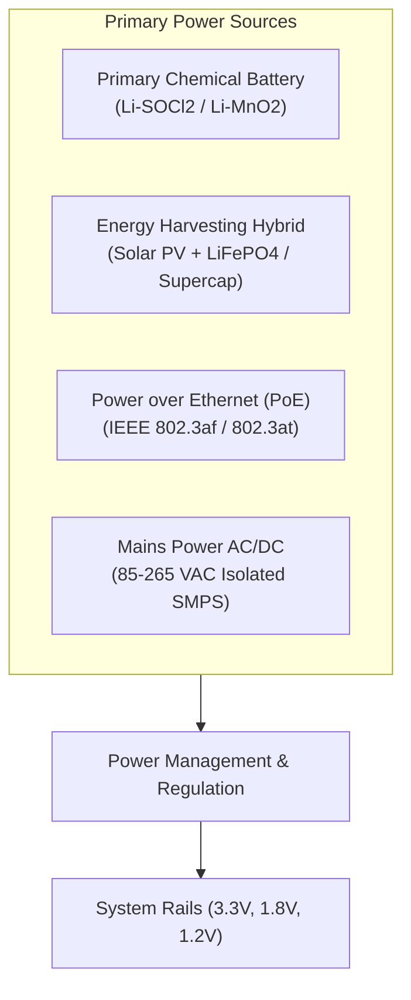
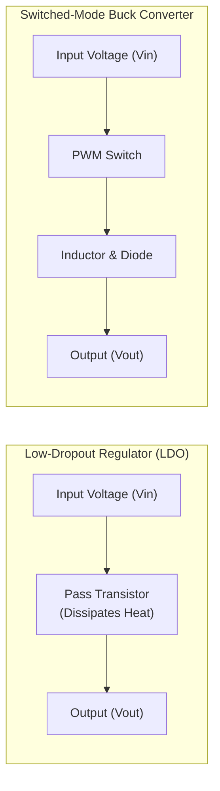
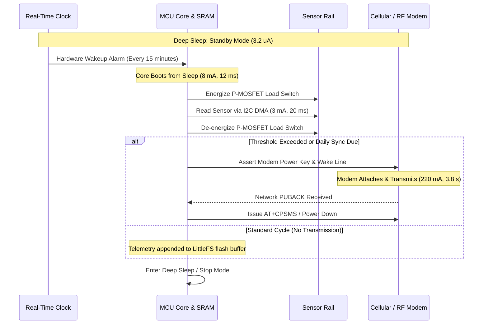
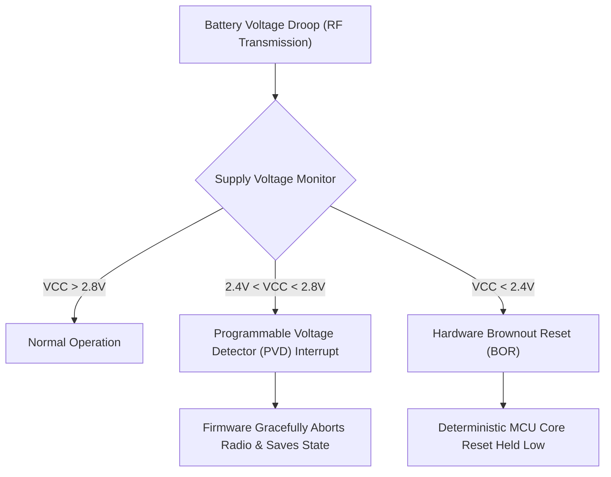

# Power Architecture & Duty-Cycling

Designing power architectures for connected devices requires balancing peak pulse requirements, sleep quiescent leakage, supply voltage ranges, and thermal dissipation. Whether an endpoint relies on a decade-long primary lithium cell, ambient solar energy harvesting, or Power-over-Ethernet (PoE), power architecture dictates system reliability and field operating life.

This chapter details power supply topologies, contrasts DC-DC conversion architectures, provides guidelines for firmware duty-cycling, and outlines hardware brownout mitigation mechanisms.

## 1. Power Supply Topologies

Connected systems utilise four primary power intake topologies:

[[CAPTION:Figure]] Common power intake architectures across endpoint and gateway designs.

| Topology | Input Range | Primary Advantages | Critical Design Challenges | Best Use Cases |
| :--- | :--- | :--- | :--- | :--- |
| **Primary Lithium** | 2.0 V to 3.6 V | Decade-long life without external wiring | Severe peak pulse voltage drop, passivation | Remote telemetry, pipeline monitors |
| **Solar Harvesting** | 0.5 V to 6.0 V (PV) | Indefinite operational lifetime | Multi-day cloudy periods, winter freeze degradation | Outdoor weather stations, agricultural IoT |
| **PoE (802.3af/at)** | 37 V to 57 V DC | Single cable for Gigabit data and 15W-30W power | Requires isolated flyback transformer, magnetics | Building automation, security cameras, gateways |
| **Mains AC/DC** | 85 V to 264 V AC | Unlimited continuous electrical energy | High voltage isolation (4 kV surge), safety certs | Industrial gateways, street light controllers |

[[CAPTION:Table]] Comparison of power intake architectures.

## 2. Voltage Regulation: LDO vs DC-DC Switching Converters

Microcontrollers and RF radios require stable voltage rails (typically 3.3 V, 1.8 V, or 1.2 V core). Converting battery or bus voltage down to these rails requires evaluating the trade-offs between Low-Dropout Regulators (LDOs) and Switched-Mode DC-DC Buck Converters:

[[CAPTION:Figure]] Linear LDO versus switched-mode inductive DC-DC conversion.

### 2.1 Efficiency Comparison and the Quiescent Current Trap

Linear regulators exhibit electrical efficiency proportional to the voltage ratio:

$$\eta_{LDO} = \frac{V_{out}}{V_{in}} \times 100\%$$

When regulating a $3.6\,\mathrm{V}$ primary cell down to $1.8\,\mathrm{V}$ for an ultra-low-power MCU core, an LDO operates at only $50\%$ efficiency, dissipating the remaining $50\%$ as waste heat. A synchronous DC-DC buck converter delivers $90\%$ to $95\%$ efficiency under load.

> [!WARNING]
> While DC-DC buck converters excel at active currents ($> 10\,\mathrm{mA}$), their internal oscillator and switching circuits consume quiescent current ($I_Q$) ranging from $10\,\mu\mathrm{A}$ to $50\,\mu\mathrm{A}$. In an ultra-low-power sensor that sleeps $99.9\%$ of the time, this continuous $I_Q$ draw will drain the battery faster than the radio transmissions!

**Architectural Recommendation**: Use **Dual-Mode Power Management ICs (PMICs)** or select ultra-low-quiescent buck converters (such as Texas Instruments TPS62840 with $I_Q = 60\,\mathrm{nA}$) that automatically transition to high-efficiency pulse-frequency modulation (PFM) during sleep states.

## 3. Firmware Duty-Cycling & Low-Power State Execution

Extending battery lifetime requires the firmware to treat every milliampere-second of active compute as a scarce resource.

[[CAPTION:Figure]] Discrete event timeline for deterministic low-power sensor duty-cycling.

### 3.1 Firmware Power Optimization Rules

1. **Tickless RTOS Scheduling**: Standard RTOS kernels maintain a periodic 1 ms tick interrupt that wakes the processor 1,000 times per second. Firmware must enable tickless idle (for example, `configUSE_TICKLESS_IDLE` in FreeRTOS), which programs hardware low-power timers (LPTIM) to sleep for seconds or hours until the next actual software timer expires.
1. **Peripheral Power Rail Gating**: Idle sensors, level shifters, and external memory chips frequently leak $5\,\mu\mathrm{A}$ to $50\,\mu\mathrm{A}$ in standby. Route all peripheral power supplies through a high-side P-channel MOSFET load switch controlled by an MCU GPIO, keeping external circuits completely de-energized during sleep.
1. **Dynamic Voltage and Frequency Scaling (DVFS)**: When executing sensor math or cryptographic hashing, run the core clock at maximum frequency (for example, 80 MHz) to complete computations as fast as possible ("race-to-sleep"). Once computation finishes, immediately drop the clock down to 32 kHz or enter deep sleep.

## 4. Hardware Reliability & Brownout Mitigation

When primary batteries degrade or experience cold temperatures, high-current RF transmission bursts induce sharp voltage droops. If the system rail drops below the digital logic threshold, the microcontroller enters a chaotic undefined state.

[[CAPTION:Figure]] Multi-tier voltage supervision mitigating catastrophic brownouts.

### 4.1 Independent Watchdog (IWDG) Architecture

Firmware can hang due to electrostatic discharge (ESD), infinite loops, or locked external buses. A dedicated **Independent Watchdog Timer (IWDG)** is mandatory:
- The IWDG must be clocked from an independent dedicated internal low-speed RC oscillator (32 kHz), completely decoupled from the main system PLL and crystal oscillators.
- The watchdog timeout must be configured to reset the system if the main loop fails to refresh the watchdog within a bounded window (typically 4 to 8 seconds).
- The watchdog service function must only be called from the primary operational task after verifying that all sub-tasks and IPC queues are healthy. Never refresh a watchdog unconditionally inside a hardware timer interrupt service routine (ISR).
