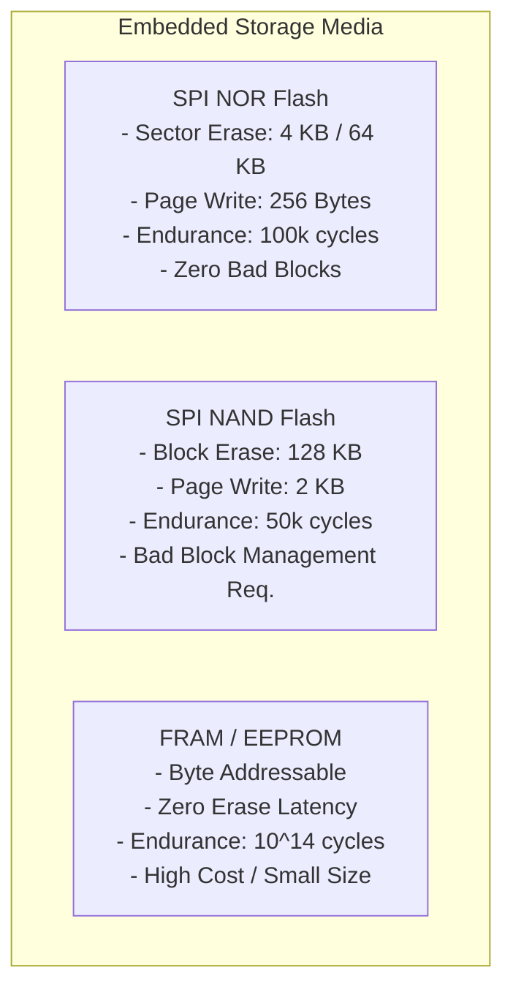
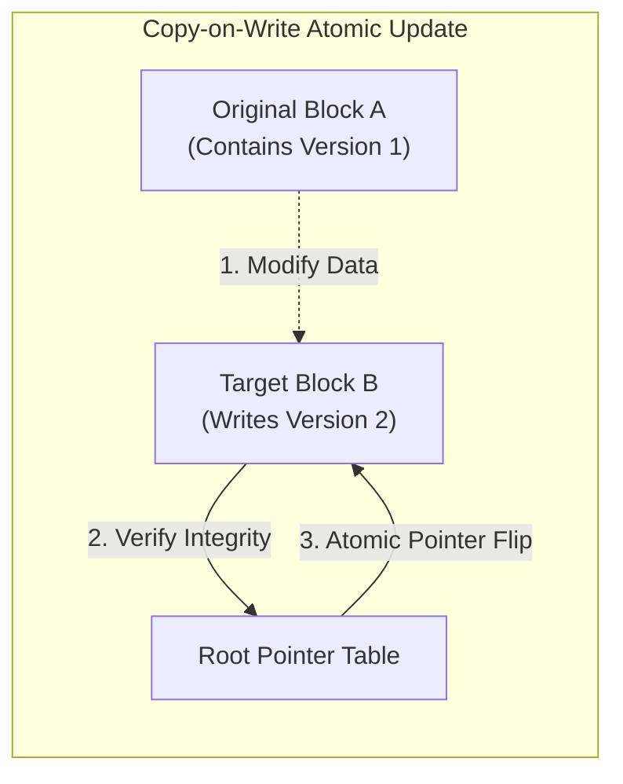

# Edge storage and local resilience

Connected devices deployed across harsh field environments encounter unexpected power interruptions, dead battery cutoffs, network brownouts, and physical shocks. Microcontrollers cannot assume clean shutdowns. A device may lose power while committing a database record, writing a telemetry batch or applying a firmware update. Its non-volatile storage must then recover deterministically on reboot, without human intervention.

This chapter details embedded non-volatile memory architectures, copy-on-write storage engines, offline spooling priority queues, and crash dump persistence.

## 1. Storage Media Selection & Failure Modes

Understanding physical storage failure modes is vital to preventing bricked devices in the field:



[[CAPTION:Figure]] Comparison of non-volatile storage media physical constraints.

### 1.1 Physical Storage Hazards

1. **Incomplete Sector Erase**: Erasing a 4 KB NOR flash sector takes 50 ms to 200 ms. If power collapses mid-erase, the sector contains invalid floating charge levels that fail future reads and writes.
1. **Bit Rot & Charge Leakage**: Flash cells store electrons in isolated floating gates. Over years of thermal cycling, charge leaks, turning a programmed `0` bit back into an unprogrammed `1`. High-integrity filesystems must employ CRC32 or ECC (Error Correcting Code) checks on every block.
1. **Write Disturb**: Programming data into one flash page can inadvertently stress adjacent unprogrammed cells in the same block, inducing silent bit flips.

## 2. Power-Fail-Safe Filesystem: LittleFS

Standard desktop filesystems (FAT, ext4) are unsuitable for raw microcontroller flash because they cache file allocation tables in RAM and update metadata in place. A power cut during a metadata update renders the entire partition unmountable.

**LittleFS** is the mandated open-source filesystem for resource-constrained embedded systems:



[[CAPTION:Figure]] LittleFS copy-on-write transaction ensuring atomic state commits.

### 2.1 Core Architectural Guarantees of LittleFS

1. **Power-Loss Atomicity**: LittleFS uses a copy-on-write log-structured architecture. File modifications are written to freshly erased blocks. Once the new data is fully written and verified, the master metadata pointer is flipped atomically. If power fails at any point prior to the pointer flip, the filesystem cleanly mounts the preceding consistent version.
1. **Dynamic & Static Wear Leveling**: LittleFS tracks cumulative erase counts for every physical block. If a block's erase count significantly exceeds neighboring blocks, LittleFS migrates cold, static data to the worn block and reallocates the fresh block for active writes, ensuring uniform degradation across the entire flash chip.
1. **Zero Dynamic Allocation**: LittleFS operates using bounded static memory buffers, requiring less than 4 KB of RAM regardless of flash partition size.

## 3. Disconnected Spooling & Priority Queues

When cellular, satellite, or mesh connectivity is disrupted, endpoints must spool inbound events into local non-volatile queues:

```mermaid
flowchart TD
    Event["Sensor / System Event"] --> Filter{"Severity Classification"}
    Filter -->|Critical: Tamper / Fault / BOR| Q0["High Priority Queue (Guaranteed Delivery)"]
    Filter -->|Routine: Periodic Telemetry| Q1["Standard FIFO Queue (Spool Buffer)"]
    Filter -->|Trace: Verbose Debug Logs| Q2["Ephemeral Ring Buffer (Drop on Overflow)"]

    Q0 --> LittleFS["LittleFS Non-Volatile Storage"]
    Q1 --> LittleFS
    Q2 --> SRAM["SRAM Circular Buffer"]

    LittleFS --> Dispatcher["Network Cloud Dispatcher"]
```



[[CAPTION:Figure]] Prioritized spooling pipeline preventing critical alarm loss.

### 3.1 Backpressure and Queue Eviction Rules

When a network outage persists for weeks, local flash capacity will eventually be exhausted:

1. **Drop Ephemeral Traces First**: Diagnostic debug logs in Queue Q2 are discarded immediately.
1. **Telemetry Downsampling**: When Queue Q1 exceeds 80% capacity, an automated background task consolidates 1-minute telemetry records into hourly aggregates (recording minimum, maximum, mean, and sample count), freeing up to 90% of occupied flash sectors.
1. **Strict FIFO Tail Protection**: If downsampled storage still reaches 98% capacity, the oldest unacknowledged routine records in Queue Q1 are deleted (FIFO head drop). **Queue Q0 (critical security and fault alarms) must never be evicted under any condition**.

## 4. Crash Reporting & Hardware Fault Persistence

When an unrecoverable runtime exception occurs (such as an ARM Cortex-M `HardFault`, Memory Management Fault, or Watchdog Timeout), the device must capture forensic diagnostic telemetry before executing a hardware reset.

```c
// Embedded C: HardFault Forensic Context Dump
typedef struct {
    uint32_t r0;
    uint32_t r1;
    uint32_t r2;
    uint32_t r3;
    uint32_t r12;
    uint32_t lr;  // Link Register (Return Address)
    uint32_t pc;  // Program Counter (Fault Location)
    uint32_t psr; // Program Status Register
    uint32_t cfsr;// Configurable Fault Status Register
    uint32_t hfsr;// HardFault Status Register
    uint32_t mmfar; // Memory Management Fault Address
    uint32_t bfar;  // Bus Fault Address
} crash_dump_t;

void HardFault_Handler_C(uint32_t *hardfault_args) {
    crash_dump_t dump;
    dump.r0  = hardfault_args[0];
    dump.r1  = hardfault_args[1];
    dump.r2  = hardfault_args[2];
    dump.r3  = hardfault_args[3];
    dump.r12 = hardfault_args[4];
    dump.lr  = hardfault_args[5];
    dump.pc  = hardfault_args[6];
    dump.psr = hardfault_args[7];
    dump.cfsr = SCB->CFSR;
    dump.hfsr = SCB->HFSR;
    dump.mmfar = SCB->MMFAR;
    dump.bfar  = SCB->BFAR;

    // Write crash dump to dedicated raw backup flash sector (bypassing RTOS / interrupts)
    raw_flash_emergency_write(CRASH_SECTOR_ADDR, (uint8_t *)&dump, sizeof(dump));

    // Force system reboot
    NVIC_SystemReset();
}
```

Upon subsequent reboot, the primary boot routine inspects the crash dump sector. If it finds a valid crash record, it formats the dump as an urgent diagnostic event. It uploads the event to the cloud observability platform on the first network connection, and marks the sector as acknowledged.
