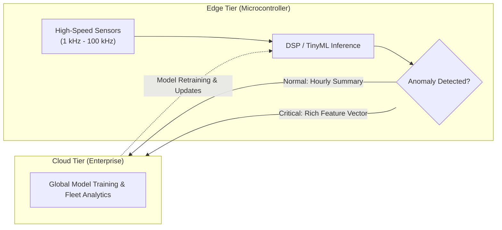
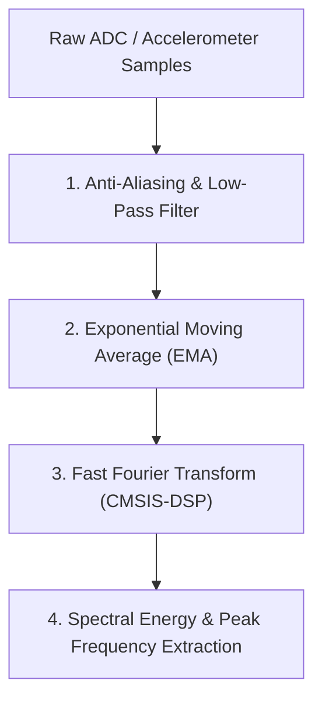
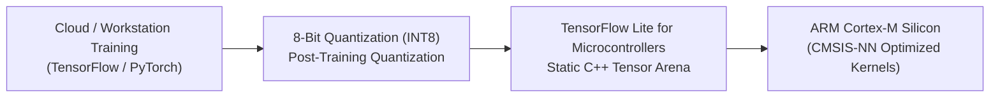
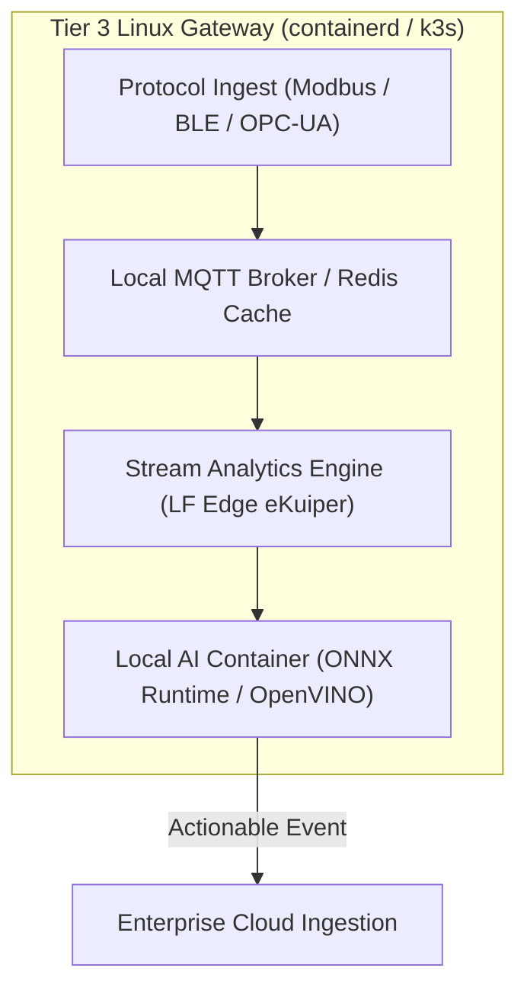

# Edge intelligence and processing

As edge devices become equipped with higher-performance microcontrollers and digital signal processing (DSP) extensions, transmitting raw, uncompressed sensor streams to the cloud becomes both economically unviable and technically inefficient. Transmitting high-frequency vibration signals (such as 10 kHz accelerometer samples) over cellular or satellite networks would deplete battery budgets and incur enormous cellular data costs.

This chapter establishes architectural frameworks for partitioning compute between edge and cloud, executing digital signal processing on microcontrollers, deploying TinyML neural networks, and containerizing software on edge gateways.

## 1. Compute Partitioning Framework

Deciding where data processing occurs requires evaluating four core trade-off vectors:



[[CAPTION:Figure]] Compute partitioning topology filtering raw high-frequency signals into concise telemetry.

| Vector | Edge Execution (MCU / Gateway) | Cloud Execution |
| :--- | :--- | :--- |
| **Response Latency** | Sub-millisecond deterministic control loops | 100 ms to 2 seconds (network-dependent) |
| **Network Bandwidth**| Transmits only filtered features or anomalies | Requires continuous high-bandwidth uplink |
| **Data Privacy** | Raw audio/video/vibration never leaves device | Sensitive raw data traverses public networks |
| **Compute Scalability**| Strictly bounded by local MCU RAM/Flash | Elastic, virtually unbounded GPU/CPU resources |

[[CAPTION:Table]] Trade-off comparison between edge and cloud compute execution.

## 2. On-Device Digital Signal Processing (DSP)

Prior to invoking machine learning models or writing to flash, microcontrollers should apply classic digital signal processing algorithms to clean raw sensor inputs:



[[CAPTION:Figure]] Digital signal processing pipeline on an embedded microcontroller.

### 2.1 Exponential Moving Average (EMA) Filter

For continuous environmental measurements (temperature, pressure, gas concentration), high-frequency electrical noise is eliminated using fixed-point exponential smoothing:

$$y[n] = \alpha \cdot x[n] + (1 - \alpha) \cdot y[n-1]$$

Where $\alpha \in (0, 1]$ represents the smoothing factor. In embedded C, fixed-point arithmetic eliminates floating-point coprocessor power consumption:

```c
// Embedded C: Integer Fixed-Point EMA Filter (Alpha = 1/8)
uint32_t filter_ema_fixed(uint32_t current_sample, uint32_t previous_filtered) {
    // y[n] = (x[n] + 7 * y[n-1]) / 8
    return (current_sample + (7 * previous_filtered) + 4) >> 3;
}
```

### 2.2 Frequency-Domain Analysis with CMSIS-DSP

For predictive maintenance on rotating industrial machinery, time-domain vibration data is transformed into the frequency domain using the **ARM CMSIS-DSP** RFFT (Real Fast Fourier Transform) library. By extracting spectral energy across specific harmonic bins (bearing fault frequencies), the MCU compresses 4,096 raw time-domain samples into a 16-byte frequency health vector.

## 3. TinyML: Machine Learning on Microcontrollers

Modern 32-bit microcontrollers (such as ARM Cortex-M4F, Cortex-M33, or Cortex-M55 with Helium vector extensions) can execute quantized deep neural networks directly in SRAM.



[[CAPTION:Figure]] TinyML model conversion and deployment pipeline.

### 3.1 Architectural Constraints for TinyML

1. **Strict INT8 Quantization**: Floating-point models (FP32) must be quantized to 8-bit integers (INT8). Quantization reduces model flash size by 75%, reduces SRAM consumption by 75%, and allows the processor to execute four SIMD multiply-accumulate operations in a single cycle.
1. **Pre-Allocated Tensor Arena**: Dynamic memory allocation (`malloc`) during inference is strictly prohibited. The runtime (such as TensorFlow Lite for Microcontrollers - TFLM) must be assigned a fixed, static byte array (`tensor_arena`) at initialization:
   ```cpp
   constexpr int kTensorArenaSize = 32 * 1024; // 32 KB Static SRAM Arena
   alignas(16) uint8_t tensor_arena[kTensorArenaSize];
   ```
1. **Inference Watchdog Protection**: Machine learning inference loops must be assigned a bounded execution time slice. If an inference task exceeds its time budget (for example, taking > 50 ms), the scheduler must preempt or terminate the model to prevent starving critical radio or sensor interrupts.

## 4. Tier 3 Edge Gateway Containerization & Streaming

On Tier 3 Linux gateways (running Yocto, Debian, or Ubuntu Core on ARM Cortex-A processors), edge intelligence transitions to containerized microservices:



[[CAPTION:Figure]] Edge gateway containerized processing architecture.

### 4.1 Edge Container Best Practices

1. **Lightweight Container Runtimes**: Deploy `containerd` or `crun` rather than full Docker daemons to conserve RAM and CPU cycles on embedded gateways.
1. **Read-Only Root Filesystem**: Gateway operating systems must mount the root filesystem as read-only (`ro`), isolating dynamic container state and telemetry databases to an encrypted, wear-managed data partition.
1. **Edge Stream Processing**: Use lightweight edge stream engines (such as LF Edge eKuiper) to evaluate SQL-like filtering rules on continuous local telemetry streams, transmitting only aggregated metrics or anomalies to cloud brokers.
