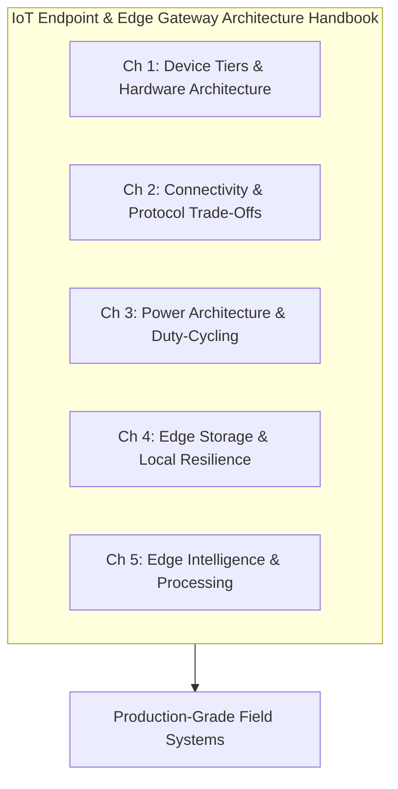

# IoT endpoint and edge gateway architecture

## Executive Overview

Connected device engineering demands a rigorous, cross-disciplinary architectural approach that unifies low-power embedded hardware, real-time operating systems, wireless telecommunications, resilient local storage, and edge intelligence. Modern IoT ecosystems span from micro-watt sensor nodes surviving a decade on a coin cell to multi-core edge gateways executing containerized neural networks on industrial machinery.

This guide establishes the definitive architecture reference for designing, implementing, and deploying generic connected endpoints and edge gateways across commercial, industrial, municipal, and consumer environments.

[[CAPTION:Figure]] Five architectural pillars of generic IoT endpoint and gateway design.

## Target Audience & Guide Structure

This guide is designed for embedded firmware engineers, hardware architects, IoT systems architects, and technical delivery leaders:

- **[Chapter 1: Device Tiers & Hardware Architecture](01-device-tiers-and-hardware-architecture.md)**: Classifies devices across RFC 7228 tiers, silicon families (Cortex-M, RISC-V, Cortex-A), memory partitioning, and high-reliability bus topologies.
- **[Chapter 2: Connectivity & Protocol Trade-Offs](02-connectivity-and-protocol-tradeoffs.md)**: Comprehensive evaluation of wireless technologies (Cellular LPWAN, BLE, Wi-Fi 6, LoRaWAN) and transport protocols (CoAP, MQTT, gRPC).
- **[Chapter 3: Power Architecture & Duty-Cycling](03-power-architecture-and-duty-cycling.md)**: Power supply topologies, energy harvesting, tickless sleep state machines, and brownout protection.
- **[Chapter 4: Edge Storage & Local Resilience](04-edge-storage-and-local-resilience.md)**: Solid-state memory hierarchies, LittleFS wear leveling, power-fail safety, and priority offline queues.
- **[Chapter 5: Edge Intelligence & Processing](05-edge-intelligence-and-processing.md)**: Partitioning workloads between edge and cloud, TinyML embedded inference, stream filtering, and gateway containerization.
