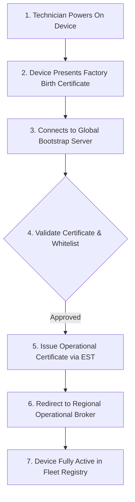
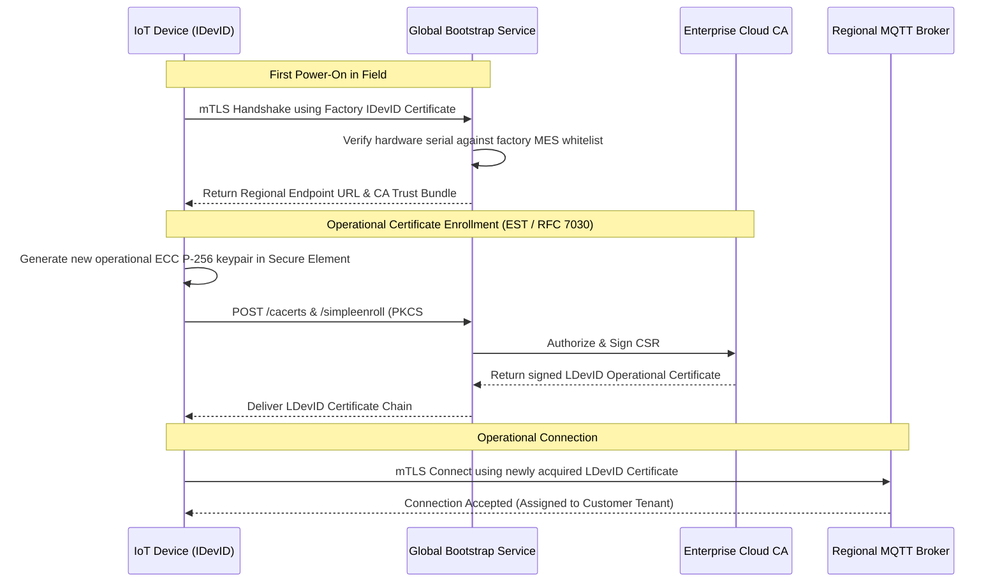

# Zero-Touch Device Onboarding

Deploying connected devices at fleet scale makes manual on-site configuration, keyboard credential entry, or technician pairing economically unviable. An installation technician mounting an asset tracker, air quality monitor, or industrial sensor should simply apply power, close the enclosure, and walk away.

**Zero-Touch Onboarding** automates the entire authentication, authorisation, cryptographic credential issuance, and cloud assignment sequence upon first boot.

[[CAPTION:Figure]] End-to-end zero-touch device bootstrapping and onboarding lifecycle.

## 1. Cryptographic Identity Separation: Birth vs Operational Certificates

A fundamental principle of secure device onboarding is the strict decoupling of **Birth (Factory) Credentials** from **Operational (Runtime) Credentials**:

| Credential Type | Issuing Authority | Storage Location | Lifetime | Revocation Mechanism |
| :--- | :--- | :--- | :--- | :--- |
| **Birth Certificate (IDevID)** | Factory Root of Trust CA | Secure Element (Locked Slot) | Lifetime of device hardware | Hardware blacklist in cloud |
| **Operational Certificate (LDevID)**| Enterprise Operational PKI CA | Secure Element or Encrypted Flash | 90 days to 2 years (Rotatable)| Cloud CRL / OCSP revocation |

[[CAPTION:Table]] IEEE 802.1AR Initial Device Identifier (IDevID) versus Locally Significant Device Identifier (LDevID).

1. **Initial Device Identifier (IDevID)**: Injected into the Secure Element during factory testing. It proves the physical provenance of the hardware to the global onboarding service.
1. **Locally Significant Device Identifier (LDevID)**: Generated during zero-touch onboarding. It grants access to specific customer tenants, MQTT topics, and enterprise cloud applications, and is rotated periodically throughout the device's operational life.

## 2. Automated Provisioning Protocols: EST and LwM2M Bootstrap

To transition a device from its factory state to its operational tenant, the platform deploys standardized certificate enrollment protocols:

[[CAPTION:Figure]] Automated certificate enrollment sequence using Enrollment over Secure Transport (EST).

### 2.1 Enrollment over Secure Transport (EST - RFC 7030)

EST operates over standard HTTPS/TLS, providing lightweight endpoints for certificate lifecycle management:
- `/simpleenroll`: The device sends a Certificate Signing Request (CSR) generated inside its Secure Element. The private key never leaves the device. The platform signs the CSR and returns an X.509 client certificate.
- `/simplereenroll`: Enables automated certificate rotation prior to expiration without requiring technician intervention.

## 3. Just-in-Time Registration (JITR / JITP)

In high-scale cloud platforms (such as AWS IoT Core or Azure Device Provisioning Service - DPS), **Just-in-Time Provisioning (JITP)** streamlines onboarding:
1. The enterprise registers its intermediate CA with the cloud IoT registry once.
1. When a new device connects for the first time presenting a client certificate signed by that CA, the cloud automatically triggers a provisioning hook (such as an AWS Lambda function or Azure Function).
1. The hook validates device ownership, creates the Digital Twin, applies least-privilege security policies, assigns customer metadata tags, and publishes a welcome message back to the device.

## 4. Carrier-Integrated Provisioning via eSIM (GSMA SGP.32)

For cellular connected fleets deployed internationally:
- Devices utilise **eSIM (eUICC)** hardware conforming to the **GSMA SGP.32** standard for IoT.
- Upon booting in a new country, the cellular modem connects via a low-cost global bootstrap profile.
- The carrier's Subscription Manager Data Preparation (SM-DP+) server pushes a localized domestic mobile network operator (MNO) profile over the air, switching the device to local commercial cellular data rates without physical SIM replacement.
