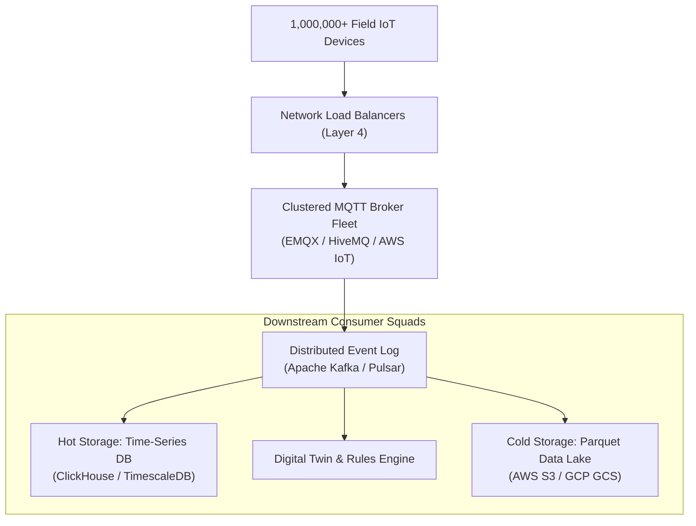
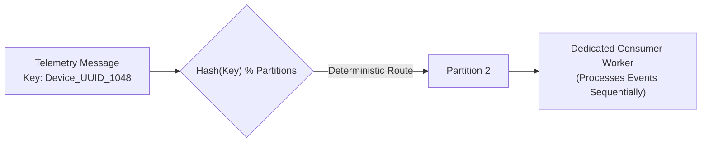

# Scalable telemetry ingestion

When an IoT fleet grows from ten thousand to one million devices, the telemetry pipeline must absorb millions of concurrent TCP connections and millions of messages per second. It must also survive the thundering herd of reconnections after a network outage ends. A naive cloud architecture that writes directly to relational databases will collapse under connection limits and disk I/O bottlenecks.

This chapter establishes the reference architecture for decoupling ingest brokers, event streaming pipelines, time-series storage, and rate-limiting controls.

## 1. High-Scale Ingestion Pipeline Architecture

The ingestion pipeline decouples protocol termination from downstream business processing using a multi-stage streaming pipeline:



[[CAPTION:Figure]] Decoupled event streaming architecture for high-volume IoT telemetry.

### 1.1 Ingestion Layers & Responsibilities

1. **Layer 4 Network Load Balancing**: Distributes incoming mTLS connections across broker nodes without terminating TLS, preserving client certificate authentication down to the application brokers.
1. **Clustered MQTT Broker Tier**: Terminates TLS handshakes, verifies client identities, enforces topic ACLs, and immediately bridges payload bytes into Kafka topics. The broker retains no business logic.
1. **Distributed Event Streaming (Kafka / Pulsar)**: Serves as a persistent, high-throughput buffer that absorbs upstream traffic spikes without dropping messages. Downstream database consumers pull records at their own sustainable processing rate.

## 2. Kafka Partitioning & In-Order Telemetry Guarantees

In distributed event streaming, partitioning strategy dictates whether telemetry can be processed in chronological order:



[[CAPTION:Figure]] Key-based partitioning guaranteeing sequential telemetry consumption per physical device.

### 2.1 Partitioning Rules

> [!IMPORTANT]
> Messages produced to the event streaming layer must use the unique **Device Hardware UUID** as the Kafka message key. This guarantees that all telemetry emitted by a single physical device is routed to the exact same Kafka partition, ensuring strict in-order processing.

- Never use random keys or timestamps as partition keys; doing so scatters a device's readings across different consumer workers, causing race conditions in state calculation.
- If a tenant has thousands of devices, prefixing keys with `tenant_id/device_id` preserves per-device ordering while allowing tenant-level stream filtering.

## 3. Hot vs Cold Time-Series Storage Architecture

Storing years of high-frequency telemetry in transactional databases incurs unsustainable infrastructure costs. Deploy a tiered storage lifecycle:

| Storage Tier | Technology | Retention Period | Query Latency | Storage Cost / GB | Intended Purpose |
| :--- | :--- | :--- | :--- | :--- | :--- |
| **Hot Tier** | ClickHouse / TimescaleDB | 30 to 90 days | < 50 ms | High (Fast NVMe SSD) | Operational dashboards, real-time alerting |
| **Warm Tier** | Compressed Parquet on Object Storage | 90 to 365 days | 1 s to 5 s | Low (Standard S3/GCS) | Machine learning training, trend analytics |
| **Cold / Glacier**| Encrypted Parquet Archives | 1 to 10+ years | Minutes to Hours | Ultra-low (Glacier / Deep Archive) | Regulatory compliance, long-term auditing |

[[CAPTION:Table]] Telemetry data storage tiering strategy.

### 3.1 ClickHouse Table Optimisation for IoT

ClickHouse provides extreme compression (often exceeding 80% to 90%) and sub-second aggregation across billions of rows when configured with appropriate primary keys:

```sql
CREATE TABLE iot_telemetry (
    tenant_id UUID,
    device_id UUID,
    timestamp DateTime64(3, 'UTC'),
    metric_name LowCardinality(String),
    val_float Float64,
    status_flags UInt32
) ENGINE = MergeTree()
PARTITION BY toYYYYMM(timestamp)
ORDER BY (tenant_id, metric_name, device_id, timestamp);
```

By placing `tenant_id`, `metric_name`, and `device_id` at the beginning of the `ORDER BY` tuple, queries that aggregate specific sensor readings over time span contiguous disk blocks, minimizing disk seeks.

## 4. Backpressure, Throttling & Thundering Herd Defence

When a regional cellular tower experiences an outage and comes back online, tens of thousands of sleeping devices wake up and attempt to reconnect simultaneously—creating a **thundering herd**:

1. **Randomized Exponential Backoff with Jitter**: Embedded devices must never reconnect on fixed intervals. Reconnection attempts must incorporate random jitter:
   $$t_{wait} = \min(t_{max}, t_{base} \times 2^{attempt}) + \mathrm{Uniform}(-0.5, +0.5) \times t_{base}$$
1. **Token Bucket Rate Limiting at Ingest Gateways**: The MQTT broker tier must enforce per-device and per-tenant connection and publish rate limits (for example, maximum 5 connects per minute and 1 publish per second per device). Excess attempts receive MQTT disconnects with reason code `0x9D` (Message rate too high) or `0x89` (Server busy).
1. **Non-Critical Telemetry Shedding**: If the Kafka cluster or cloud consumers experience high lag, the edge gateway can temporarily instruct field devices to downsample or drop verbose diagnostic logs, preserving broker bandwidth for critical alarms.
