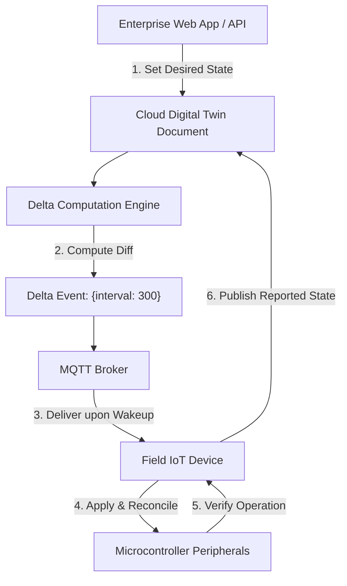
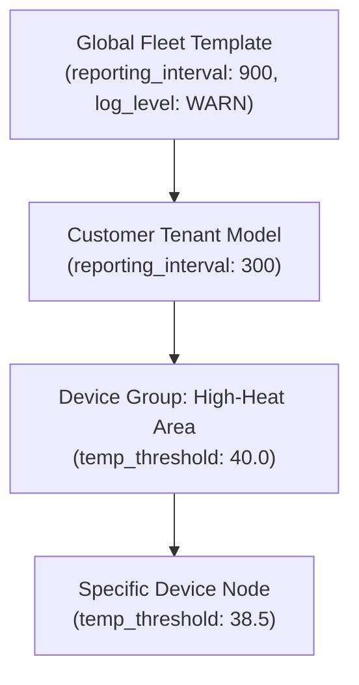
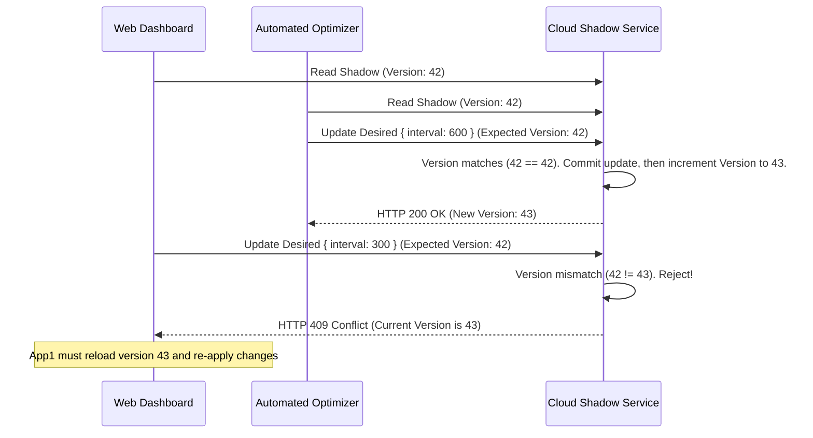

# Digital twins and state reconciliation

In large-scale IoT fleets, physical devices operate under intermittent connectivity, while enterprise web consoles, mobile applications, and scheduling microservices require continuous, instant read-and-write access to device settings. Directly issuing synchronous HTTP or RPC requests to physical field hardware fails because devices are frequently asleep, out of coverage, or executing high-priority sensing routines.

The **Digital Twin** (or **Device Shadow**) architecture decouples operational intent from physical execution by maintaining a persistent cloud state document synchronized with physical hardware.



[[CAPTION:Figure]] Desired-to-reported convergence cycle in large-scale digital twins.

## 1. Digital Twin Document Model

A production-grade digital twin document partitions device properties into four primary top-level structures:

```json
{
  "state": {
    "desired": {
      "reporting_interval_seconds": 300,
      "temp_alarm_threshold_celsius": 45.0,
      "firmware_target_version": "v3.2.0"
    },
    "reported": {
      "reporting_interval_seconds": 900,
      "temp_alarm_threshold_celsius": 45.0,
      "firmware_target_version": "v3.1.4",
      "battery_voltage_mv": 3620,
      "hardware_sku": "EDGE-SENS-REV2"
    },
    "delta": {
      "reporting_interval_seconds": 300,
      "firmware_target_version": "v3.2.0"
    }
  },
  "metadata": {
    "desired": {
      "reporting_interval_seconds": { "timestamp": 1774182000, "updated_by": "operator_alice" }
    },
    "reported": {
      "reporting_interval_seconds": { "timestamp": 1774170000 }
    }
  },
  "version": 1284,
  "last_updated": 1774182005
}
```

[[CAPTION:Table]] Digital twin JSON state representation.

1. **Desired State**: Represents the configuration intended by cloud systems or human operators.
1. **Reported State**: Represents the actual, physical reality reported by the device's firmware and onboard sensors.
1. **Delta State**: Dynamically computed by the platform as $\mathrm{Desired} \setminus \mathrm{Reported}$. If an element in `desired` matches `reported`, it is automatically stripped from the delta.
1. **Metadata & Versioning**: Tracks timestamps, updating identities, and a monotonically increasing 64-bit integer `version` used for optimistic concurrency locking.

## 2. Multi-Tenant Hierarchical Twin Configuration

In fleets spanning thousands of enterprise customers, managing configuration per individual device is error-prone. The platform must implement **Hierarchical Property Inheritance**:



[[CAPTION:Figure]] Hierarchical property inheritance and group-level cascading configuration.

- Settings cascade downwards: Device-level configurations override Group-level configurations, which in turn override Tenant- and Fleet-level defaults.
- Updating a single property on the Device Group automatically recomputes and dispatches deltas across all member devices upon their next communication session.

## 3. Concurrency Control & State Conflict Resolution

When multiple applications or automated workflows attempt to mutate a digital twin simultaneously, race conditions can corrupt system state:

### 3.1 Optimistic Concurrency Control

Every shadow update request from a cloud application must include the expected `version` tag. If the document has been modified by another process in the interim, the twin service rejects the transaction with a `409 Conflict` error:



[[CAPTION:Figure]] Optimistic concurrency control preventing lost update anomalies.

### 3.2 Last-Write-Wins (LWW) with Monotonic Timers

For reported telemetry where devices reconnect after weeks offline, clocks might drift. The twin service uses UTC microsecond timestamps recorded by the ingestion broker to resolve conflicts. If an inbound reported message carries a timestamp older than the current metadata timestamp, the update is dropped as stale.

## 4. Edge State Machine Reconciliation Rules

The firmware running on the connected hardware must implement strict validation before acknowledging configuration updates:

1. **Schema & Range Validation**: If an incoming delta requests `reporting_interval_seconds: -10` or a value outside physical transducer limits, the device must reject the update, report an error flag in `reported.status`, and leave the existing operational configuration intact.
1. **Resource & Battery Verification**: If an update requests high-power operations (such as energizing a cellular modem continuously or activating a heater), the device checks current battery voltage and ambient temperature. If resources are insufficient, the configuration change is rejected.
1. **Atomic Flash Persistence**: Validated configuration must be written to wear-leveled non-volatile storage (LittleFS) before acknowledging the new state in `reported`. This ensures that if the device reboots five seconds later, it boots with the newly applied configuration.
