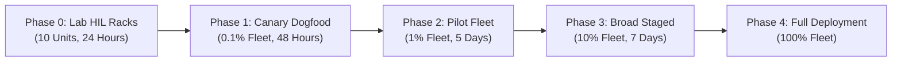
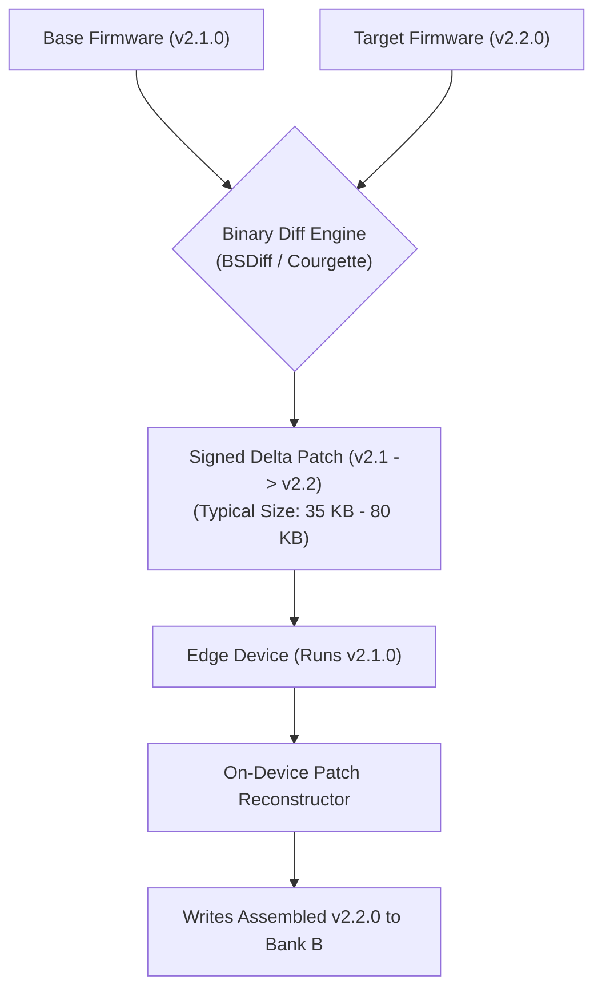
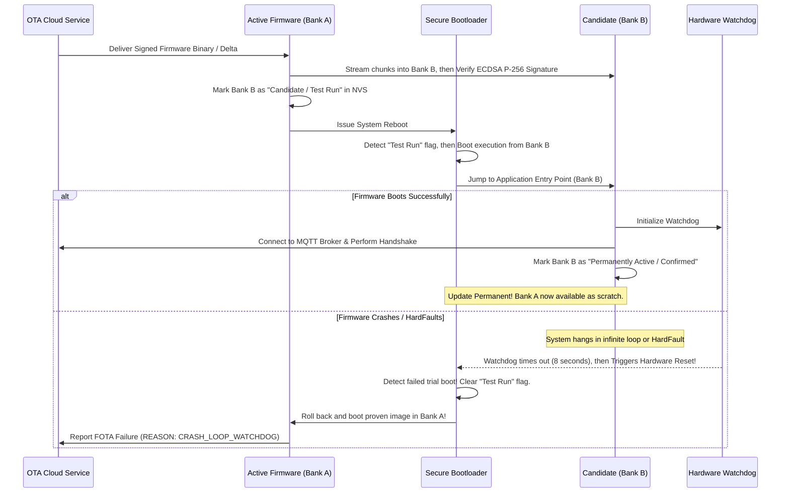

# Fleet-scale OTA update campaigns

Firmware Over-The-Air (FOTA) updates represent both the most critical operational capability and the single highest-risk procedure in connected device engineering. A bug in cloud software can be rolled back within seconds by an SRE squad. A flawed firmware update dispatched globally can simultaneously brick an entire fleet of field-deployed hardware, requiring catastrophic physical recalls.

This chapter defines the engineering requirements for managing fleet-scale OTA campaigns, executing phased canary rollouts, minimizing cellular bandwidth via delta compression, and enforcing autonomous bootloader rollbacks.

## 1. Phased Staged Rollouts & Canary Deployments

Dispatched updates must never be released to a production fleet simultaneously. Campaigns must progress through five gated phases:

[[CAPTION:Figure]] Five-phase staged rollout sequence for risk-managed OTA deployments.

### 1.1 Automated Campaign Circuit Breakers

Every active campaign must be monitored by automated health supervisors in the cloud:

> [!CAUTION]
> If the cumulative failure rate (devices reporting download failures, bootloader CRC errors, or watchdog crash loops) exceeds **0.5% of targeted nodes**, the campaign engine must immediately trip an automated circuit breaker, halting further firmware distributions and alerting engineering on-call personnel.

## 2. Bandwidth Optimisation: Delta Updates (BSDiff / Courgette)

Sending a full 1 MB or 2 MB firmware image over cellular LPWAN (NB-IoT) to one million devices would use terabytes of data. It would take weeks and drain the batteries.

The enterprise OTA platform must support **Binary Delta Compression**:

[[CAPTION:Figure]] Delta compression generating compact patches from existing base images.

1. **85% to 95% Bandwidth Reduction**: By transmitting only the changed binary symbols and instruction relocations, the payload size drops from ~1 MB down to 40 KB.
1. **Deterministic Verification**: Before applying a delta patch, the edge device validates the SHA-256 hash of its currently executing flash image (Bank A) to ensure the base matches the delta expectations exactly. Once reconstructed in Bank B, the full binary hash is verified against the signed release manifest.

## 3. Dual-Bank A/B Bootloader Architecture & Automatic Rollback

Hardware must implement dual-bank flash partitioning (Bank A and Bank B) coordinated by a cryptographically secure bootloader (such as MCUboot or TF-M):

[[CAPTION:Figure]] Dual-bank trial boot sequence ensuring automated self-healing rollback.

### 3.1 Rules for Trial Boot Confirmation

1. **Autonomous Rollback**: The new firmware image must be booted in a provisional "trial" state. If the device reboots before confirming stability, the bootloader automatically reverts to the previous known-good bank.
1. **Mandatory Handshake Before Confirmation**: Firmware must never mark itself as permanently confirmed simply because it reached `main()`. Confirmation requires successfully passing three criteria:
   - Initializing all sensor buses and peripherals without errors.
   - Establishing an encrypted connection with the cloud MQTT broker.
   - Successfully receiving an acknowledgment packet from the cloud twin service.

## 4. Fleet Campaign Lifecycle Metrics

The fleet operations dashboard must track the real-time state machine of every device targeted by the campaign:

| Campaign State | Description | Next Permitted State |
| :--- | :--- | :--- |
| **Pending** | Device targeted; waiting for next communication window | Downloading |
| **Downloading** | Chunks currently streaming to Bank B over radio | Validating, Failed |
| **Validating** | Binary received; checking ECDSA signature and SHA-256 | Rebooting, Failed |
| **Rebooting** | Device has scheduled reset into candidate bank | Confirming, Rolled Back |
| **Confirming** | Candidate bank running in trial mode; testing cloud link | Succeeded, Rolled Back |
| **Succeeded** | Candidate permanently confirmed; twin updated | Complete |
| **Rolled Back** | Watchdog reset during trial boot; reverted to prior bank | Failed |

[[CAPTION:Table]] Finite state machine states during fleet OTA campaigns.
