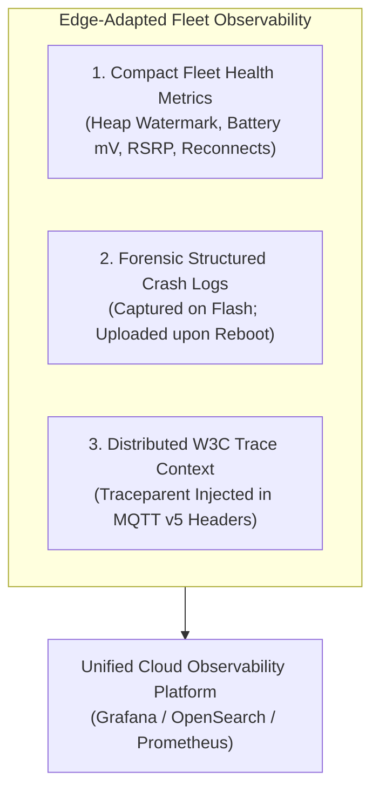
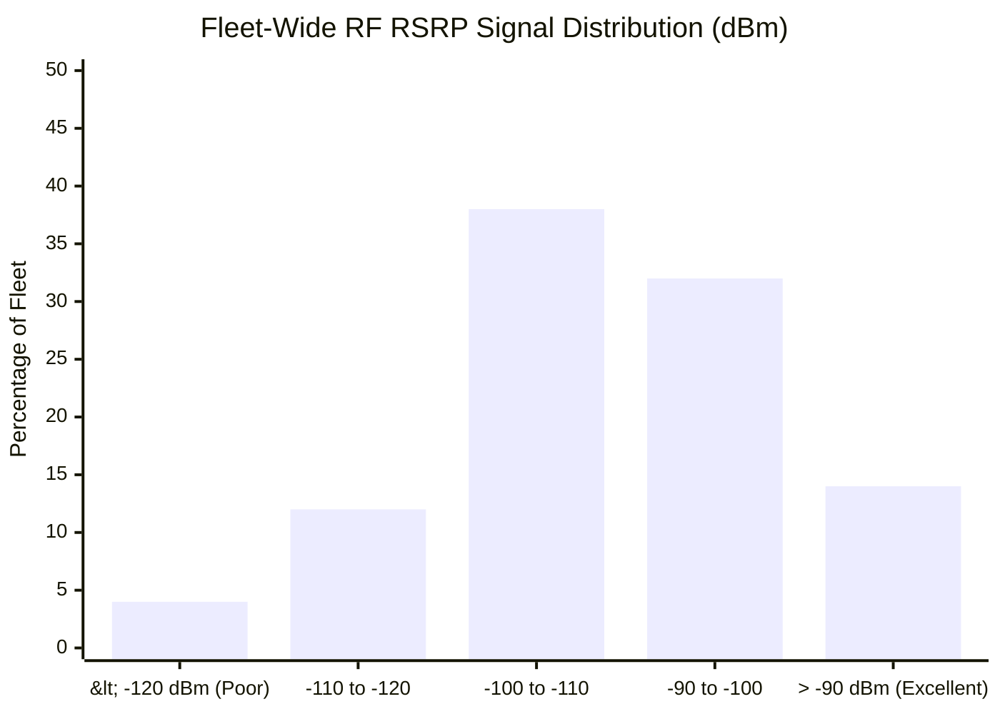
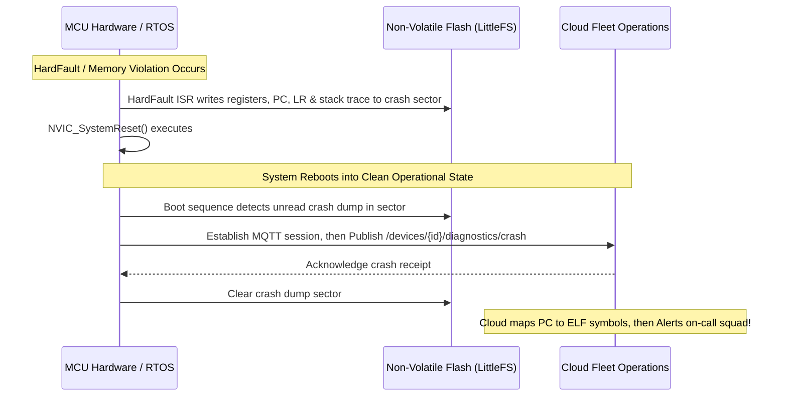
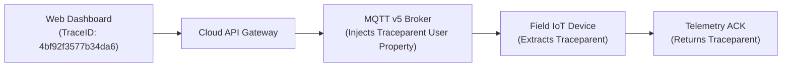

# Fleet observability and remote diagnostics

Maintaining high reliability across a geographically dispersed fleet of connected devices requires proactive observability. When a field device silently drops connections, exhausts its battery prematurely, or encounters memory corruption, operations teams must detect the failure pattern before end users experience outages.

However, standard enterprise observability tools (such as heavy APM agents or verbose OpenTelemetry streaming) cannot run directly on microcontrollers due to RAM, compute, and bandwidth constraints. This chapter details observability architectures adapted specifically for constrained IoT fleets.

## 1. The Three Pillars of Edge Observability

Observability for connected devices must be structured around three disciplined telemetry streams:

[[CAPTION:Figure]] The three pillars of edge fleet observability adapted for constrained systems.

## 2. Core Fleet Health Metrics

Every routine telemetry message or diagnostic heartbeat emitted by an endpoint should bundle concise, single-byte health indicators alongside physical sensor data:

| Metric Category | Specific KPI | Format | Typical Threshold / Warning |
| :--- | :--- | :--- | :--- |
| **RF & Link Quality** | RSRP (dBm) / RSRQ (dB) | Int8 (-140 to -40) | RSRP < -115 dBm (Marginal signal) |
| **RF Coverage Level** | 3GPP CE Level (0, 1, 2) | UInt8 (0, 1, 2) | CE Level 2 (High battery drain alert) |
| **Memory Health** | SRAM Minimum Free Watermark | UInt16 (Bytes) | Free SRAM < 2048 Bytes (Near OOM) |
| **Power Health** | Battery Terminal Voltage | UInt16 (Millivolts) | Drop rate > 50 mV / month |
| **System Uptime** | Reset Reason Code | Enum (POR, BOR, WDT) | Watchdog or BOR reset flags an alert |
| **Network Reliability**| TCP Disconnect Count | UInt8 (Count) | > 5 disconnects per 24 hours |

[[CAPTION:Table]] Standard embedded diagnostic health indicators.

[[CAPTION:Figure]] Fleet signal distribution identifying units operating in marginal cellular coverage.

## 3. Remote Diagnostic Harvesting & Crash Dumps

When an unhandled exception or crash occurs, the device cannot stream logs in real time because the execution core is compromised.

[[CAPTION:Figure]] Forensic crash dump harvesting sequence from silicon exception to cloud triage.

### 3.1 Automated Symbol Demangling in CI/CD

When the cloud platform ingests a raw crash dump containing hexadecimal register values (`pc: 0x08012A4C`, `lr: 0x08011E20`):
1. The cloud diagnostic service looks up the firmware build manifest matching the device's reported firmware hash.
1. The service invokes `arm-none-eabi-addr2line` against the stored release `.elf` symbol file.
1. The hexadecimal addresses are demangled into human-readable source code locations:
   `0x08012A4C -> sensor_driver.c:142 (sensor_read_i2c_dma)`.
1. An issue is automatically logged in the team's defect tracking system, complete with stack trace and hardware telemetry.

## 4. Distributed Tracing Across Edge and Cloud

When an operator issues a command from an enterprise web interface (such as triggering an on-demand sensor calibration), tracking the end-to-end transaction latency requires distributed tracing:

[[CAPTION:Figure]] W3C Trace Context propagation across MQTT v5 user properties.

1. **W3C Trace Context**: The cloud API assigns a standard `traceparent` header to the outbound command:
   `traceparent: 00-4bf92f3577b34da6a3ce929d0e0e4736-00f067aa0ba902b7-01`.
1. **MQTT v5 User Properties**: The MQTT broker injects the traceparent into the MQTT v5 PUBLISH variable header.
1. **Edge Propagation**: The device logs the traceparent with its local execution timestamp and echoes it in its acknowledgment publish, providing full end-to-end tracing visibility in distributed APM dashboards.

## 5. Predictive Fleet Health & SLA Monitoring

By analyzing aggregated diagnostic streams across the entire fleet, machine learning models can detect impending hardware failures before service disruptions occur:
- **Battery Depletion Regression**: Predicts the exact month a cell will reach brownout cutoff based on seasonal temperature fluctuations and discharge slopes.
- **Cell Tower Degradation**: Identifies when a cellular carrier tower experiences hardware faults by detecting sudden correlated drops in RSRP across multiple independent devices in the same geographic cell sector.
- **Flash Wear Warnings**: Alerts operations when high-frequency logging drives a device's LittleFS erase cycles past 80% of rated NOR flash block endurance.
