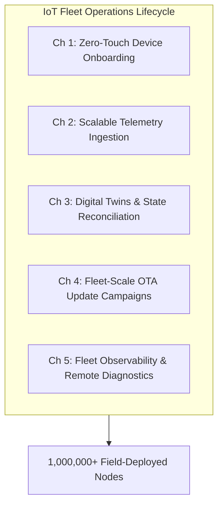

# IoT fleet operations, telemetry and digital twins

## Executive Overview

Operating a production fleet of connected IoT devices across hundreds of thousands or millions of physical nodes presents unique distributed systems challenges. Cloud servers are uniform and sit in temperature-controlled data centres. IoT fleets are in uncontrolled environments, with intermittent connectivity and mixed firmware versions, and engineers cannot reach them when software fails.

This guide sets out how to run a large IoT fleet through its whole life cycle. It covers zero-touch onboarding in the factory, telemetry ingestion at scale, digital twin reconciliation, fleet-wide OTA campaigns and automated observability.

[[CAPTION:Figure]] The five operational pillars of large-scale IoT fleet management.

## Target Audience & Guide Structure

This guide is designed for cloud architects, platform engineers, site reliability engineers (SREs), and IoT operations managers:

- **[Chapter 1: Zero-Touch Device Onboarding](01-zero-touch-device-onboarding.md)**: Automated bootstrapping, cryptographic claim workflows, Enrollment over Secure Transport (EST), and carrier provisioning.
- **[Chapter 2: Scalable Telemetry Ingestion](02-scalable-telemetry-ingestion.md)**: High-throughput broker clusters, Kafka event streaming, time-series storage, partitioning, and rate-limiting.
- **[Chapter 3: Digital Twins & State Reconciliation](03-digital-twins-and-state-reconciliation.md)**: Decoupled shadow architecture, desired versus reported state convergence, conflict handling, and offline synchronization.
- **[Chapter 4: Fleet-Scale OTA Update Campaigns](04-fleet-scale-ota-campaigns.md)**: Phased canary campaigns, blast radius containment, binary delta distribution, and automatic bootloader rollbacks.
- **[Chapter 5: Fleet Observability & Remote Diagnostics](05-fleet-observability-and-remote-diagnostics.md)**: Fleet health metrics, cellular radio diagnostics, crash dump aggregation, distributed tracing, and SLA monitoring.
