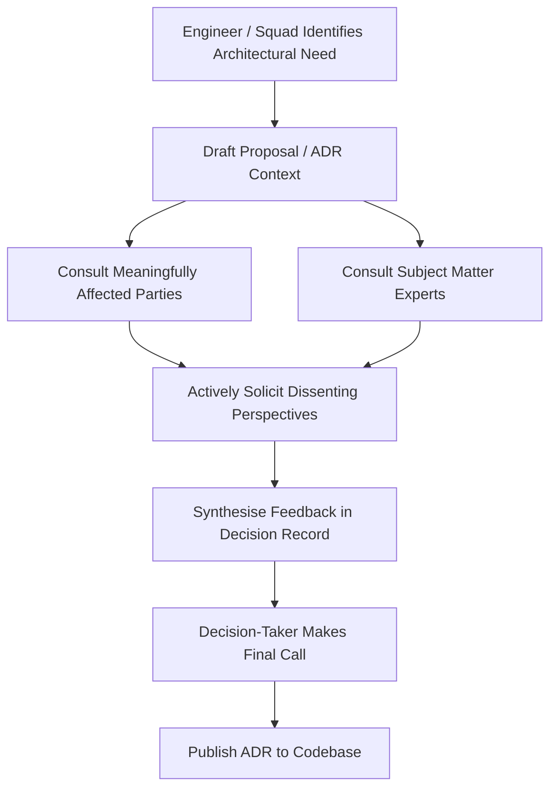
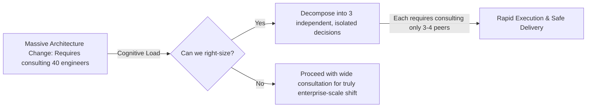

# The Advice Process

The foundational engine of conversational architecture is the **Advice Process**. Adapted from organizational governance models and pioneered in software engineering by Andrew Harmel-Law, the Advice Process replaces hierarchical approval chains with empowered peer consultation.

## 1. The Rule and the Qualifier

The Advice Process comprises a single rule and one essential qualifier:

> **The Rule**: Anyone in the engineering organisation can make any architectural decision.

> **The Qualifier**: Before taking the decision, the decision-taker MUST consult two distinct groups:
> 1. Everyone who will be **meaningfully affected** by the decision.
> 2. People with **demonstrable expertise** in the domain of the decision.

[[CAPTION:Figure]] The Advice Process decision workflow.

### Advice is Not Consensus

A frequent misunderstanding is equating the Advice Process with seeking consensus or unanimous committee agreement.

- **Consensus** is slow, stifling, and political; it waters down bold architectural ideas to the lowest common denominator and allows single obstinate voices to veto innovation.
- **The Advice Process** places complete decision-making authority and accountability on the individual or squad taking the call. The decision-taker is under no obligation to agree with the feedback received. However, they must listen actively, consider implications, and formally record the advice in the Architecture Decision Record ([Writing ADRs and RFCs](../decision-records.md)).

## 2. Who to Consult: Mapping the Advice Scope

To prevent engineers from feeling overwhelmed by consultation lists, teams maintain clear stakeholder matrices:

| Architectural Impact Area | Affected Parties to Consult | Subject Matter Experts to Consult |
| :--- | :--- | :--- |
| **API Contract Modification** | Downstream consuming squads, mobile app leads, third-party integration engineers. | Principal API Architect, Integration Tech Lead. |
| **New Cloud Data Store Adoption** | Operations/SRE on-call engineers, billing/FinOps owners. | Cloud Data Architect, Database Administrator. |
| **Microcontroller Hardware Swap** | Firmware developers, manufacturing test engineers, hardware layout team. | Lead Embedded Architect, Hardware Engineering Lead. |
| **Security / Auth Model Change** | All client developers, QA automation team, support desk. | Chief Information Security Officer (CISO), Security Architect. |
| **Personal Identifiable Info (PII)** | Data pipeline engineers, customer operations. | Data Protection Officer, Legal & Compliance Counsel. |

[[CAPTION:Table]] Advice Process consultation mapping matrix.

## 3. The Power of Seeking Out Dissent

High-performing architects do not seek echo chambers; they actively seek out colleagues who are most likely to disagree with their proposed direction.

When decision-takers know they do not need consensus, fear of disagreement vanishes. Instead of defensive posturing, the interaction becomes an objective exploration of failure modes:
- *"What catastrophic failure mode am I failing to anticipate?"*
- *"If you had to break this design under peak load, how would you do it?"*
- *"What operational friction will your squad experience if we deploy this pattern?"*

Hearing and documenting dissenting viewpoints surfaces unconsidered edge cases, transforms skeptics into respected contributors, and builds deep institutional trust.

## 4. Right-Sizing Architectural Decisions

The Advice Process contains a self-regulating economic forcing function:

[[CAPTION:Figure]] Natural right-sizing of architectural decisions under the Advice Process.

An engineer who sees that an organisation-wide change means consulting twenty teams will naturally pause. They ask: *"Can I decouple this change so it only affects my bounded context?"*

By right-sizing decisions, teams minimise blast radiuses, limit inter-team dependencies, and accelerate release cadences without descending into chaos.

## Summary

The Advice Process decentralizes decision-making while ensuring decisions remain informed and accountable. In Chapter 2, we examine the four organizational alignment mechanisms that support this practice.
