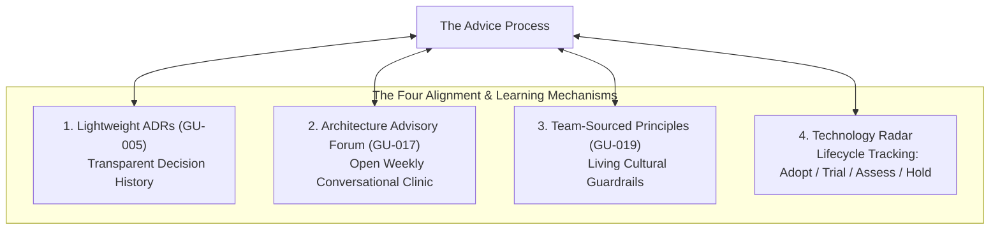
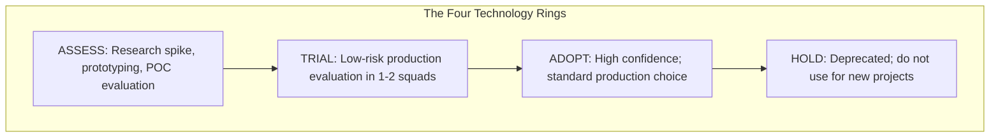

# The Four Alignment Mechanisms

To prevent decentralized decision-making from fracturing into architectural fragmentation, the Advice Process MUST be anchored by four interconnected alignment and learning mechanisms:

[[CAPTION:Figure]] The four alignment mechanisms reinforcing the Advice Process.

## 1. Lightweight Architecture Decision Records (ADRs)

Architecture Decision Records ([GU-005](../decision-records.md)) capture significant technical choices directly inside the version-controlled codebase.

### Why ADRs are Critical for Autonomous Teams

- **Temporal Transparency**: In distributed teams, members inevitably ask: *"Why on earth did we choose SQLite instead of PostgreSQL here?"* Without an ADR, engineers assume past incompetence and rewrite working code. With an ADR, they discover the decision was constrained by a 512 KB microcontroller RAM envelope.
- **Advice Documentation**: The ADR explicitly records who was consulted, what advice was given, and the rationale for accepting or rejecting specific recommendations.
- **Lightweight PR Review**: ADRs are submitted as pull requests. Reviewers comment directly on the Markdown text, creating a verifiable audit trail before merging into the repository `docs/adr/` folder.

## 2. The Architecture Advisory Forum (ARB)

The Architecture Advisory Forum transforms the traditional, dreaded Architecture Review Board into an open, collaborative clinic ([GU-017](../architecture-review-board.md)).

| Traditional Review Board | Architecture Advisory Forum |
| :--- | :--- |
| Closed committee of senior ivory-tower architects. | Open drop-in clinic attended by developers, tech leads, and specialists. |
| Adversarial: teams "defend" their design against interrogation. | Consultative: teams bring nascent ideas early to solicit constructive advice. |
| Binary verdict: PASS or FAIL gates blocking release pipelines. | Collaborative alignment: refining proposals and connecting disparate squads. |
| Infrequent meetings (monthly); creates delivery bottlenecks. | Frequent, predictable cadence (weekly 60-minute session). |

[[CAPTION:Table]] Evolution from traditional gatekeeper board to open Advisory Forum.

Teams use the 23-point Architecture Review Checklist ([GU-018](../../templates/architecture-review-checklist.md)) not as an administrative barrier, but as a diagnostic checklist to prepare for the session.

## 3. Team-Sourced Architecture Principles

Architectural principles cannot be imposed by executive decree. Principles written on laminated posters or hidden in corporate wikis are universally ignored.

In conversational architecture, principles are **team-sourced**:
- Authored by practicing engineers who live with the consequences of implementation.
- Grounded in real-world engineering fundamentals ([Fundamental Software Architecture Principles](../../standards/software-architecture-principles.md)).
- Regularly reviewed, refined, and retired as organizational maturity evolves.
- Serving as guardrails that guide daily code reviews and pull request discussions.

## 4. The Technology Radar

The fourth mechanism is the **Technology Radar**, inspired by ThoughtWorks and curated collaboratively across the engineering estate.

The radar tracks the maturity lifecycle of technologies across four quadrants and four concentric rings:

[[CAPTION:Figure]] Technology progression across radar rings.

- **Adopt**: Mature, battle-tested technologies that represent the default production choice (for example, FreeRTOS, PostgreSQL, Docker, C4-PlantUML).
- **Trial**: Promising tools undergoing controlled evaluation in real projects with a documented rollback plan.
- **Assess**: Exploratory spikes to understand emerging paradigms without production risk.
- **Hold**: Deprecated technologies that must not be used for new projects and are actively targeted for decommissioning.

The complete curated catalogue of 64 technologies is published in the [Personal Technology Radar](../../radar/index.md).

## Summary: Sustaining Conversational Architecture

When autonomous squads practice the Advice Process, backed by Lightweight ADRs, an open Advisory Forum, Team-Sourced Principles, and a living Technology Radar, architecture scales gracefully. 

Technical debt is brought into the light, silos dissolve, and the entire engineering organisation marches forward in coherent alignment.
