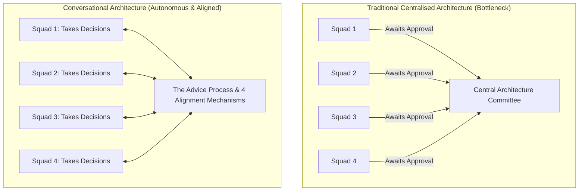

# Scaling the practice of architecture

Architecture need not be an authoritarian monologue delivered top-down from a centralized few. This guide describes architecture as a series of structured conversations. They are driven by a decentralised decision-making technique, the **Advice Process**, and anchored by four alignment mechanisms.

## The Human-Scaling Challenge of Autonomy

In software delivery environments shifting toward autonomous, value-stream-aligned squads, traditional approaches to software architecture break down. A centralized architecture team attempts to be everywhere at once: reviewing every pull request, attending every stand-up, and approving every framework choice. 

This model inevitably creates one of two pathological outcomes:
1. **The Architecture Bottleneck**: Delivery slows to a crawl as squads wait weeks for scarce architects to schedule reviews and approve design documents.
2. **Architectural Anarchy**: Frustrated squads bypass governance entirely, introducing fragmented technologies, redundant data stores, and incompatible APIs that degrade enterprise coherence.

[[CAPTION:Figure]] Centralized architectural bottleneck versus decentralized conversational alignment.

## Core Tenets of Conversational Architecture

1. **Everyone Can Architect**: Architectural thinking is not the exclusive preserve of an elite title; it is a discipline practiced across all engineering tiers.
2. **Accountability Stays with Implementers**: The team that implements and operates a system MUST own the architectural decisions that shape it.
3. **Decentralized Decision-Making**: Decisions are made rapidly at the edge, constrained by organizational principles and verified through peer advice.
4. **Continuous Shared Understanding**: Alignment is maintained through living conversations, transparent records, and shared visibility.

## Structure of this Guide

This guide is organized into two core chapters:

| Chapter | Title | Key Concepts Covered |
| :--- | :--- | :--- |
| **01** | [The Advice Process](01-advice-process.md) | The rule, the qualifier, seeking out dissent, right-sizing decisions, and scaling accountability. |
| **02** | [The Four Alignment Mechanisms](02-alignment-mechanisms.md) | Lightweight ADRs, Architecture Advisory Forum (ARB), Team-Sourced Principles, and the Technology Radar. |

[[CAPTION:Table]] Structure of the Scaling Architecture guide.

## Related Standards and Frameworks

- [ADR Authoring Guide](../decision-records.md)
- [Architecture Review Board Guide](../architecture-review-board.md)
- [Architecture Review Checklist](../../templates/architecture-review-checklist.md)
- [Fundamental Software Architecture Principles](../../standards/software-architecture-principles.md)
- [Systems and Software Architecture Handbook](../../handbook/index.md)
- [Personal Technology Radar](../../radar/index.md)
