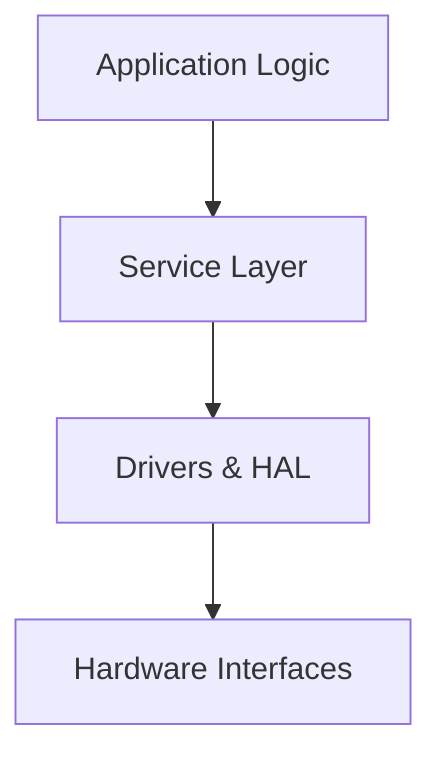
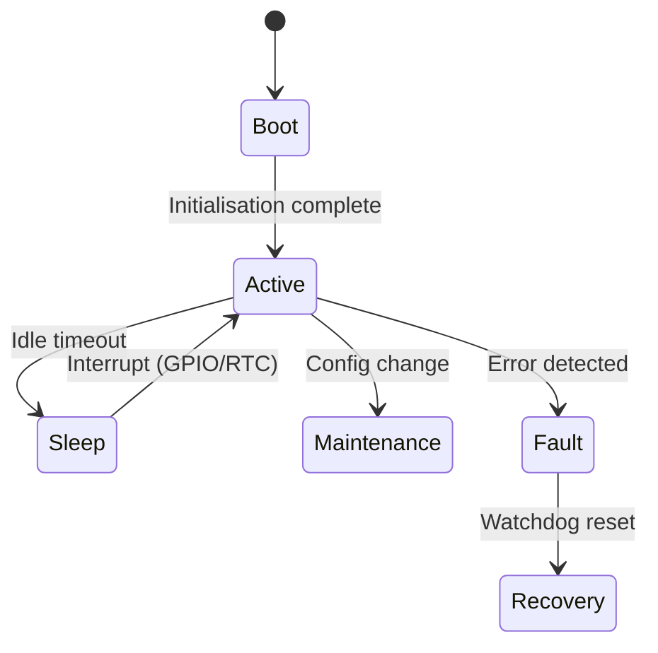

# Writing a software design specification

A Software Design Specification (SDS) is one of the most important documents produced during a software project. It serves as the definitive technical description of how a system is intended to work, why certain decisions were made, and how various components interact with each other. When maintained well, it forms the foundation for development, testing, onboarding, auditing, and future evolution of the system.

However, in traditional workflows, SDS documents are often created as Word files or PDFs during early project phases, and then left to gather dust. They become obsolete, disconnected from reality, and difficult to maintain — leading to inconsistencies across design, code, and testing.

A Docs-as-Code approach fixes this. Instead of static documents, we use markdown, version control (e.g. Git), CI automation, and modular structure to make the SDS a **living artefact**. It stays with the code, evolves with the system, and integrates with your engineering workflows.

This guide walks through how to structure, write, maintain, and automate an SDS using Docs-as-Code principles, focusing on practical use in embedded, platform, and full-stack software systems.

## Where the SDS Fits in the Engineering Lifecycle

The SDS bridges the gap between architectural decision-making and concrete implementation. It complements:

- RFCs (Requests for Comment) which explore possible changes and solicit feedback
- ADRs (Architecture Decision Records) which capture why decisions were made
- Interface Specifications, source code, test plans, and CI pipelines

The SDS captures how these decisions are realised in a consistent, understandable, and traceable form. It provides clarity not only for developers, but for stakeholders, testers, maintainers, and even future hires.

A good SDS doesn’t just list features — it tells the story of how and why the system behaves the way it does.

> A good SDS is a narrative, not just a checklist — it explains how the system is built and *why* it’s built that way.

## Example Folder Structure

Here’s an example structure for storing your SDS as part of a wider docs repository:

```plaintext
docs/
├── adr/                        # Architectural decision records
├── rfc/                        # Requests for comment
├── sds/                        # The software design specification
│   ├── index.md
│   ├── architecture.md
│   ├── security.md
│   ├── task-model.md
│   ├── power.md
│   ├── timing.md
│   ├── memory/
│   │   ├── memory.md            # Summary of memory usage: flash, RAM, EEPROM
│   │   ├── nvm-layout.md        # Detailed description of config/data NVM
│   ├── updates.md
│   ├── interfaces/             # Internal interfaces
│   │   ├── uart-api.md
│   │   ├── i2c-protocol.md
│   │   ├── nvm-layout.md
│   ├── components/             # Software components/modules
│   │   ├── rtc.md
│   │   ├── lcd.md
│   │   ├── watchdog.md
│   ├── system-modes.md
│   ├── manufacturing.md
│   ├── qa-support.md
│   ├── configuration.md
│   ├── design-patterns.md
│   ├── instrumentation.md
│   ├── limitations.md
│   ├── build-system/             
│   │   ├── build-system.md  
│   │   ├── ci-build.md
│   ├── traceability.md
│   ├── glossary.md
│   └── metadata.yaml
├── interfaces/                 # External/public APIs
├── diagrams/
├── scripts/
```

Each file is modular, focused, and reviewed independently. This makes it easier to keep the specification updated and correct.

## Introduction and Overview (`index.md`)

This section is the entry point into the SDS and should provide enough background and context to help any reader understand the system being described. It orients new team members, aligns stakeholders, and sets the tone for the level of depth and rigour expected throughout the document.

Start by introducing the system at a high level. Explain what the system is, what it does, who it's for, and what this document covers. Provide links to related documentation so readers can navigate easily between high-level decisions (ADRs), requirements, and lower-level technical references.

Consider including:

- Purpose and Scope: What is the system or component? What does the SDS cover (and not cover)?
- Audience: Who is this document for? Developers? QA? External auditors?
- System Context: Where does this software live — in a product, service, embedded device?
- References: Point to upstream ADRs, RFCs, or requirements. Link to downstream interface specs or test plans.
- System Goals: High-level objectives (e.g. real-time performance, security posture, battery life targets).

This section should be written in plain English with clarity in mind. Avoid overwhelming detail — the goal is to provide a map and a purpose, not to dive into architecture just yet.

## Architecture (`architecture.md`)

The architecture section gives a clear view of how the software system is structured and how it behaves at a high level. It provides both a *static* and *dynamic* understanding of the system:

- Static: the main building blocks, layers, and data flows
- Dynamic: how those components interact over time (e.g. task lifecycles, signal flows)

This is often the first place a developer or system integrator will look when trying to understand how things fit together.

You should include:

- Visual diagrams: Use layered diagrams (e.g. C4, onion, service interaction) to show how software components are related. Sequence diagrams can help explain runtime behaviours.
- Component layers: Describe how your application, middleware, driver layers, and hardware interact. For example, where does business logic live? What abstracts hardware?
- Runtime interactions: Summarise typical workflows (e.g. "sensor event → processing → transmit via UART").
- Platform constraints: Note any limitations imposed by the target (e.g. limited memory, no MMU, slow flash writes).
- Security boundaries: Indicate zones of privilege separation, sandboxing, or trust boundaries.



> Treat this section as your system's blueprint — not every detail, but enough for someone to understand the structure and find their way around.

## Security and Security Considerations (`security.md`)

This section documents the security posture of the software system. It says what threats are considered, how they are mitigated, and what design decisions protect the system and its users.

Security must be baked into the system from the start, not bolted on at the end. A good SDS explicitly documents the threat model, key assumptions, and concrete mechanisms used to mitigate risks.

### Security Objectives

- Protect confidential data stored or transmitted by the device
- Ensure software integrity during updates and boot
- Prevent unauthorised access or misuse of interfaces
- Enable recovery from fault or attack
- Support traceability and audit of changes

### Threat Model

Describe the assumptions about potential attackers, their capabilities, and vectors. Define what is in-scope vs out-of-scope.

#### Example Considerations

- Physical Access: Does the attacker have physical access to the device?
- Network Exposure: Is the device internet-connected or air-gapped?
- Tampering Scenarios: Battery removal, sensor spoofing, UART sniffing?
- Supply Chain Risks: Malicious firmware injection at factory?
- Replay Attacks: Are command messages signed or timestamped?

### Boot and Firmware Validation

Explain how the system ensures that only authorised code is executed:

- Bootloader Validation: CRCs, digital signatures, hash comparison?
- Key Storage: Where are root-of-trust keys stored? (OTP, secure flash, external secure element)
- Rollback Protection: How are older, vulnerable images prevented from reloading?
- Integrity Checks: Are checks done at boot only, or periodically?

### Data Protection

Detail how sensitive data is stored or transmitted:

- At Rest: Is config/NVM data encrypted? How is key material protected?
- In Transit: Are communications encrypted (TLS, DTLS, AES)? On which links?
- Tamper Evident Storage: Are audit logs or counters protected from erasure?

> Include how secrets are provisioned — at factory, on first boot, or over-the-air.

### Interface Hardening

Document how external and internal interfaces are protected:

- Authentication/Authorisation: Who can call what APIs or send what commands?
- Rate Limiting: Are repeated attempts (e.g. password, firmware flashing) throttled?
- Error Handling: Are responses generic enough to avoid leaking internal state?
- Interface Disablement: Are debug ports disabled/locked after provisioning?

### Secure Update Process

Reiterate or expand on the update mechanism with a focus on security:

- Manifest Validation: Signature verification before applying?
- Fail-Safe Update: Can update be rolled back or re-attempted without bricking?
- Secure Channels: Is firmware fetched over a trusted path?

### Logging and Audit

Capture how events are monitored or logged for later review:

- Security Logs: Are invalid access attempts or tamper events recorded?
- Forensics: Can retained logs aid post-attack analysis?
- Log Protection: How are logs protected from tampering?

### Mitigations and Controls

Summarise protections in place against common embedded threats:

| Threat                    | Mitigation                              |
|--------------------------|------------------------------------------|
| Firmware tampering       | Secure boot, signed updates              |
| UART console hijack      | Passwords, lockout, port disable         |
| Flash memory extraction  | Encryption, obfuscation, secure storage  |
| Replay attacks           | Nonces, timestamps, rolling counters     |
| Debug access             | JTAG/SWD lockout after provisioning      |

### Security Testing

Describe how the system’s security is validated:

- Penetration testing (manual or automated)
- Fuzzing tools or static analysis
- Formal review of crypto or secure boot flows

Mention any compliance standards targeted (e.g. IEC 62443, ENISA guidelines).

### Maintenance & Response

Explain how the system stays secure over time:

- How are CVEs and third-party vulnerabilities tracked?
- How are keys rotated or revoked?
- What’s the process for patching live devices?

### Documentation and Policy Links

Reference supporting documents such as:

- Key management policy
- Secure coding guidelines (e.g. MISRA, CERT)
- Incident response plan
- Vulnerability disclosure process

> Security must be a living concern — this section should be reviewed regularly and updated alongside changes in the threat landscape or architecture.

## System Modes (`system-modes.md`)

Many software systems operate in distinct modes or states, each optimised for a specific set of conditions, use cases, or environmental triggers. Capturing these modes and the rules for transitioning between them is essential for understanding runtime behaviour — especially under error conditions, during startup, or in low-power scenarios.

This section outlines the operational states of the system and describes how and why transitions occur. It should be used by developers, testers, and system architects to ensure consistent behaviour across all operating conditions.

Consider including:

- Defined Modes: Common examples include Boot, Active, Sleep, Maintenance, Recovery, Fault, and Shutdown.
- Triggers and Transitions: What causes a transition? Examples: GPIO wakeup, watchdog timeout, scheduled maintenance, low battery.
- Mode-specific Behaviour: What changes in each mode? Power usage, active tasks, network stack activity, user interface state.
- State Diagrams: These are especially helpful for visualising complex transitions.



> Use this section to provide a robust mental model of how your system behaves over time.

## Manufacturing Support (`manufacturing.md`)

This section describes any software features, modes, or behaviours specifically included to support factory testing, provisioning, or calibration.

## Why It Matters

These features are often critical for volume deployment but easily forgotten or misunderstood later. If not documented, changes made for manufacturing (e.g. skipping init steps, ignoring CRCs, bypassing security checks) can leak into field code or be misunderstood in audits.

## Suggested Contents

### Manufacturing Modes

- Does the firmware support a dedicated mode? (e.g. “factory mode”, “golden image boot”)
- How is it triggered? (pin strapping, serial command, fuse setting)

### Test Points / Interfaces

- Special I/O exposed for boundary scan, serial diagnostics, or sensor calibration?
- UART/I2C debug protocols used?

### Provisioning Workflows

- How are serial numbers, keys, or config data written?
- Describe use of factory fixtures, scripts, or host tools.

### Bypass Logic

- Does manufacturing mode skip watchdogs, boot validation, or timers?
- Any backdoors enabled for engineering use (should be removed or gated in release builds)?

### Logs / Confirmation Output

- What signals a “pass” vs “fail”?
- Where are results logged — UART, EEPROM, test jig?

> ⚠️ Be clear about how manufacturing features are locked out, hidden, or disabled in release builds (e.g. `#ifdef MANUFACTURE_MODE` + no release define)

## QA & Testing Support (`qa-support.md`)

This section documents special firmware behaviours or interfaces that help with validation, automated testing, or quality gates.

### Why It’s Important

These are often the hooks that make factory validation or CI testing practical. Without this, firmware teams forget which debug pins or CLI commands were critical to QA and lose velocity on regression testing.

### Suggested Contents

#### Debug/Test CLI or Protocols

- Are there commands to simulate inputs, dump state, or force transitions?
- Accessible via serial, SWD, CLI shell?

#### Test Hooks / Mock Modes

- Can you fake sensor inputs, bypass power checks, etc. for bench testing?
- Support for hardware abstraction that allows mocking?

#### Assertions, Logs, and Diagnostics

- Are test assertions enabled?
- Logs routed to test tools or available via postmortem dump?

#### Test Patterns or Modes

- Is there a loopback, soak, or burn-in test?
- Stress patterns (e.g. rapid wake/sleep) for endurance checks?

#### API or Register Access

- Can testers access internal registers, counters, or performance metrics?
- Memory-mapped or via an RPC/debug protocol?

#### Integration With QA Tools

- Jigs or scripts used to validate results?
- Compatibility with TestStand, LabView, or custom Python frameworks?

## Design Considerations

This section exists to provide insight into the broader context and trade-offs that shape your system’s design. These considerations often come from business goals, development constraints, or risk management practices — and they help justify why the system is built the way it is.

Think of it as the foundation layer of your technical rationale. If someone asks "why didn’t you use X?" or "why is it done this way?", this section should help answer that.

You might want to discuss:

- Assumptions: What has been assumed about the hardware, users, network environment, third-party components?
- External Dependencies: Include reliance on SDKs, vendor HALs, cloud services, or middleware.
- Coding Standards: Which are followed? (e.g. MISRA C, CERT, AUTOSAR)
- Security Concerns: Discuss expected threat models and mitigations — encrypted channels, secure boot, flash protection.
- Power and Performance Constraints: e.g. CPU utilisation targets, sleep mode constraints, battery sizing.
- Legal and Licensing: GPL risk avoidance, open-source use policies, FIPS compliance.

> This is the place to capture what influences your design but doesn’t always show up in code.

## Design Patterns and Anti-Patterns (`design-patterns.md`)

As your system evolves, recurring architectural or coding practices will emerge. Capturing these as standardised patterns (or anti-patterns) helps your team improve consistency, reduce onboarding time, and avoid costly mistakes.

This section acts like a miniature design playbook. It highlights what has worked well and what should be avoided — especially in areas like tasking, interface boundaries, or message handling.

### Recommended Patterns

- Publish/Subscribe Messaging: Used to decouple components and allow for asynchronous event handling. Useful for telemetry, sensor updates, command dispatch.
- State Machines: Encapsulate mode transitions using modular state patterns, avoiding sprawling switch/case logic.
- Factory or Registry Patterns: To dynamically configure drivers or interfaces based on configuration at boot.
- Command Pattern: Separates logic from actions, helpful in communication protocols and UI abstraction.

### Known Anti-Patterns

- God Objects: One module knows and does too much — often seen in monolithic main loops.
- Tight Coupling Across Layers: HALs calling business logic directly, breaking abstraction layers.
- Hidden Global State: Making testing and debugging unpredictable.
- Duplicated Logic Across Tasks: E.g. similar parsing code in both comms and test tasks.

Where possible, include:

- Code examples of good vs. bad implementations
- Links to components that exemplify each pattern
- Notes about when a pattern *shouldn’t* be used

> ⚠️ This section helps encode institutial knowledge, it shoudl evolve over time.

## Task Model (`task-model.md`)

In systems using real-time operating systems (RTOS), cooperative scheduling, or even basic super loops, understanding how software is structured into tasks or threads is crucial. This section provides an overview of all concurrent execution contexts, their responsibilities, timing expectations, and interactions with other tasks or interrupts.

Well-documented task models help avoid timing conflicts, resource contention, and make it easier for new developers to reason about system flow.

What to include:

- Task List: Describe each task's responsibility, its period or trigger mechanism, and its priority.
- Stack Size: If stack usage is measured or estimated, note how much each task needs — especially for memory-constrained targets.
- Event Flow: Describe how ISRs signal or wake tasks (e.g. semaphores, message queues).
- Diagrams: Timeline or interaction charts can help visualise timing and sequence of events.

| Task Name  | Priority | Trigger     | Stack | Description                     |
| ---------- | -------- | ----------- | ----- | ------------------------------- |
| SensorTask | High     | Timer       | 1kB   | Polls sensors every 100ms       |
| CommTask   | Medium   | Event queue | 2kB   | Handles all communication flows |
| UITask     | Low      | Button IRQ  | 1kB   | Manages display and UI updates  |

> 💡 Documenting stack size and priority together makes it easier to identify task starvation or overflow risk during later reviews or audits.

## Concurrency and Synchronisation

Multithreaded or multitasking systems require careful coordination to avoid race conditions, deadlocks, or corruption of shared data. This section captures the strategy for how tasks and ISRs interact safely and predictably.

Describe the mechanisms used for synchronisation and inter-task communication. For example, which tasks publish or consume events? What locks are used, and where? How is starvation or blocking handled?

Include the following if applicable:

- Mutexes, Semaphores, Queues: Which ones are used, and in what situations?
- Priority Inversion Mitigation: Does the RTOS support priority inheritance? Are there software strategies in place?
- Deadlock Avoidance: Document timeout strategies or watchdog recovery paths.
- Non-blocking Strategies: In some systems, blocking on shared resources is avoided altogether — capture this as a design choice.

> ⚠️ This section is often overlooked but becomes critical when diagnosing hard-to-reproduce bugs or unexpected lockups in production.

## Timing (`timing.md`)

Time constraints are common in embedded and real-time systems. Whether you’re reading sensors, driving a user interface, or meeting external communication deadlines, understanding your timing model is essential.

This section documents which tasks or interrupts are time-sensitive and what their constraints are.

Consider describing:

- ISR Deadlines: How fast must interrupts complete? What work is deferred?
- Task Budgeting: Expected worst-case execution time for each major task.
- System Tick and Timebase: Describe the base timer, tick rate, and how time is kept.
- Time Sync Mechanisms: Use of RTC, GPS, NTP, or synchronisation with external clocks.

```yaml
timing-budget:
  control-loop: 10ms
  display-refresh: 20ms
  uart-isr: 2µs
```

> ⏲ This information is especially useful when validating designs against real-time constraints or reviewing logs from performance instrumentation.

## Power (`power.md`)

For embedded or battery-powered systems, power consumption is often one of the most critical design constraints. The goal of this section is to document how your system manages energy usage across different operating conditions and modes.

This is particularly important for systems where uptime, efficiency, or thermal limits are affected by energy draw. It also helps verify that your design aligns with battery sizing, regulator capabilities, and customer expectations for device longevity.

Suggested contents:

- Supported Low-Power Modes: Enumerate the power states supported by your MCU or platform (e.g. RUN, SLEEP, STOP, STANDBY). Include any specific characteristics (e.g. which peripherals remain active).
- Wakeup Sources and Rules: Describe how the system transitions out of low-power modes — for example, GPIO interrupt, timer, RTC alarm, watchdog.
- Debounce and Filtering: If wake sources involve mechanical switches or user input, include debounce timing strategies to avoid false wakeups.
- Power Budget Estimates: If available, provide power draw figures in each state (measured or estimated), with context for how often the system enters them.
- Peripheral Power Control: Describe how and when peripherals are powered down or gated. E.g. turning off UART transceivers, putting sensors into standby.

> ⚡ Include a state diagram or table if your system uses multiple modes with complex transitions.

## Interfaces (`interfaces/`)

This section documents how software interacts with hardware peripherals or internal drivers. For each interface, provide a dedicated markdown file that describes the protocol or API in full. This helps maintain a clear contract between the software layers and supports portability, testability, and modular design.

You should break this section into one file per interface. For example:

- `uart-api.md`: Describes the UART driver API. Include init/config calls, transmit/receive flows, DMA usage (if any), and any line-discipline logic (e.g. software flow control, newline translation).
- `i2c-protocol.md`: Documents I2C commands to and from a specific device. Include register layout, timing requirements, expected acknowledgements, and examples.

Each interface file should typically include:

- Overview: Purpose of the interface, what it controls or monitors
- API Summary or Command Set: Function prototypes or I2C/SPI commands
- Parameters: Buffer sizes, error codes, retry logic, blocking/non-blocking behaviour
- Data Structures or Encodings: Register maps, bitfields, enums
- Diagrams: State transitions or bus timing diagrams if relevant
- Examples: Sample usage code or communication trace

> 📂 You may also include an `interfaces.md` index file if you have many interfaces. It can list and link to each subfile with a short summary, but it’s optional if your structure is already clear from folder organisation.

## Memory (`memory.md`)

This section defines how your software uses memory, particularly when there are fixed constraints or persistent data to manage. In embedded systems, memory layout is often tightly coupled to the firmware image and must be coordinated with bootloaders, config storage, or debug tools.

Document both volatile and non-volatile memory use:

- Flash Layout: Include memory map showing regions for bootloader, application firmware, configuration pages, user data, and diagnostic logs. If dual-image or failover schemes are used, detail the image switching mechanism.
- RAM Usage Strategy: Outline how RAM is allocated — statically, dynamically, or per-task. Mention stack sizes and heap if applicable.
- Emulated EEPROM or NVM: Describe how configuration data is stored and updated, including wear-leveling, sector rotation, and CRC use.
- Persistent Variables: Note any variables that retain values across resets, using backup registers, battery-backed RAM, or flash.

```plaintext
0x08000000 - 0x08003FFF : Bootloader (16 KB)
0x08004000 - 0x0801FFFF : App Firmware (96 KB)
0x08020000 - 0x08027FFF : Configuration Data (32 KB)
0x20000000 - 0x20002000 : RAM (8 KB)
```

### `nvm-layout.md`

In addition to the general memory section, a separate file can be created to describe the layout and management of non-volatile memory (NVM). This is useful when configuration or runtime data is stored in flash and managed dynamically.

Suggested contents:

- Storage Regions: Define sectors or pages allocated to config, counters, logs, etc.
- Versioning Scheme: Explain how you track versions of stored data, particularly during firmware upgrades.
- Integrity Checks: CRCs, checksums, or signature strategies used to validate contents.
- Update Strategies: Whether you use append-only, copy-on-write, sector rotation, or journaling.
- Error Handling: What happens if a CRC fails or a config is corrupt? Describe the fallback or reset logic.
- Tool Compatibility: Link to any scripts or debug tools that can parse or inspect this memory structure.

> 📎 Keep this file aligned with memory maps, linker scripts, and config handling logic.

## Updates (`updates.md`)

This section describes how the firmware or software running on the device can be updated. Depending on your system architecture, this could include Over-the-Air (OTA) updates, updates via USB, UART flashing, or during production line programming. It should clearly describe what gets updated, how integrity is validated, and what the fallback strategies are in case of partial or failed updates.

Include the following details:

- Update Mechanism: Describe supported mechanisms such as OTA (e.g. via LwM2M or MQTT), serial bootloader tools, or SD card updates.
- Bootloader and Validation:
  - Does the bootloader validate firmware via CRC, hash, or digital signature?
  - What happens on validation failure?
  - Include a brief flow: reset → bootloader → validation → app launch.
- Dual-Image Strategy:
  - If supported, describe how image switching works.
  - Document active vs backup image location.
  - Explain the conditions under which rollback happens.
- Update Triggering:
  - Who or what initiates an update? (e.g. remote server command, physical button, watchdog failover)
  - How is update progress reported?
- Metadata & Versioning:
  - Is there a manifest file, checksum table, or version block?
  - How is the running firmware version exposed to external systems?

> 🧪 Include test cases or validation flows to ensure reliability. A diagram or sequence chart can also help visualise the update lifecycle.

## Components (`components/`)

This directory contains one markdown file per key software component or module. This helps keep the design documentation modular and scalable. Each file provides the rationale, API summary, interactions, and special considerations for that module.

Each component file should include:

- Name and Purpose: What is this component for?
- Key Functions or Interfaces: Public APIs exposed by this component.
- Dependencies: What peripherals or other modules does it rely on?
- Startup/Shutdown Behaviour: What must be initialised? What resets state?
- Resource Usage: Stack size, RAM footprint, exclusive hardware access.
- Constraints and Limitations: Known edge cases or design trade-offs.

Example: `rtc.md`

```markdown
## RTC Module

The RTC module handles timekeeping for the system and provides alarms for timed events.

### Public API
- `rtc_init()` — Initialise the clock domain
- `rtc_get_time()` — Read current RTC value
- `rtc_set_time()` — Set RTC value
- `rtc_set_alarm()` — Configure future wakeup event

### Uses
- LSE oscillator (32.768kHz)
- Backup registers for retention across resets

### Constraints
- Drift may occur during STOP mode without calibration
- Cannot use without LSE availability
```

> 📦 Use consistent headers and formatting across all component docs for easier review.

## Build System (`build-system.md`)

This section documents how the software is built — what toolchains and configurations are supported, how outputs are structured, and what metadata should be captured to support traceability and CI integration.

A well-documented build system ensures reproducibility, supports automation, and allows future engineers to rebuild or audit the firmware with confidence.

### Supported Build Systems

Describe how the software can be built across environments and by different roles — e.g. developer, CI agent, or release engineer.

The SDS should explain which build systems are supported and how they interrelate. Typically, this includes:

- `make` or similar build orchestration for local and CI use
- Generator-based build systems (e.g. `cmake`) if supporting multiple IDEs or cross-platform builds
- IDE-native builds (e.g. IAR project files) for deeply embedded targets
- Scripted or container-based builds for portable, isolated environments
  
If multiple systems are supported, note which is canonical.

### Toolchains

Capture the expected compiler and toolchain setup used by developers and CI systems.

Mention whether the toolchain is installed manually, managed by package manager, or included via container. The SDS should list supported toolchains (e.g. GCC, LLVM, IAR), any minimum version requirements, and a pointer to a `.toolchain` file or Docker image if used.

### Build Configurations

Define the available build variants, their intended use, and any functional differences.

Typical configurations include:

- Debug – enables diagnostics, logs, and debug symbols for development
- Release – optimised firmware, stripped of debugging features, suitable for deployment
- Test – includes mocking, test scaffolding, and additional hooks

Explain how these configurations affect preprocessor defines, output structure, and included modules. This helps others understand which build type is suitable for specific tasks like flashing, validation, or lab testing.

### Feature Flags and Defines

List the key compile-time flags or feature switches used across the system.

A well-maintained SDS should explain where these are declared (e.g. `build_flags.h`, `CMakeLists.txt`) and what they control — such as optional hardware interfaces, debug modes, or platform-specific adaptations.

Flags should be consistently named and grouped logically to aid discoverability and maintainability.

### Output Artefacts

Detail what artefacts are produced by the build process and where they are placed.

These commonly include:
- Executables (`.elf`, `.out`)
- Map files (`.map`), listings, and symbol tables
- Optional: memory reports, coverage files, metrics

The SDS should state how these files are named and structured, especially if they're used in flashing, testing, or deployment workflows.

### Build Metadata

Describe the metadata embedded or exported by the build to support traceability and debugging.

This may include:

- Git commit, branch, and tag
- Build timestamp
- Build configuration and feature flags
- Toolchain ID or version string

This metadata should be stored in a header file (`version.h`), embedded in flash, and optionally exported in a structured format (`build.json`) for integration with dashboards or CI pipelines.

### Firmware Packaging

Outline how formal release builds are bundled and versioned.

The SDS should document how release artefacts are packaged for handoff — including:

- Firmware binaries and supporting files
- Associated map and metadata files
- Optional checksums, signatures, or version manifests
- Directory naming and retention practices (e.g. `/dist/firmware-v1.2.3/`)

This supports reliable delivery, testing, and rollback of firmware.

### CI Integration (`ci-build.md`)

This section documents the expectations for continuous integration (CI) pipelines that validate the design, enforce quality, and protect against regressions.

A well-integrated CI process ensures every change is verifiable, traceable, and safe to merge. The SDS should make clear what is checked, how failures are detected, and which rules are enforced before code reaches production.

#### CI Validates

Summarise what CI pipelines are expected to do.

A typical embedded software CI system should:

- Build all configurations (Debug, Release, Test)
- Run static analysis on source code
- Execute unit or integration tests where applicable
- Enforce style and formatting rules
- Validate SDS structure and metadata
- Track binary sizes and alert on unexpected growth

Mention if different CI stages are split across jobs or merged into a single runner.

#### Code Quality Metrics

Define which quality metrics are gathered to evaluate changes over time.

A good SDS should specify that CI calculates and monitors:

- Cyclomatic complexity
- Halstead metrics
- Function and file sizes
- Nesting/indentation depth
- Code churn and comment density

The metrics system should highlight regressions and identify hotspots that may need refactoring. Detail thresholds if they exist.

#### Binary Size Regression

The SDS should define how binary size growth is detected and reported.

CI must compare the size of key artefacts (e.g. `.elf`, `.bin`) to a known baseline and flag regressions. This protects against creeping feature growth, unexpected linker behaviour, or accidental inclusion of unused features.

Summarise how size trends are tracked (e.g. via diff or dashboard), and when the build should fail.

#### Incremental Checks

Document how CI limits scope to affected areas to optimise feedback loops.

The SDS should note that:

- Static analysis and linting focus on changed files
- Code metrics and tests are limited to touched modules when possible
- Full system analysis is run nightly or before release
  
This keeps feedback fast while still catching critical issues.

#### Feedback & Merge Protection

Explain how developers are informed of issues and how quality is enforced.

CI pipelines should:

- Post warnings or diffs directly into pull requests
- Annotate files or lines that fail checks
- Block merge if thresholds are exceeded, or key checks fail

Summarise your merge rules — e.g. static analysis clean, no binary size regression, all tests pass, metadata validated.

#### Optional Enhancements

Capture any additional checks required for regulatory, audit, or public release workflows.

The SDS may include optional CI jobs for:

- Secret scanning (e.g. env or config leaks)
- Software Bill of Materials (SBOM) generation
- Open source licence validation
- Dependency vulnerability alerts
- Traceability metadata checks (e.g. ADRs linked to features or tests)

Mention these if your process supports them — or leave as future improvements.

> 📎 If detailed CI configuration (e.g. job scripts, badge configuration, security policies) is maintained separately, link to a `ci-extras.md` or `.github/workflows/` folder for deeper implementation detail.

## Instrumentation (`instrumentation.md`)

Instrumentation allows developers and testers to observe, measure, and validate the behaviour of a running system. Whether it’s to diagnose issues, evaluate performance, or confirm that a state transition occurred as expected, a well-instrumented system offers transparency without requiring invasive access.

This section should explain how observability is achieved, which tools or techniques are in use, and what runtime flags or modes exist to toggle diagnostic output.

Recommended contents:

- Logging Strategy:
  - What logging framework is used? (e.g. macros, circular buffers, conditional printfs)
  - Describe log levels: `DEBUG`, `INFO`, `WARN`, `ERROR`
  - Format: plain text, JSON, binary packets?
  - Where does logging go? (UART, memory buffer, external tool?)
- Conditional Compilation:
  - Are there flags like `ENABLE_LOGGING`, `DEBUG_MODE`, or `VERBOSE_UART`?
  - What impact do they have on binary size or performance?
- Runtime Controls:
  - Can instrumentation be enabled/disabled on the fly (e.g. via CLI or config register)?
  - Describe diagnostic commands or debug shells (if any)
- Fault Capture:
  - What happens on assert or fault? (e.g. stack dump, PC/SP snapshot, reset reason)
  - Persistent logs in retained memory or NVM?
  - Use of semihosting, debug probes, or test firmware overlays

> 🧠 Consider documenting how to replay or interpret logs — especially if they use custom formats.

## Limitations (`limitations.md`)

This section is a place for honest reflection. It acknowledges areas where the system isn’t perfect — yet. Capturing technical debt, design shortcuts, or areas needing future refactor helps maintain team awareness and supports informed planning.

You should aim to answer: “What’s broken, missing, or non-ideal — and what are we going to do about it?”

Include the following where relevant:

- Unimplemented or Deferred Features:
  - APIs that exist in stub form
  - Tasks or behaviours described elsewhere but not yet complete
- Known Weaknesses or Risks:
  - Use of dynamic memory in ISR context
  - Shared global state with minimal locking
  - Reliance on outdated or unstable third-party libraries
- Legacy Components:
  - Code that is known to be hard to test, slow, or buggy
  - Modules earmarked for future replacement
- Refactoring Plans or Proposals:
  - Links to backlog items, tickets, or internal RFCs for cleanup
  - Prioritisation of technical debt relative to business features

> ⚠️ Be realistic — don’t list *everything* that could be better, just what is known and likely to impact the system.

## Traceability (`traceability.md`)

Traceability ensures your design isn’t floating in isolation — it ties every part of the system to the rationale behind it and the tests that verify it. This is especially valuable in safety-critical, audited, or regulated environments — but it also helps with long-term maintainability in any serious project.

The goal is to allow someone to trace from:

- A feature or bug → to the design decision → to the implementation → to the validation

Document:

- Linked ADRs:
  - Reference architecture decisions that led to this design (e.g. “Use MQTT over CoAP”)
- Linked RFCs:
  - Proposals or exploration work that evaluated options (e.g. “rfc-006-iot-messaging.md”)
- Associated Tests:
  - Unit, integration, or system tests that verify correctness
  - Use consistent test names or IDs to simplify automation
- Metadata Tags:
  - Use per-section frontmatter or YAML blocks to define traceability metadata

Example:

```yaml
owner: "comm-stack"
linked-adr: ["adr-014-mqtt-integration"]
linked-rfc: ["rfc-006-mqtt-vs-coap"]
linked-tests:
  - test_mqtt_reconnect
  - test_power_on_retry
last-reviewed: "2025-05-01"
```

> 🔍 Good traceability gives confidence during change reviews. It answers “why is this here?”, “who owns it?”, and “how do we know it works?” without needing tribal knowledge.

## Exporting to PDF or Word for SharePoint

Although the SDS should be maintained as markdown in version control, there are often cases where you need a formal, static version — for example:

- Regulatory audits or compliance documentation
- Certification processes
- Customer deliverables
- SharePoint document repositories
- Project release cutoffs

This section explains how to generate exportable formats (PDF, Word, or HTML) from your markdown-based SDS using tools like **Pandoc** or **MkDocs**. These exports should be versioned and traceable to a specific tagged release or commit to ensure clarity and accountability.

### Export via MkDocs

For high-quality, structured exports that include styles, branding, and proper navigation, **MkDocs** (with Material theme and `with-pdf` plugin) is highly recommended.

MkDocs also supports rendering **inline Mermaid diagrams**, something Pandoc cannot easily do. If your SDS includes architecture diagrams in Mermaid syntax, MkDocs ensures these are fully rendered in the PDF export.

#### Example MkDocs Configuration

Here’s a real-world example of an SDS-friendly `mkdocs.yml` setup:

```yaml
site_name: SDS Documentation
site_author: Engineering Team
site_description: Version-controlled Software Design Spec
copyright: © 2025 Engineering Group

docs_dir: docs/sds

theme:
  name: material
  palette:
    - scheme: default
      toggle:
        icon: material/brightness-7
        name: Switch to dark mode
      primary: indigo
      accent: pink
    - scheme: slate
      toggle:
        icon: material/brightness-4
        name: Switch to light mode
      primary: indigo
      accent: pink
  features:
    - navigation.sections
    - navigation.expand
    - navigation.top
    - toc.integrate
    - search.highlight

markdown_extensions:
  - pymdownx.superfences:
      custom_fences:
        - name: mermaid
          class: mermaid
          format: !!python/name:pymdownx.superfences.fence_code_format
  - toc:
      permalink: true
  - codehilite
  - admonition
  - plantuml_markdown:
      server: https://www.plantuml.com/plantuml/svg/

extra_javascript:
  - https://unpkg.com/mermaid@10.4.0/dist/mermaid.min.js

plugins:
  - gen_nav:
      enabled: true
  - search
  - with-pdf:
      cover: true
      cover_title: "Software Design Specification"
      cover_subtitle: "Auto-generated PDF version"
      cover_logo: "assets/cover.png"
```

#### Export Commands

To export the entire SDS as a styled PDF:

```bash
pip install mkdocs mkdocs-material mkdocs-with-pdf
mkdocs build
mkdocs with-pdf export
```

### Alternative: Pandoc

If you prefer Pandoc (e.g. for lightweight pipelines):

```bash
pandoc sds/index.md -o SoftwareDesignSpec_v1.2.pdf --from markdown --pdf-engine=xelatex
pandoc sds/index.md -o SoftwareDesignSpec_v1.2.docx
```

> 📌 Note: Pandoc **cannot render inline Mermaid diagrams**. If you use these, MkDocs is the better choice.

### CI Integration Example

```yaml
- name: Install MkDocs dependencies
  run: |
    pip install mkdocs mkdocs-material mkdocs-with-pdf

- name: Export SDS as PDF using MkDocs
  run: |
    mkdocs build
    mkdocs with-pdf export
```

Alternatively, for Pandoc:

```yaml
- name: Export SDS for release using Pandoc
  if: github.ref == 'refs/tags/v1.2.0'
  run: |
    pandoc docs/sds/index.md -o release-artifacts/SDS_v1.2.0.pdf
```

> ✨ Whatever tooling you choose, take time to learn it well. Automate as much as you can, and keep it elegant — a polished export process makes your SDS as credible and useful as your code.
> 🚧 Recommendation: Choose **MkDocs** if you rely on diagrams and advanced layout, or **Pandoc** if simplicity and minimal dependencies are key.

## CI Integration

To make sure the SDS stays accurate and usable, treat it like code. That means validating its structure, checking metadata, linting markdown formatting, and optionally exporting versioned artefacts.

Below is a sample CI pipeline that can be included in GitHub Actions, GitLab CI, or any other CI platform:

```yaml
- name: Validate metadata and frontmatter
  run: python scripts/validate_metadata.py

- name: Check markdown syntax
  run: markdownlint docs/sds/**/*.md

- name: Export SDS to PDF
  run: pandoc docs/sds/index.md -o docs/SoftwareDesignSpec.pdf
```

You might also add:

- Spellcheck
- Broken link checker
- Diagram generation from `.mmd` or `.puml` files
- Automatic reviewers for docs-only PRs

> ⚙️ The goal is to embed SDS health checks into the development lifecycle, ensuring the doc is always ready to ship.

## Summary of Benefits

| Docs-as-Code Practice      | What it Helps With                   |
| -------------------------- | ------------------------------------ |
| Modular files              | Focused ownership, easier updates    |
| Traceable metadata         | Clear links to decisions and tests   |
| CI integration             | Avoids rot, ensures freshness        |
| Export to PDF/Word         | Works with formal approval workflows |
| Patterns and anti-patterns | Onboarding, review, and consistency  |

A well-structured SDS, maintained using Docs-as-Code, bridges the gap between design and delivery. It gives teams confidence, improves collaboration, and becomes a trusted reference throughout the lifecycle of a system.

## Final Thoughts

A well-written SDS helps your team understand the system, justify decisions, and scale the design. When treated as code, it becomes part of your engineering DNA — continuously maintained, traceable, and aligned with the system itself. Build it once, evolve it forever.
