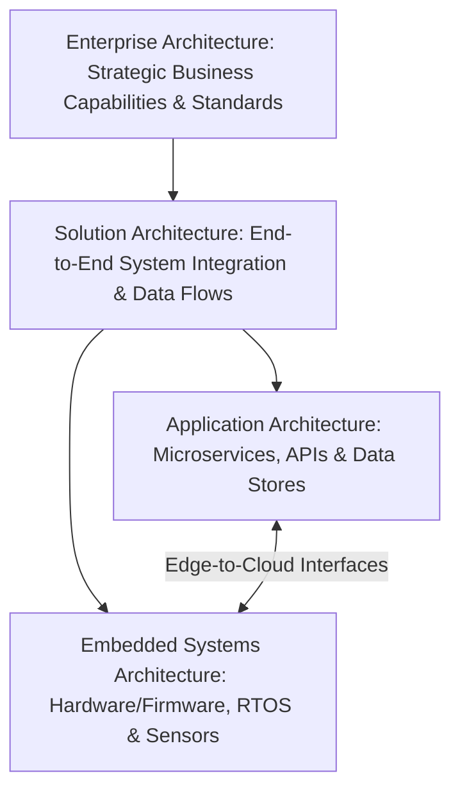
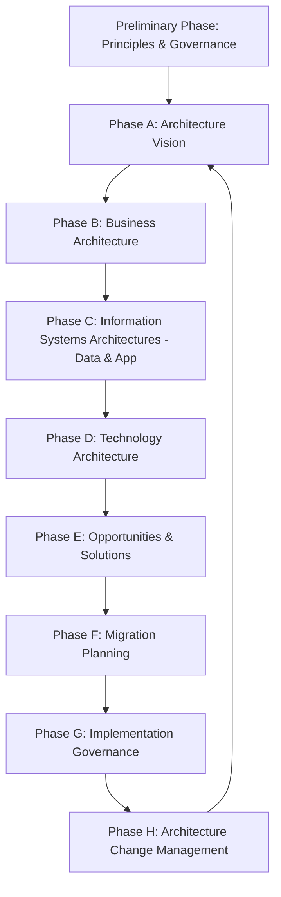
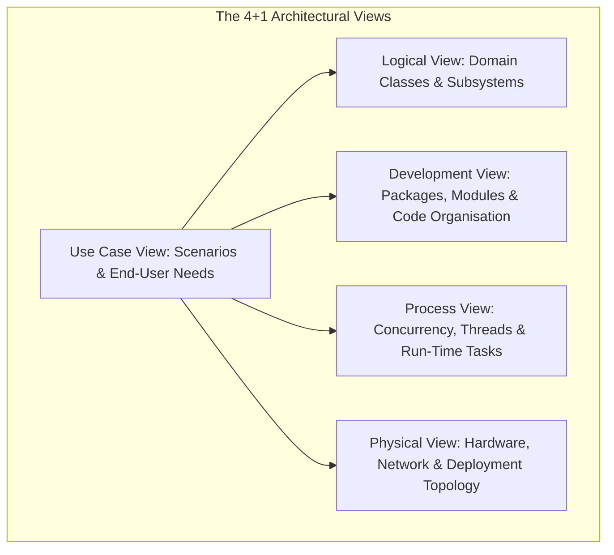

# Introduction to architecture

Architecture provides the structural blueprint that guides system engineering from inception through decades of operational deployment. ISO/IEC/IEEE 42010 defines architecture as the fundamental organisation of a system. It is embodied in the system's components and their relationships to each other and to the environment, and in the principles that guide its design and evolution.

## 1. What is Architecture?

Martin Fowler describes architecture as "the shared understanding that developers have of the system design". It is also "the decisions that you wish you could get right early in a project because they are difficult to change later."

Architecture is distinguished from detailed implementation by three core characteristics:
1. **Scope and Consequence**: Architectural decisions dictate system topology, inter-process communication protocols, security boundaries, and persistence mechanisms. Reversing an architectural decision incurs orders of magnitude higher cost than modifying an internal function.
2. **Non-Functional Focus**: While feature engineering focuses on what the system does (functional requirements), architecture focuses on how the system behaves under stress, failure, growth, and security attacks (quality attributes or non-functional requirements).
3. **Abstraction Management**: Architecture abstracts away algorithmic minutiae to provide clear cognitive models of how data, control, and failure domains interact across the entire estate.

### The Four Architectural Tiers

System engineering operates across four interconnected architectural tiers:

| Tier | Primary Focus | Typical Artefacts | Stakeholders |
| :--- | :--- | :--- | :--- |
| **Enterprise Architecture** | Strategic business capabilities, corporate IT landscape, digital transformation, and technical debt reduction across the entire company. | Capability models, strategic roadmaps, technology standards radar. | C-suite, CTO, VP Engineering, Business Unit Leaders. |
| **Solution Architecture** | End-to-end technical solution spanning multiple systems, clouds, edge gateways, and commercial SaaS integrations for a specific product or project. | Solution Design Documents (SDD), High-Level Designs (HLD), interface contracts. | Product Managers, Delivery Leads, Lead Architects. |
| **Software / Application Architecture** | Internal structure of a specific application, microservice, or gateway daemon (classes, modules, threads, databases). | Low-Level Designs (LLD), Software Detailed Specifications ([Writing a software design specification](../guides/software-design-specification.md)), class/container models. | Tech Leads, Senior Software Engineers. |
| **Embedded & Systems Architecture** | Hardware-software co-design, real-time constraints, peripheral buses (I2C, SPI, CAN), memory segmentation, and power budgets. | Hardware-Software Interface specifications, memory layout maps, RTOS task concurrency models. | Firmware Engineers, Hardware Engineers, Embedded Architects. |

[[CAPTION:Table]] The four architectural tiers in modern engineering organisations.

[[CAPTION:Figure]] Relationships between the four architectural tiers.

## 2. The Role of the Modern Architect

Historically, organisations frequently succumbed to the disconnected, top-down architecture antipattern: individuals producing voluminous, theoretical specification documents without engaging with the engineering teams implementing them.

Modern engineering requires pragmatic, engaged technical leadership. The modern architect functions as an enabler, mentor, and communicator who scales architectural decision-making across autonomous delivery teams.

### Core Responsibilities of an Architect

- **Technical Vision and Tenets**: Defining clear, unambiguous architectural principles that empower delivery teams to make decentralized, coherent decisions (the Advice Process).
- **Managing Technical Risk and Trade-offs**: Evaluating competing priorities (for example, latency versus throughput, battery life versus reporting frequency) through structured trade-off analyses (Architecture Decision Records per [Writing ADRs and RFCs](../guides/decision-records.md)).
- **Governance and Quality Assurance**: Chairing the Architecture Review Board ([Running an architecture review board](../guides/architecture-review-board.md)) and conducting systematic checklist reviews ([Architecture review checklist](../templates/architecture-review-checklist.md)) to maintain consistency across squads.
- **Continuous Hands-On Calibration**: Remaining close to production code and deployment pipelines. Architects who never inspect pull requests or flash hardware lose calibration with real-world developer friction.

## 3. Core Architecture Frameworks and Standards

Formal architecture frameworks provide standardised vocabularies, decomposition methodologies, and documentation structures.

### 3.1 TOGAF (The Open Group Architecture Framework)

TOGAF is the globally recognized enterprise architecture standard. Its core engine is the **Architecture Development Method (ADM)**, an iterative cycle for creating enterprise architectures:

[[CAPTION:Figure]] TOGAF Architecture Development Method (ADM) iterative cycle.

TOGAF provides rigor when structuring large multi-year enterprise transformation initiatives, ensuring technology roadmaps align directly with corporate business capabilities.

### 3.2 The Zachman Framework

John Zachman formulated a two-dimensional classification matrix providing an exhaustive taxonomy of enterprise architecture. It intersects six fundamental communication questions against six stakeholder perspectives:

| Perspective \ Focus | What (Data) | How (Function) | Where (Network) | Who (People) | When (Time) | Why (Motivation) |
| :--- | :--- | :--- | :--- | :--- | :--- | :--- |
| **Planner (Scope)** | List of business objects | List of business processes | List of business locations | List of organisations | List of business events | List of business goals |
| **Owner (Business Concept)** | Conceptual data model | Business process model | Logistics network model | Organisational workflow | Business cycle model | Business plan |
| **Designer (System Logic)** | Logical data model | System architecture model | Distributed system topology | Human interface spec | State transition model | Business rule model |
| **Builder (Technology Physics)** | Physical data model | Software detailed design | Network architecture spec | Presentation format | Process timing schedule | Operational rule model |
| **Integrator (Component Config)** | Data definition language | Machine instruction code | Node configuration map | Security permission table | Thread dispatch sequence | Logic condition table |
| **User (Operational Instance)** | Database records | Executing system processes | Live operational network | Authenticated actors | Real-time events | Business operational value |

[[CAPTION:Table]] The Zachman Enterprise Architecture Framework taxonomy matrix.

While rarely implemented in its complete 36-cell form today, Zachman remains invaluable as a conceptual checklist to guarantee that no architectural perspective is neglected.

### 3.3 Kruchten's 4+1 View Model

Formulated by Philippe Kruchten, the 4+1 View Model structures software architecture into five distinct viewpoints, each addressing concerns of specific stakeholders:

[[CAPTION:Figure]] Kruchten's 4+1 Architectural View Model.

- **Logical View**: Concerned with system functionality exposed to end-users (class models, domain objects).
- **Process View**: Addresses runtime concurrency, non-blocking tasks, inter-thread synchronization, and system availability.
- **Development View**: Focuses on the actual software assets, source code repository organisation, packages, and build systems.
- **Physical View**: Details hardware components, network infrastructure, edge processors, and cloud execution environments.
- **Use Case (+1) View**: Ties the four views together by demonstrating how scenarios and operational workflows traverse the architecture.

### 3.4 The Arc42 Architecture Template

Arc42 is an open-source, pragmatic documentation template widely adopted across European and global engineering teams. It decomposes software architecture into 12 structured sections:
1. Introduction and Goals (Business goals, requirements, stakeholders)
2. Architecture Constraints
3. Context and Scope (Business and technical context)
4. Solution Strategy
5. Building Block View (Decomposition hierarchy)
6. Runtime View (Scenarios, state machines, sequences)
7. Deployment View (Infrastructure, nodes, network)
8. Cross-cutting Concepts (Security, error handling, logging, testing)
9. Architecture Decisions (ADR records)
10. Quality Requirements (Quality tree, scenarios)
11. Risks and Technical Debt
12. Glossary

Arc42 maps seamlessly into the Docs-as-Code methodology ([Documentation as code and terminology](../guidelines/documentation-as-code.md)) and Markdown-based documentation repositories.

## Summary

Architecture is not an isolated deliverable or an academic exercise. It is the living, evolving set of structural decisions and boundaries that enable engineering teams to move with speed, safety, and autonomy. 

In the subsequent chapter, we will explore how to establish an actionable Architecture Vision, assess engineering competencies using the SFIA framework, and enforce quality attributes through governance.
