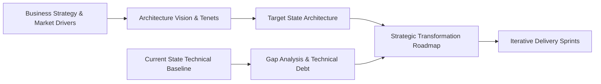
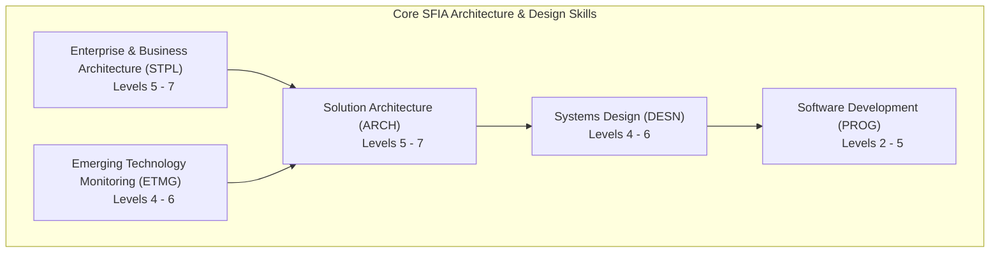
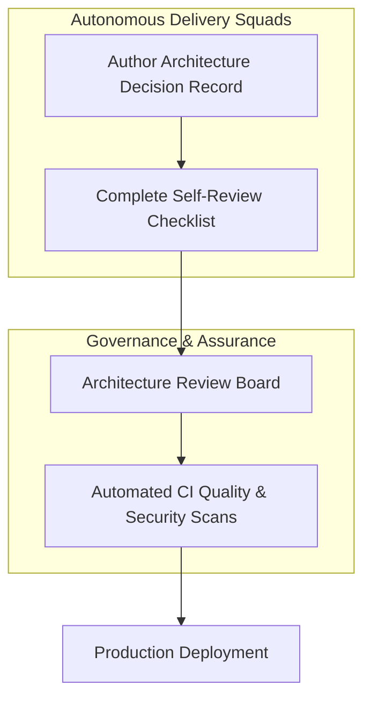

# Architecture vision and principles

A successful engineering practice needs more than individual technical skill. It needs a coherent Architecture Vision and a repeatable governance mechanism. It also needs structured professional development, so that architectural thinking scales across the organisation.

## 1. Defining the Architecture Vision

An Architecture Vision articulates the future-state technical capabilities of an organisation, illustrating how technology enables strategic commercial objectives while systematically dismantling technical debt.

[[CAPTION:Figure]] From business strategy to iterative delivery via Architecture Vision.

### Elements of an Actionable Architecture Vision

1. **Guiding Tenets**: A concise set of non-negotiable principles that guide architectural decisions when competing trade-offs arise (for example, "API-first: every service exposes capabilities via standardized contracts before building user interfaces").
2. **Current State Baseline**: An honest, objective inventory of the existing technical estate, legacy limitations, defect hot-spots, and security vulnerabilities.
3. **Target State Definition**: Clear models (C4 context and container diagrams per [GD-001](../guides/c4-model/index.md)) depicting the desired architecture three to five years in the future.
4. **Transition Roadmap**: Phased milestones (Now, Next, Later) delivering tangible business value at each step while deprecating obsolete subsystems.

## 2. Professional Capability Frameworks: SFIA

To build and sustain high-performing architecture and engineering teams, organisations must adopt structured skills frameworks. The **Skills Framework for the Information Age (SFIA)** is the globally recognized taxonomy for digital and technical skills.

### The Seven SFIA Responsibility Levels

SFIA defines seven distinct levels of professional responsibility:

| Level | Title | Guiding Description | Autonomy and Influence |
| :--- | :--- | :--- | :--- |
| **Level 1** | Follow | Works under direct supervision; uses basic skills and routine procedures. | Minimal autonomy; follows established instructions. |
| **Level 2** | Assist | Works under routine supervision; exercises limited discretion. | Participates in work packages; collaborates with peers. |
| **Level 3** | Apply | Performs varied work activities in a range of contexts. | Plans and schedules own work within given deadlines. |
| **Level 4** | Enable | Performs broad and complex activities; provides technical direction to others. | Self-directed; guides junior engineers; resolves escalations. |
| **Level 5** | Ensure / Advise | Influences organisation, customers, and partners; authoritative subject matter expert. | Full accountability for technical outcomes of work streams. |
| **Level 6** | Initiate / Influence | Shapes organizational strategy; leads major technical disciplines. | Champions technical innovation; influences executive leadership. |
| **Level 7** | Set Strategy / Inspire | Directs enterprise technology vision; sets industry benchmarks. | Highest organizational level; accountable for corporate tech strategy. |

[[CAPTION:Table]] The seven SFIA levels of professional responsibility.

### Core Architecture and Engineering Skills in SFIA

SFIA categorises technical competencies into specific skill codes relevant to architecture and systems engineering:

[[CAPTION:Figure]] Key SFIA skills for architecture, design, and software development.

- **Solution Architecture (ARCH)**: Designing complete solutions that integrate business processes, applications, data, and cloud/hardware infrastructure.
- **Systems Design (DESN)**: Specifying detailed components, hardware-software interfaces, algorithms, and data storage structures.
- **Software Development (PROG)**: Authoring robust, verified production source code conforming to coding standards ([C coding standard](../standards/c-coding-standard.md), [Python for supporting tools](../standards/python.md)).
- **Emerging Technology Monitoring (ETMG)**: Researching, evaluating, and trialing new platforms, tools, and methodologies for the Technology Radar.

## 3. Architecture Governance and Review Mechanisms

Architecture governance ensures that projects deliver against the agreed Architecture Vision, comply with corporate security standards, and avoid introducing rogue technical debt.

[[CAPTION:Figure]] Integrated architecture governance workflow.

Effective governance operates across three complementary layers:

### 3.1 Architecture Decision Records (ADRs)

Every significant architectural decision MUST be documented as an ADR committed directly into the codebase ([Writing ADRs and RFCs](../guides/decision-records.md)). ADRs capture the business context, evaluated alternatives, and trade-off consequences at the time the decision was made.

### 3.2 The Architecture Review Board (ARB)

The ARB provides central oversight, cross-domain alignment, and compliance review ([Running an architecture review board](../guides/architecture-review-board.md)). Meeting on a regular cadence, the board evaluates proposed High-Level Designs against the 23-point Architecture Review Checklist ([Architecture review checklist](../templates/architecture-review-checklist.md)).

### 3.3 Automated Architectural Fitness Functions

Governance cannot rely solely on manual reviews. Modern architectures employ automated tests (fitness functions) executed within CI pipelines:
- Dependency graph analysers enforcing layered isolation (for example, verifying domain logic never imports database or HTTP transport modules per [Software architecture principles](../standards/software-architecture-principles.md)).
- Binary size and memory footprint tracking for embedded microcontroller images.
- Automated API contract linters verifying OpenAPI schemas and RFC 9457 error payload conformance ([API design and error handling](../standards/api-design.md)).

## 4. Quality Attributes and Quantitative Metrics

Quality attributes (non-functional requirements) define the behavioural properties of a system. The **ISO/IEC 25010** software product quality model establishes eight primary quality characteristics:

| Characteristic | Architectural Focus | Quantitative Verification Metric |
| :--- | :--- | :--- |
| **Performance Efficiency** | Response latency, throughput capacity, CPU and RAM resource utilisation. | 99th percentile response time < 200 ms; CPU utilisation < 65% at peak load. |
| **Compatibility** | Interoperability across heterogeneous devices and protocol co-existence. | Full compliance with standard schemas (OpenAPI 3.1, LwM2M Object Registry). |
| **Usability** | Developer experience (DX), intuitive API naming, clear documentation. | Time-to-first-successful-API-call < 15 minutes. |
| **Reliability** | Availability, fault tolerance, MTBF, automatic recovery. | 99.95% monthly availability; MTTR < 5 minutes via automated failover. |
| **Security** | Confidentiality, integrity, non-repudiation, authenticated access control. | Zero high/critical CVEs; TLS 1.3 encryption with Mutual TLS for device auth. |
| **Maintainability** | Modularity, testability, reusability, cyclomatic complexity. | Unit test coverage >= 85%; cyclomatic complexity per function <= 10. |
| **Portability** | Adaptability across hardware variants and cloud deployment environments. | Compilation across ARM GCC and Clang with zero warnings; containerized microservices. |
| **Functional Suitability** | Completeness, correctness, and appropriateness of core business capabilities. | 100% requirements traceability verified against automated system integration tests. |

[[CAPTION:Table]] ISO/IEC 25010 Quality Characteristics and quantitative engineering metrics.

### Architecture Trade-off Analysis Method (ATAM)

Software architecture is fundamentally the management of trade-offs. The SEI Architecture Trade-off Analysis Method (ATAM) provides a structured workshop format to evaluate candidate architectures against competing quality attributes:

[[CAPTION:Figure]] The Architecture Trade-off Analysis Method (ATAM) flow.

A **Utility Tree** turns high-level concerns such as "System must be secure" into precise, testable scenarios. An example is "When an unauthorised client sends an unauthenticated MQTT packet, the broker drops the connection within 50 ms and increments a security audit metric".

## Summary

Architecture vision, professional capability frameworks, and rigorous governance create an engineering environment where technical quality is built into the culture. In Chapter 3, we turn to the structural patterns that implement these requirements.
