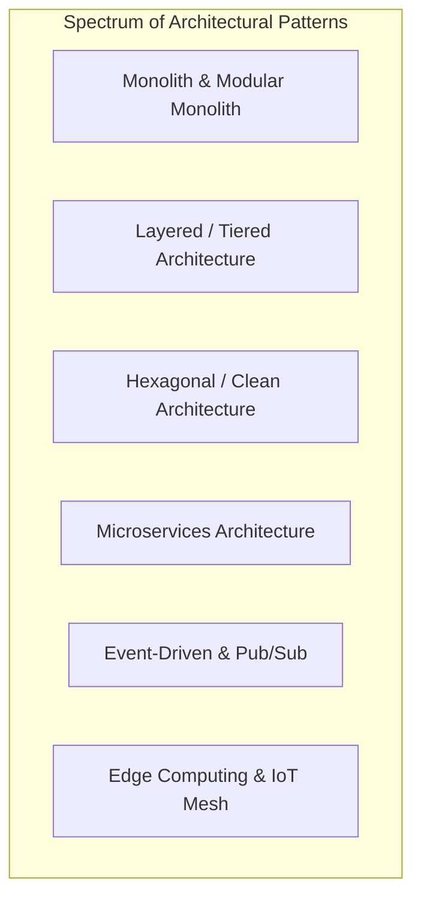
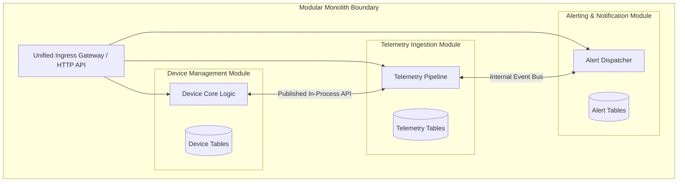
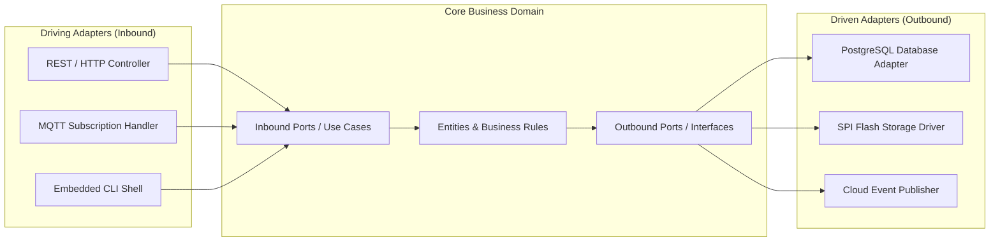
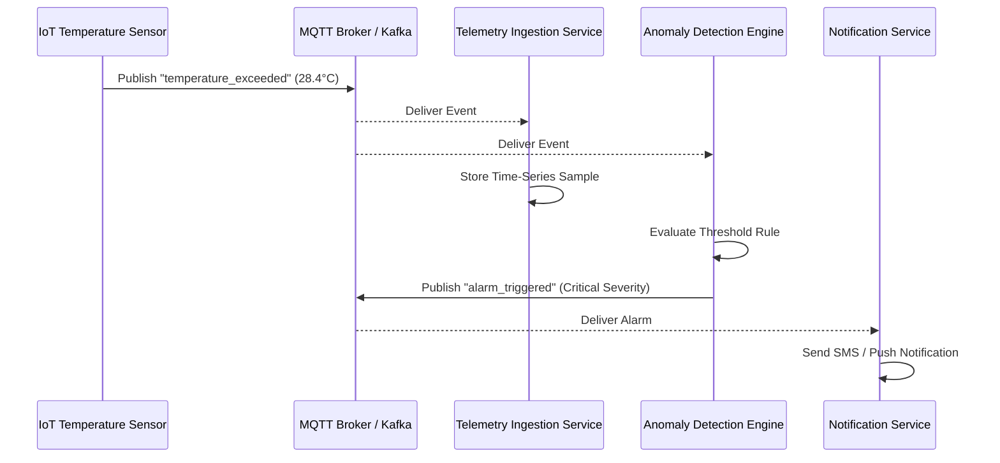
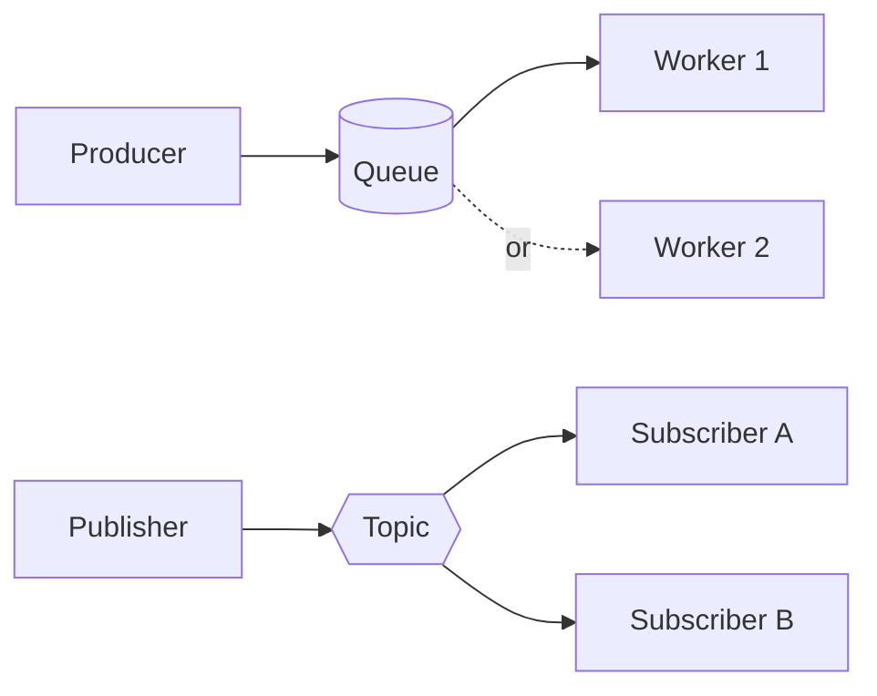
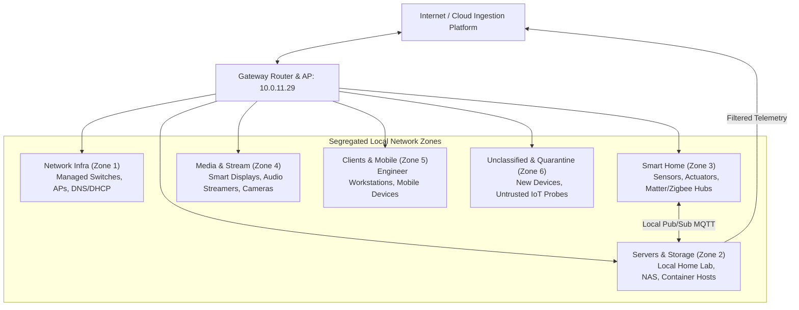

# Architecture patterns

Architectural patterns represent reusable, proven solutions to recurring design challenges across distributed systems, firmware runtimes, and enterprise platforms. Selecting the appropriate architectural pattern establishes the structural foundation for system scalability, maintainability, and resilience.

## 1. Architectural Styles vs Design Patterns

While design patterns (such as Factory, Strategy, or Observer) operate at the level of classes, functions, and objects within a single code module, **architectural styles and patterns** govern:
- Coarse-grained subsystem boundaries and execution environments.
- Inter-process and inter-network communication mechanisms.
- Data persistence strategies and consistency boundaries.
- Fault containment and deployment isolation.

[[CAPTION:Figure]] Spectrum of core architectural patterns.

## 2. Monolithic vs Modular Monolith Architectures

### The Traditional Monolith

In a classic monolithic architecture, all functional business logic, database queries, and presentation logic are packaged and deployed as a single executable artefact.

- **Strengths**: Simple initial deployment, straightforward local development, zero inter-process network latency, easy transaction boundaries.
- **Vulnerabilities**: Risk of becoming a "Big Ball of Mud", tight coupling across modules, single point of failure (a crash in one module brings down the entire process), and scaling bottlenecks (entire binary must be scaled horizontally).

### The Modular Monolith

A **Modular Monolith** preserves the single-deployment benefit of a monolith while enforcing strict, compile-time module boundaries. Each business domain resides in an isolated package, communicating with other modules strictly through published in-process interfaces rather than querying private database tables directly.

[[CAPTION:Figure]] Modular Monolith architecture with encapsulated private data stores.

Modular monoliths represent the optimal starting architecture for most products, avoiding the distributed system overhead of microservices until team size or scaling demands warrant separation.

## 3. Layered vs Hexagonal (Clean) Architecture

### Traditional Layered Architecture

Layered architecture divides the software into horizontal tiers (Presentation, Application/Business Logic, Persistence, and Database). 

Traditional layered systems are intuitive, but they have a serious flaw. High-level business logic often depends directly on low-level database schemas or ORM models. That breaks the Dependency Inversion Principle ([Software architecture principles](../standards/software-architecture-principles.md)).

### Hexagonal Architecture (Ports and Adapters)

Alistair Cockburn's Hexagonal Architecture places the core business domain at the centre, completely insulated from external technologies, frameworks, hardware peripherals, and databases.

[[CAPTION:Figure]] Hexagonal Architecture (Ports and Adapters) decoupling domain logic from infrastructure.

- **Ports**: Specification of what the domain needs (interfaces). Inbound ports define use cases; outbound ports define required services (repositories, notifiers).
- **Adapters**: Concrete implementations that translate between port interfaces and external technologies (such as translating an outbound `TelemetryStore` port to an SQLite database or SPI NOR flash driver).

## 4. Microservices Architecture

Microservices partition a system into small, independently deployable services organized around distinct business capabilities. Each microservice manages its own private datastore.

| Property | Monolith / Modular Monolith | Microservices Architecture |
| :--- | :--- | :--- |
| **Deployment Unit** | Single executable or container. | Tens to hundreds of independent containers. |
| **Data Storage** | Shared single database instance. | Database-per-Service; decentralized persistence. |
| **Communication** | In-process function calls (< 1 μs). | Network RPC, HTTP, or message buses (1 to 50 ms). |
| **Failure Isolation** | Process crash affects entire application. | Failure contained to individual service. |
| **Operational Overhead** | Low: simple CI/CD and single server host. | High: requires container orchestration, service mesh, tracing. |

[[CAPTION:Table]] Comparison between Monolithic and Microservices architectural styles.

Microservices are justified when independent teams require autonomous release cadences or when distinct components require radically divergent scaling profiles (for example, video transcoding versus billing).

## 5. Event-Driven Architecture (EDA)

Event-Driven Architecture decouples message producers from consumers. Instead of synchronous request-response calls, components react asynchronously to state change notifications (events).

[[CAPTION:Figure]] Event-driven choreography across distributed IoT services.

### Core EDA Tenets

- **Choreography vs Orchestration**: In choreographed systems, services react independently to events published on a broker without central control. In orchestrated systems, a central workflow coordinator explicitly commands each step.
- **Event Sourcing**: Storing every state mutation as an immutable append-only event log rather than overwriting current state in a relational table. Current state is reconstructed by replaying events.
- **CQRS**: Separating command (write) models from query (read) projections to optimise data schemas for specific access patterns.

### Message queues and publish-subscribe

Event-driven systems rest on messaging middleware: a broker that sits between the parts of a system so that they never call each other directly. Two delivery models matter, and most brokers offer both.

- **Queues (point to point).** A producer sends a message to a queue, and exactly one consumer takes it. Add consumers to share the work. Use a queue for commands and jobs, where each piece of work must be done once, such as processing a payment or generating a report.
- **Topics (publish-subscribe).** A publisher sends a message to a topic, and every subscriber gets its own copy. Publishers do not know who is listening, so a new subscriber can be added without changing them. Use a topic for events that several services care about, such as a device reporting a reading.

[[CAPTION:Figure]] A queue delivers each message to one consumer; a topic delivers a copy to every subscriber.

In connected products the two often appear together. A gateway publishes device readings to an MQTT topic. A bridge forwards them into a streaming platform such as Kafka, where analytics, dashboards and alerting each subscribe independently. Commands to a device go the other way, through a queue or a per-device topic.

Whichever model you use:

- **Make consumers idempotent.** Most brokers deliver at least once, so a consumer will sometimes see a message twice. Processing it twice must be harmless.
- **Acknowledge after processing, not before.** A consumer that acknowledges on receipt and then crashes loses the message.
- **Plan for poison messages.** A message that always fails should go to a dead-letter queue after a few attempts, rather than block everything behind it.
- **Name topics deliberately.** A hierarchy such as `site/device-type/device-id/reading` makes routing, access control and wildcards straightforward.
- **Secure the broker.** Authenticate every client, encrypt the connection, and restrict which clients may publish or subscribe to each topic.
- **Watch queue depth and consumer lag.** A growing backlog is the earliest sign that consumers cannot keep up.

## 6. Edge and Smart Home IoT Network Topologies

Connected environments (such as smart buildings, industrial factories, and connected homes) require multi-tiered edge architectures that balance local real-time responsiveness with cloud intelligence.

A production IoT edge topology isolates sensitive infrastructure, segregates untrusted smart devices, and optimizes bandwidth across six distinct network zones:

[[CAPTION:Figure]] Production multi-zone network topology for smart home and edge IoT environments.

### Zone Isolation Rules

1. **Zone 1 (Network Infra)**: Core routing, PoE switches, and network management consoles. Access restricted to dedicated administrative credentials.
2. **Zone 2 (Servers & Storage)**: Local Kubernetes/Docker clusters, home lab instances, telemetry aggregators, and Network Attached Storage (NAS). Acts as the local edge compute layer.
3. **Zone 3 (Smart Home)**: Environmental sensors, smart thermostatic radiator valves (TRVs), light switches, and protocol gateways (Matter, Zigbee, Thread). Isolated on a dedicated VLAN with restricted internet egress.
4. **Zone 4 (Media & Stream)**: High-bandwidth multicast devices (IP security cameras, smart TVs, audio streamers). Isolated to prevent buffer-bloat on sensor networks.
5. **Zone 5 (Clients & Mobile)**: Trusted laptops, workstations, and smartphones accessing secure management portals.
6. **Zone 6 (Quarantine / Unclassified)**: Newly provisioned or unverified devices subjected to automated port scanning, behavioural analysis, and containment prior to admission into production VLANs.

### Edge Store-and-Forward Pattern

IoT edge nodes must operate reliably during intermittent WAN outages:
- **Local Ring Buffers**: Telemetry is written to local non-volatile storage (flash or embedded SQLite).
- **Graceful Degradation**: Core control loops (such as thermostat heating schedules or motion-triggered lights) execute locally with zero cloud dependence.
- **Batch Upload with Jitter**: When WAN connectivity resumes, edge gateways stream queued data using exponential backoff to avoid overwhelming cloud ingestion pipelines ([API design and error handling](../standards/api-design.md)).

## Summary

No single pattern suits every problem. World-class architectures blend Hexagonal Architecture for core software modules, Modular Monoliths or Microservices for service deployment, and multi-tier Edge topologies for connected device fleets. 

In Chapter 4, we examine how these distributed systems communicate via modern API standards.
