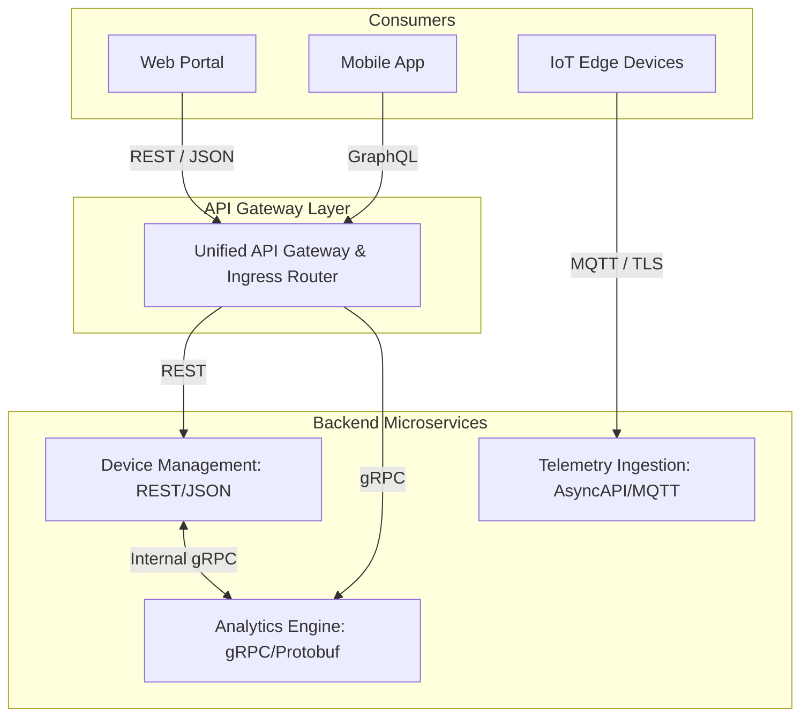

# API design and management

Application Programming Interfaces (APIs) form the digital contracts connecting microservices, embedded edge appliances, mobile applications, and third-party partners. Robust API engineering demands clear protocol selection, disciplined schema governance, and systematic serialisation design.

## 1. Modern API Paradigms: A Comparative Analysis

Different communication paradigms optimise for different operational trade-offs (such as latency, payload size, developer ergonomics, and streaming support):

| Paradigm | Transport | Serialisation | Schema Contract | Ideal Operational Use Cases |
| :--- | :--- | :--- | :--- | :--- |
| **REST** | HTTP/1.1 or HTTP/2 | JSON (RFC 8259) | OpenAPI 3.1 | Public APIs, CRUD management, browser-to-server communications. |
| **gRPC** | HTTP/2 | Protocol Buffers | `.proto` files | High-throughput inter-service microservice RPC, polyglot back-end communications. |
| **GraphQL** | HTTP/1.1 or HTTP/2 | JSON | GraphQL SDL | Complex front-end client queries, aggregations across multiple microservices. |
| **AsyncAPI** | MQTT, Kafka, AMQP | JSON, Protobuf, Avro | AsyncAPI 3.0 | Event-driven telemetry, IoT pub/sub streaming, distributed background workers. |
| **WebSocket** | TCP / WS | Binary / Text | Application-defined | Full-duplex real-time dashboards, financial tickers, live bidirectional device sessions. |

[[CAPTION:Table]] Comparative analysis of modern API paradigms.


[[CAPTION:Figure]] Multi-protocol API ingress and internal microservice communication architecture.

## 2. Data Serialisation Formats

The choice of serialisation format directly impacts network bandwidth, CPU utilisation, and memory consumption. In resource-constrained embedded systems and high-throughput cloud streaming pipelines, binary formats provide decisive advantages over text-based JSON.

### Comparative Serialisation Matrix

| Format | Type | Schema Required? | Relative Size | CPU Overhead | Embedded Feasibility |
| :--- | :--- | :--- | :--- | :--- | :--- |
| **JSON** | Text | Optional (JSON Schema) | 1.0x (Baseline) | High (String parsing, tokenization) | Feasible on 32-bit MCUs with >= 64 KB RAM; poor for 8/16-bit. |
| **Protobuf** | Binary | Yes (`.proto`) | 0.25 to 0.4x | Minimal (Bit-shift decoding, varints) | Excellent via nanopb library; minimal stack/heap footprint. |
| **CBOR** | Binary | Optional (CDDL) | 0.4 to 0.6x | Low (Type-length-value byte parsing) | Native standard for CoAP and IETF IoT specifications (RFC 8949). |
| **MessagePack** | Binary | Optional | 0.4 to 0.6x | Low | Good general-purpose binary JSON drop-in replacement. |

[[CAPTION:Table]] Serialisation format comparison across size, performance, and embedded feasibility.

### Protocol Buffers in Embedded Architecture

Protocol Buffers (Protobuf) encode strongly-typed data structures into compact binary representations using variable-length integer encoding (varints) and field tags.

```protobuf
syntax = "proto3";

package iot.telemetry.v1;

message SensorSample {
  string device_id = 1;
  uint64 timestamp_utc_ms = 2;
  float temperature_celsius = 3;
  float relative_humidity_pct = 4;
  uint32 battery_millivolts = 5;
  
  enum SensorStatus {
    STATUS_UNSPECIFIED = 0;
    STATUS_OK = 1;
    STATUS_CALIBRATION_NEEDED = 2;
    STATUS_HARDWARE_FAULT = 3;
  }
  SensorStatus status = 6;
}
```
[[CAPTION:Figure]] Protobuf v3 schema defining strongly-typed IoT sensor telemetry.

Using lightweight generators like `nanopb`, this schema compiles into plain C structs with static memory allocations, allowing microcontrollers to encode and decode messages in microseconds with zero dynamic memory allocation (`malloc`).

## 3. API Governance and Management

As an API estate expands across dozens of squads, centralized governance ensures consistency, security, and backward compatibility.

### 3.1 The API Gateway Pattern

An **API Gateway** sits between external clients and internal services, providing cross-cutting operational capabilities:
- **Authentication & Authorisation**: Validating OAuth2 JWT tokens or mTLS client certificates before traffic reaches internal services.
- **Traffic Shaping & Rate Limiting**: Enforcing quota policies (for example, 100 requests/minute per client IP) using token bucket algorithms, returning HTTP `429 Too Many Requests` when exceeded ([API design and error handling](../standards/api-design.md)).
- **Protocol Translation**: Transcoding external REST/JSON HTTP requests into internal high-speed gRPC calls.
- **Circuit Breaking and Fallbacks**: Isolating failing downstream services to prevent cascading failures.
- **Distributed Tracing & Metrics**: Injecting W3C Trace Context headers (`traceparent`) to monitor end-to-end request latencies.

### 3.2 API Versioning Strategies

APIs MUST manage evolutionary changes without breaking existing consumer integrations:

| Versioning Strategy | Syntax Example | Pros | Cons | Recommendation |
| :--- | :--- | :--- | :--- | :--- |
| **URI Path Versioning** | `/api/v1/devices` | Explicit, easily tested in browsers, cache-friendly. | Couples versioning to URL structure; violates pure REST resource modelling. | **Recommended** for public and partner APIs. |
| **Header Versioning** | `Accept: application/vnd.company.v1+json` | Preserves clean URIs; semantically pure content negotiation. | Harder to test manually; proxies and caches may strip or mishandle headers. | Suitable for internal microservices. |
| **Query Parameter** | `/devices?v=1` | Easy to append dynamically. | Can cause cache poisoning or confusion with filtering query parameters. | Discouraged. |

[[CAPTION:Table]] Comparison of API versioning strategies.

### 3.3 The API Deprecation Lifecycle

When introducing breaking changes, teams MUST adhere to the formal deprecation lifecycle:


[[CAPTION:Figure]] Formal API deprecation lifecycle.

During the deprecation window:
1. The API MUST return the standard HTTP `Sunset` and `Deprecation` response headers (RFC 8594):
   ```http
   Deprecation: @1790000000
   Sunset: Wed, 20 Sep 2027 12:00:00 GMT
   Link: <https://api.example.com/docs/v2-migration>; rel="successor-version"
   ```
   [[CAPTION:Figure]] RFC 8594 Deprecation and Sunset headers.
2. The team must monitor API gateway metrics to actively identify consumers still calling deprecated endpoints and assist their migration.

## Summary

Disciplined API design ensures systems remain decoupled, discoverable, and performant. In Chapter 5, we explore how cloud platforms provide the computing, streaming, and infrastructure-as-code foundation for these APIs.
