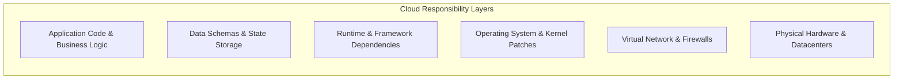
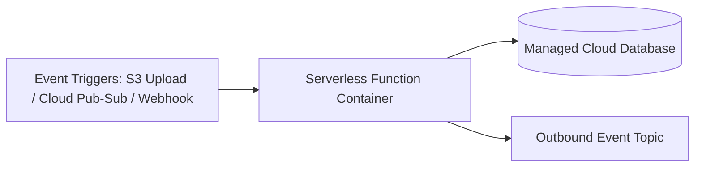
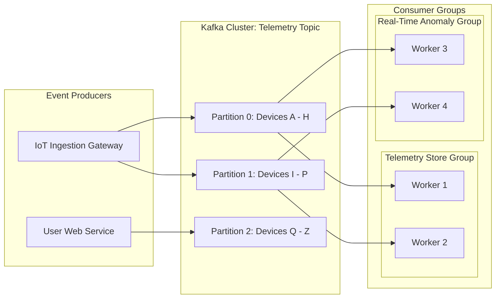
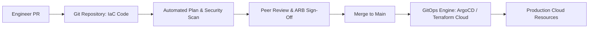

# Cloud architecture

Cloud computing transforms software architecture from static server management into dynamic, programmable utility services. Modern cloud architecture demands robust multi-cloud strategies, serverless elasticity, real-time event streaming pipelines, and automated Infrastructure as Code (IaC).

## 1. Cloud Service Models: Strategic Trade-Offs

Architects must match system requirements against the appropriate cloud abstraction tier:

| Cloud Model | Management Responsibility | Architectural Strengths | Trade-Offs & Constraints |
| :--- | :--- | :--- | :--- |
| **IaaS** (Infrastructure as a Service) | OS, Runtime, Middleware, Application, Data. | Complete control; direct kernel and network tuning. | High operational maintenance; manual patching and scaling. |
| **CaaS** (Containers as a Service / K8s) | Application container, Config, Cluster sizing. | Portability; declarative scaling; uniform developer workflow. | Kubernetes operational complexity; control plane overhead. |
| **PaaS** (Platform as a Service) | Application code and configuration only. | Rapid time-to-market; automated patching and scaling. | Platform lock-in; constrained runtime customisation. |
| **Serverless (FaaS)** | Pure functional logic and event bindings. | Zero idle cost; instant scale-to-zero; high developer agility. | Cold-start latency; execution time limits; stateless constraints. |

[[CAPTION:Table]] Comparison of cloud service delivery models.


[[CAPTION:Figure]] Shared responsibility stack across cloud models.

## 2. Hybrid and Multi-Cloud Architecture

Operating across multiple cloud providers (such as AWS, Google Cloud Platform, Microsoft Azure) or bridging on-premises edge clusters with public clouds provides critical strategic advantages:
- **Resilience and High Availability**: Eliminating single-vendor regional outages.
- **Regulatory Compliance and Data Sovereignty**: Retaining sensitive citizen or customer data within local jurisdiction boundaries (such as UK GDPR).
- **Workload Optimisation**: Leveraging specialized vendor strengths (for example, BigQuery and Vertex AI on GCP, edge device provisioning on Azure IoT Hub).

### Achieving Workload Portability

To avoid crippling vendor lock-in, multi-cloud architectures employ three design patterns:
1. **Containerized Abstraction**: Packaging services as Open Container Initiative (OCI) images deployed on managed Kubernetes (GKE, EKS, AKS).
2. **Database Decoupling**: Utilising open-source database engines (PostgreSQL, Redis, ClickHouse) supported across all major cloud providers or deployable via managed operators.
3. **Multi-Cloud IaC**: Defining infrastructure using vendor-agnostic declarative tools (Terraform / OpenTofu) with modular abstractions.

## 3. Serverless Architectures and Patterns

Serverless computing executes code in ephemeral execution containers triggered by asynchronous events or HTTP requests, scaling down to zero when idle.


[[CAPTION:Figure]] Serverless event execution flow.

### Critical Serverless Engineering Disciplines

- **Mitigating Cold Starts**: In latency-sensitive APIs, language choice significantly impacts cold-start delays. Compiled binaries (Go, Rust) or optimized C runtimes initiate within 10 to 50 ms, whereas JVM or Python runtimes requiring large dependency trees can incur 500 to 2,500 ms cold starts.
- **Idempotency by Design**: Serverless event triggers guarantee *at-least-once* delivery. Function logic MUST be strictly idempotent, recording processed transaction IDs in a distributed cache (such as Redis or DynamoDB with conditional writes) to discard duplicate events safely.
- **Concurrency Ceilings and Backpressure**: Serverless functions can scale to thousands of concurrent instances within seconds, easily overwhelming downstream relational databases. Serverless tiers must sit behind queue-based rate limiters or connection poolers.

## 4. High-Throughput Event Streaming: Apache Kafka

Modern distributed platforms ingest, process, and analyse millions of telemetry events per second. Distributed log-centric streaming architectures (such as Apache Kafka and GCP Pub/Sub) provide the core infrastructure for real-time analytics and event-driven microservices.


[[CAPTION:Figure]] Kafka partition distribution and independent consumer group scaling.

### Key Streaming Concepts

- **Partitions and Ordering Guarantees**: Messages sent to Kafka with the same partition key (such as `device_id`) are guaranteed to land on the same partition and be consumed in strict temporal order. Different partition keys process in parallel.
- **Consumer Groups and Event Replay**: Multiple independent consumer groups read from the same log independently. If an analytics algorithm requires re-training, consumers can reset their offset to replay weeks of historical data without impacting real-time services.
- **Standardized Envelopes: CloudEvents**: Systems SHOULD package events using the CNCF CloudEvents specification, standardizing metadata attributes (`id`, `source`, `specversion`, `type`, `datacontenttype`, `time`):

```json
{
  "specversion": "1.0",
  "type": "com.company.telemetry.sensor.thresholdExceeded",
  "source": "/devices/blackburn/gw-042",
  "id": "e84d2b45-1234-5678-9abc-def012345678",
  "time": "2026-09-20T12:30:00Z",
  "datacontenttype": "application/json",
  "data": {
    "temperature_c": 31.8,
    "threshold_c": 30.0,
    "duration_sec": 45
  }
}
```
[[CAPTION:Figure]] CloudEvents v1.0 standard JSON event envelope.

## 5. Infrastructure as Code (IaC) and GitOps

Manual server configuration via cloud web consoles ("ClickOps") is strictly prohibited in production environments. Infrastructure MUST be declared as version-controlled code.


[[CAPTION:Figure]] GitOps declarative infrastructure delivery pipeline.

### Core IaC Tenets

1. **Declarative State**: Define the desired end-state infrastructure in code (Terraform, OpenTofu, Bicep); the engine computes the execution graph to transition from current state to desired state.
2. **Immutable Infrastructure**: Cloud servers and container hosts are never patched in-place. Updates deploy newly minted container images or virtual machine images; old instances are terminated.
3. **Drift Detection**: Automated scheduled CI jobs scan live cloud environments against the committed code baseline, immediately alerting or automatically reconciling unapproved out-of-band modifications.

## Summary

Cloud architecture provides the elastic compute, robust streaming, and automated deployment foundation necessary for modern connected software systems. In Chapter 6, we delve into the physical edge: Embedded Systems and IoT architecture.
