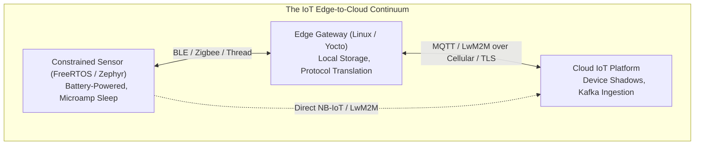
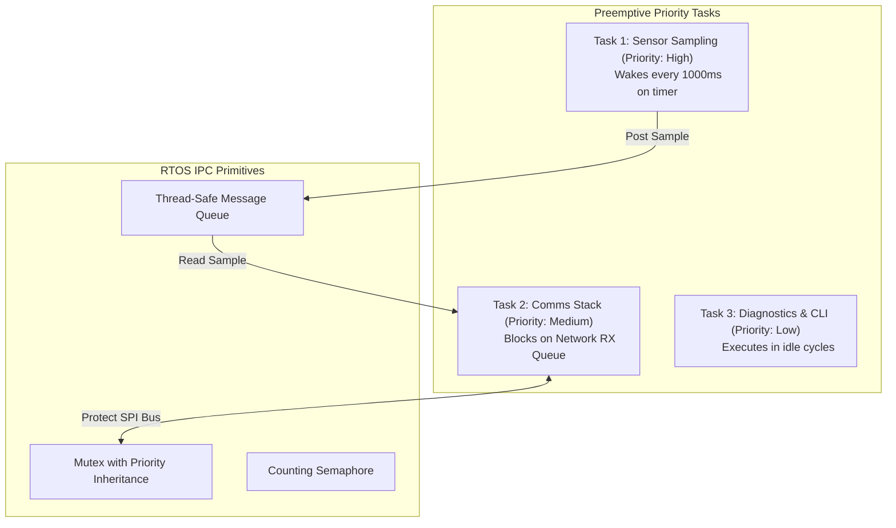
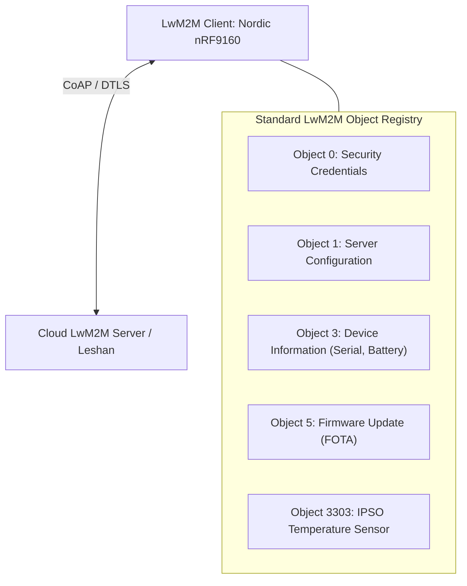
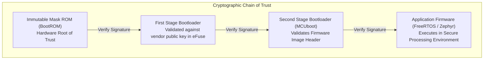

# IoT and embedded systems

Embedded and Internet of Things (IoT) systems inhabit the intersection of physical hardware, real-time operating constraints, and distributed cloud connectivity. Designing robust connected appliances demands deep mastery of hardware-software co-design, real-time scheduling, constrained networking protocols, and cryptographic hardware security.

## 1. Embedded Runtimes: Microcontrollers to Embedded Linux

Architects must select the appropriate runtime environment based on processing requirements, memory budgets, power sources, and determinism:

| Tier | Typical Hardware | Memory Envelope | Operating Runtime | Determinism | Target Use Cases |
| :--- | :--- | :--- | :--- | :--- | :--- |
| **Microcontroller (MCU)** | ARM Cortex-M0+/M3/M4/M33 (for example, Nordic nRF52, STM32) | 32 to 512 KB RAM, 256 KB to 2 MB Flash | Bare-Metal or RTOS (FreeRTOS, Zephyr) | Hard Real-Time (< 10 μs interrupt response) | Battery-powered environmental sensors, BLE beacons, motor control. |
| **Mid-Tier Gateway** | Dual-core Cortex-M7, ESP32-S3 | 2 to 16 MB PSRAM, 4 to 32 MB Flash | Real-Time OS (Zephyr, FreeRTOS) | Soft Real-Time | Local protocol gateways, smart thermostats, Matter/Thread border routers. |
| **Edge Compute Appliance** | ARM Cortex-A53/A72 (for example, NXP iMX8, Raspberry Pi CM4) | 1 to 8 GB RAM, 8 to 64 GB eMMC | Embedded Linux (Yocto, Buildroot) | Non Real-Time (Milliseconds) | Video analytics, local container execution, multi-camera NVRs. |

[[CAPTION:Table]] Spectrum of embedded computing runtimes and hardware tiers.

[[CAPTION:Figure]] The end-to-end IoT Edge-to-Cloud continuum.

## 2. Real-Time Operating Systems (RTOS) Architecture

In resource-constrained MCUs, an RTOS provides deterministic multitasking, thread synchronization, and inter-task communication within a footprint under 20 KB.

### Core RTOS Architecture (FreeRTOS and Zephyr)

An RTOS replaces complex superloops with prioritized, preemptive tasks:

[[CAPTION:Figure]] RTOS preemptive task concurrency and IPC primitives.

### Critical Embedded Concurrency Disciplines

1. **Avoid Dynamic Memory Allocation (`malloc`)**: Embedded firmware operating continuously for years MUST avoid `malloc()` and `free()` after system initialisation. Heap fragmentation causes sudden, unpredictable allocation failures. All task stacks, queues, and message buffers must be statically allocated at compile time.
2. **Priority Inversion and Priority Inheritance**: When a low-priority task holds a mutex required by a high-priority task, an intermediate-priority task can preempt the low-priority task, starving the high-priority task indefinitely. Embedded mutexes MUST employ **Priority Inheritance** to temporarily elevate the holder's priority.
3. **Interrupt Service Routine (ISR) Deferred Processing**: ISRs must remain minimal, executing in under 10 μs. The ISR clears the peripheral interrupt flag, captures raw register data, posts the data to an RTOS queue, and exits immediately, deferring processing to an application task.

## 3. IoT Constrained Communication Protocols

Connecting embedded edge devices to external networks requires communication protocols designed for low bandwidth, high packet loss, and constrained energy reserves:

| Protocol | Transport | Architecture | Header Overhead | QoS Levels | Ideal Use Case |
| :--- | :--- | :--- | :--- | :--- | :--- |
| **MQTT** | TCP / TLS | Pub/Sub via Central Broker | 2 Bytes minimum | QoS 0, 1, 2 | Continuous bidirectional telemetry and remote command streaming. |
| **CoAP** | UDP / DTLS | Request/Response (REST-like) | 4 Bytes | Confirmable / Non-Confirmable | Highly constrained networks, battery devices sleeping between transmissions. |
| **LwM2M** | UDP/DTLS via CoAP | Client-Server Object Model | Compact (TLV/CBOR) | Inherits CoAP | Comprehensive device management, firmware updates (FOTA), telemetry. |
| **HTTP/REST** | TCP / TLS | Request/Response | Hundreds of Bytes | None (TCP retransmits) | Unsuitable for constrained MCUs; standard for edge gateways with abundant power. |

[[CAPTION:Table]] Constrained IoT communication protocol comparison.

### Lightweight M2M (LwM2M) and the IPSO Object Model

LwM2M (standardised by the Open Mobile Alliance) provides an interoperable device management layer on top of CoAP:

[[CAPTION:Figure]] LwM2M Object model for device management and telemetry, following the LwM2M objects standard.

Every sensor reading, configuration parameter and firmware state maps to a standard object and resource ID ([Designing LwM2M objects and resources](../standards/lwm2m-objects.md)). For example, `/3303/0/5700` is the current temperature in degrees Celsius.

## 4. Hardware Security and Cryptographic Chain of Trust

IoT edge devices are physically accessible to adversaries. Security cannot rely solely on software obfuscation; it requires hardware-enforced protection.

[[CAPTION:Figure]] Secure Boot cryptographic chain of trust.

### Essential IoT Security Pillars

1. **Hardware Root of Trust (RoT)**: Cryptographic public keys and device identity certificates are burned permanently into write-once silicon fuses (eFuses) or stored in external tamper-resistant Secure Elements (such as Microchip ATECC608B or STSAFE).
2. **Secure Boot**: At power-on, immutable Mask ROM verifies the digital cryptographic signature (ECDSA P-256 or RSA-3072) of the first bootloader before executing it. Each stage verifies subsequent stages, guaranteeing that unauthorized or tampered firmware cannot execute.
3. **Dual-Bank FOTA (Firmware Over-The-Air)**: Flash memory is partitioned into two symmetrical banks (Slot 0: Active, Slot 1: Candidate). The new image downloads into Slot 1 and is verified cryptographically. The bootloader marks Slot 1 as pending and boots into it. If the application fails its self-test or crashes before kicking the watchdog, the bootloader automatically rolls back to Slot 0.

## Summary

Embedded and IoT systems architecture demands uncompromising discipline: static memory allocation, preemptive concurrency management, protocol optimisation, and hardware-backed cryptographic security. In Chapter 7, we examine the formal security frameworks and international standards that validate these systems.
