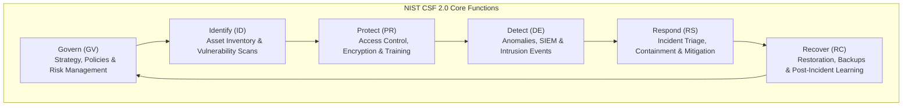
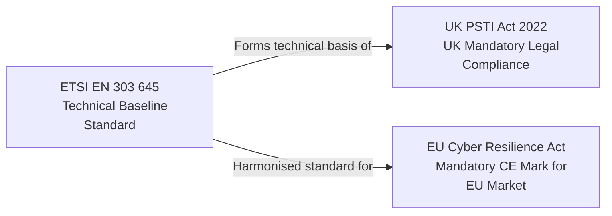
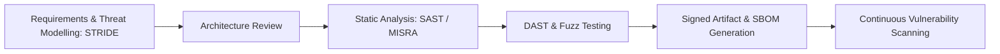

# Security and standards

Security is an intrinsic quality attribute that must be engineered into systems from initial architectural conception. In modern connected environments, security failures risk customer privacy, regulatory penalties, intellectual property theft, and physical safety hazards.

## 1. Global Security Frameworks: NIST CSF and OWASP

Enterprise and systems security architecture aligns against established international frameworks providing structured control catalogs:

### NIST Cybersecurity Framework (CSF 2.0)

The NIST CSF organizes security practices across six core functional domains:

[[CAPTION:Figure]] The six core functions of NIST CSF 2.0.

### OWASP IoT Top 10 Security Vulnerabilities

The Open Worldwide Application Security Project (OWASP) maintains the authoritative vulnerability index for connected appliances:

| Rank | Vulnerability Category | Primary Architectural Mitigation |
| :--- | :--- | :--- |
| **I1** | Weak, Guessable, or Hardcoded Passwords | Hardware unique per-device passwords generated at manufacturing; mandatory mTLS certificates. |
| **I2** | Insecure Network Services | Close unnecessary open listening ports (Telnet, unauthenticated web servers); restrict management interfaces to secure local subnets. |
| **I3** | Insecure Ecosystem Interfaces | Enforce OAuth2 / JWT authentication, TLS 1.3 encryption, and input sanitisation across mobile apps, cloud APIs, and web consoles. |
| **I4** | Lack of Secure Update Mechanism | Enforce dual-bank FOTA with cryptographic digital signature verification (ECDSA/RSA) and anti-rollback hardware counters. |
| **I5** | Use of Insecure or Outdated Components | Maintain an automated Software Bill of Materials (SBOM) scanned continuously against the National Vulnerability Database (NVD). |
| **I6** | Insufficient Privacy Protection | Minimise Personal Identifiable Information (PII) on-device; encrypt data at rest in flash using AES-XTS or AES-GCM. |
| **I7** | Insecure Data Transfer and Storage | Enforce TLS 1.3 in transit and hardware-backed cryptographic key storage (Secure Elements / eFuses). |
| **I8** | Lack of Device Management | Implement standardized telemetry, asset tracking, remote wiping, and audit logging via LwM2M ([Designing LwM2M objects and resources](../standards/lwm2m-objects.md)). |
| **I9** | Insecure Default Settings | Ship devices with least-privilege default settings; disable debug ports (JTAG/SWD) before customer dispatch. |
| **I10** | Lack of Physical Hardening | Enforce flash encryption, tamper-detection circuitry, and potting of critical cryptographic components. |

[[CAPTION:Table]] OWASP IoT Top 10 vulnerabilities and architectural mitigations.

## 2. IoT Regulatory Standards: ETSI EN 303 645, UK PSTI, and EU CRA

Global regulators have transitioned from voluntary guidelines to legally enforceable cybersecurity mandates for connected products:

[[CAPTION:Figure]] Relationships between international IoT standards and legislation.

### 2.1 ETSI EN 303 645: The Global IoT Baseline

ETSI EN 303 645 establishes 13 baseline security requirements for consumer IoT devices:
1. **No universal default passwords**: Every device must feature a unique pre-set credential or force the user to set a strong password upon initialisation.
2. **Implement a vulnerability disclosure policy**: Manufacturers must maintain a public security reporting endpoint (such as `security.txt`) and act upon reported vulnerabilities.
3. **Keep software updated**: Software updates must be verified, delivered securely, and the manufacturer must publish a defined minimum security support period.
4. **Securely store sensitive security parameters**: Cryptographic private keys and credentials must be stored in hardware-protected non-volatile storage.
5. **Communicate securely**: Encrypt all network interfaces using vetted algorithms (TLS 1.3, DTLS 1.2).
6. **Minimise exposed attack surfaces**: Disable all unused physical interfaces and network services.
7. **Ensure personal data protection**: Adhere to GDPR principles (data minimization and privacy by design).

### 2.2 UK Product Security and Telecommunications Infrastructure (PSTI) Act

The UK PSTI Act 2022 legally mandates three core ETSI EN 303 645 provisions for all connected consumer hardware sold in the United Kingdom:
- Elimination of universal default passwords.
- Mandatory public vulnerability disclosure mechanism.
- Published transparent end-of-support statement specifying the minimum duration of security update availability.

### 2.3 EU Cyber Resilience Act (CRA)

The European Cyber Resilience Act establishes sweeping mandatory requirements for all hardware and software products entering the European Single Market:
- **Mandatory CE Marking**: Non-compliant products are banned from sale within the EU.
- **Software Bill of Materials (SBOM)**: Manufacturers must deliver machine-readable SBOMs (CycloneDX or SPDX format) detailing all third-party and open-source libraries.
- **24-Hour Vulnerability Reporting**: Actively exploited zero-day vulnerabilities must be formally reported to the EU cybersecurity agency (ENISA) within 24 hours of discovery.
- **Support Lifetime Obligations**: Free security updates must be provided throughout the product's expected operational lifetime (minimum 5 years).

## 3. The Secure Software Development Lifecycle (SSDLC)

Security cannot be "tested into" software at the conclusion of development; it must be embedded systematically throughout the engineering lifecycle:

[[CAPTION:Figure]] Secure Software Development Lifecycle (SSDLC) pipeline.

### 3.1 Threat Modelling via the STRIDE Methodology

During initial architecture design, systems must be analyzed against the six STRIDE threat categories:

| Threat | Security Property Violated | Definition and Attack Vector | Architectural Mitigation |
| :--- | :--- | :--- | :--- |
| **S**poofing | Authenticity | An adversary pretends to be an authorized device, user, or cloud service. | Mutual TLS (mTLS) with client certificates; OAuth2 JWT signatures. |
| **T**ampering | Integrity | Modifying firmware, network packets, or persistent configuration records. | Cryptographic HMAC / SHA-256 checks; Secure Boot; read-only root filesystems. |
| **R**epudiation | Non-Repudiation | An entity denies performing an action without verifiable proof. | Append-only audit logs with tamper-evident cryptographic timestamps. |
| **I**nformation Disclosure | Confidentiality | Exposing sensitive telemetry, credentials, or proprietary intellectual property. | AES-256-GCM encryption at rest; TLS 1.3 in transit; disabling debug consoles. |
| **D**enial of Service | Availability | Overwhelming CPU, network bandwidth, or memory to prevent legitimate operation. | Rate-limiting token buckets ([API design and error handling](../standards/api-design.md)); hardware watchdog timers; circuit breakers. |
| **E**levation of Privilege | Authorisation | Gaining unauthorized administrative control through software exploits. | Principle of Least Privilege; ARM TrustZone hardware isolation; non-root daemon execution. |

[[CAPTION:Table]] STRIDE threat modelling matrix and architectural mitigations.

### 3.2 Automated Security Tooling in CI Pipelines

The continuous integration pipeline must enforce non-negotiable security gates:
- **Static Application Security Testing (SAST)**: Scanning source code for buffer overflows, memory leaks, and undefined behaviors (Coverity, SonarQube, MISRA C checking per [MISRA C](../standards/misra-c.md)).
- **Software Composition Analysis (SCA)**: Scanning dependencies and third-party C libraries for known Common Vulnerabilities and Exposures (CVEs) and generating CycloneDX SBOMs.
- **Fuzz Testing**: Injecting malformed, randomized packet streams into protocol parsers to uncover edge-case memory corruption faults before production deployment.

## Summary

Security architecture combines formal regulatory compliance with practical defence-in-depth engineering. In Chapter 8, we explore the software development best practices, documentation standards, and development methodologies that underpin software delivery excellence.
