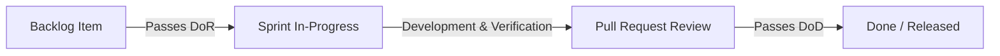
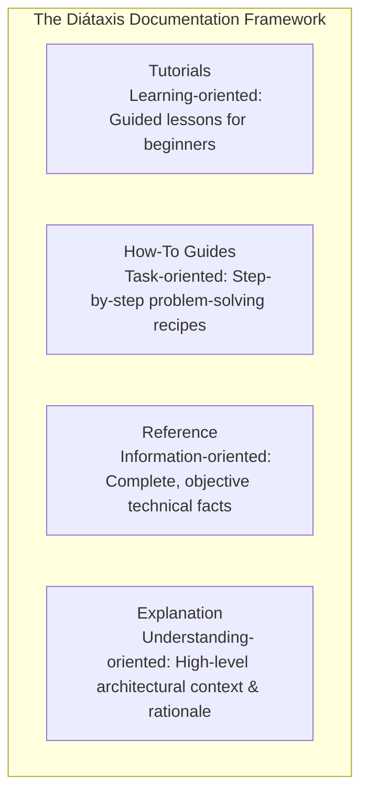
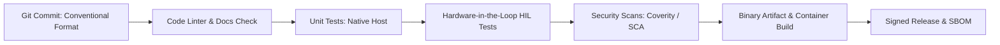

# Software development practices

Sustainable software systems depend on rigorous engineering practices that foster collaboration, preserve knowledge, and guarantee repeatable delivery. High-performing engineering teams combine proven design principles, pragmatic development methodologies, automated CI/CD pipelines, and Documentation as Code.

## 1. Foundational Software Engineering Principles

As detailed in [Fundamental Software Architecture Principles](../standards/software-architecture-principles.md), software design is governed by four timeless engineering tenets:

- **SOLID Principles**: Single Responsibility (SRP), Open-Closed (OCP), Liskov Substitution (LSP), Interface Segregation (ISP), and Dependency Inversion (DIP).
- **Don't Repeat Yourself (DRY)**: Centralizing business logic and schemas into single, authoritative definitions.
- **Keep It Simple (KISS)**: Prioritising straightforward, readable implementations over speculative, convoluted abstractions.
- **You Aren't Gonna Need It (YAGNI)**: Implementing functionality solely when justified by verified requirements.

## 2. Development Methodologies and Quality Gates

Engineering velocity requires clear operational cadence and non-negotiable quality criteria:

| Methodology | Primary Cadence | Workflow Management | Ideal Operational Fit |
| :--- | :--- | :--- | :--- |
| **Scrum** | Fixed-length iterations (1-3 weeks). | Backlog grooming, sprint planning, daily stand-up, retrospective. | Product feature teams with predictable sprint backlogs. |
| **Kanban** | Continuous flow. | Work-In-Progress (WIP) limits, cycle time optimisation. | Platform engineering, DevOps, support triage, infrastructure teams. |
| **Hybrid Scrumban** | Fixed cadence with continuous pull. | Sprint review with WIP limits on engineering boards. | Fast-paced hardware-software integration teams. |

[[CAPTION:Table]] Comparison of core agile development methodologies.

### Enforcing Quality Gates: DoR and DoD

To prevent defect leakage across sprint boundaries, teams enforce two explicit quality gates:

[[CAPTION:Figure]] Lifecycle progression through Definition of Ready and Definition of Done.

- **Definition of Ready (DoR)** ([Definition of Ready](../templates/definition-of-ready.md)): A user story or task cannot enter sprint development until it satisfies explicit preconditions: clear acceptance criteria, identified dependencies, wireframes/schemas provided, and business value articulated.
- **Definition of Done (DoD)** ([Definition of Done](../templates/definition-of-done.md)): A feature cannot be closed or released until it fulfills all technical criteria: passing unit and integration tests, code review sign-off ([Code review checklist](../templates/code-review-checklist.md)), zero static analysis violations, and documentation updated.

### Collaborative Review and Version Control Hygiene

Professional engineering teams maintain disciplined version control workflows:
- **Git Branching Strategy**: Trunk-based development or short-lived feature branches merged via Pull Requests ([Git](../guides/git/index.md)).
- **Conventional Commits**: Structuring commit messages using standardized prefixes (`feat:`, `fix:`, `docs:`, `refactor:`, `test:`, `ci:`) to enable automated changelog generation and semantic versioning ([Version control, commits and versioning](../guidelines/version-control-and-versioning.md)).
- **Structured Pull Requests**: Standardized PR descriptions detailing problem context, changes made, and verification steps ([Pull requests and code review](../guidelines/pull-requests-and-review.md)).

## 3. Documentation as Code and the Diátaxis Framework

Traditional documentation kept in disconnected corporate wikis rapidly suffers from documentation rot: out-of-sync with code, inaccessible to developers, and unreviewed.

The **Documentation as Code (Docs-as-Code)** approach ([Documentation as code and terminology](../guidelines/documentation-as-code.md)) treats documentation with the exact same rigor as production source code:
- Stored in plain text (Markdown) within version-controlled repositories.
- Authored alongside code changes within the same Pull Request.
- Validated via automated linters in CI (Vale, markdownlint, link checkers).
- Published automatically to searchable websites and printable PDF/DOCX documents via static site generators (MkDocs Material, Pandoc).

### The Diátaxis Documentation Framework

To serve different reader needs, documentation MUST be structured into the four Diátaxis quadrants:

[[CAPTION:Figure]] The four Diátaxis documentation modes.

- **Tutorials**: Practical, step-by-step learning journeys for newcomers (for example, "Getting Started with the Smart Gateway Firmware in 30 Minutes").
- **How-To Guides**: Direct recipes solving specific real-world tasks (for example, "How to Provision a New LwM2M Object in Zephyr RTOS").
- **Reference**: Objective, technical specifications (for example, "Complete HTTP Status Code Reference" or "LwM2M Object Registry").
- **Explanation**: Contextual essays illuminating architectural rationale and design choices (for example, "Why We Migrated from Monolith to Hexagonal Architecture").

### Diagrams as Code

Architectural diagrams MUST NOT be maintained as static binary images (PNG/Visio) that cannot be versioned or reviewed. Systems use declarative text-based diagramming tools:
- **Mermaid**: Native client-side rendering for sequence, state, and flowcharts.
- **PlantUML**: Standard for comprehensive UML and C4 component diagrams.
- **Structurizr DSL**: Single-source-of-truth modelling across all four C4 levels ([GD-001](../guides/c4-model/index.md)).

## 4. Continuous Integration and Testing Automation

World-class engineering teams build robust deployment pipelines that automate quality verification from commit to deployment:

[[CAPTION:Figure]] Comprehensive automated Continuous Integration pipeline.

### The Test Automation Pyramid

- **Unit Tests (Fast / High Volume)**: Running on native development workstations in milliseconds, validating algorithms and domain logic with isolated mocks.
- **Integration Tests (Medium Volume)**: Verifying communication contracts between microservices or RTOS tasks.
- **Hardware-in-the-Loop (HIL) Tests (Target Hardware)**: Flashing automated test firmware onto physical microcontrollers connected to automated relays, power monitors, and simulated network instruments to verify real-world hardware behaviour.

## Summary

Engineering excellence is the culmination of disciplined architecture, collaborative culture, and automated tooling. By adopting the principles, frameworks, and patterns set out across this handbook, teams deliver scalable, resilient, and enduring software systems.
