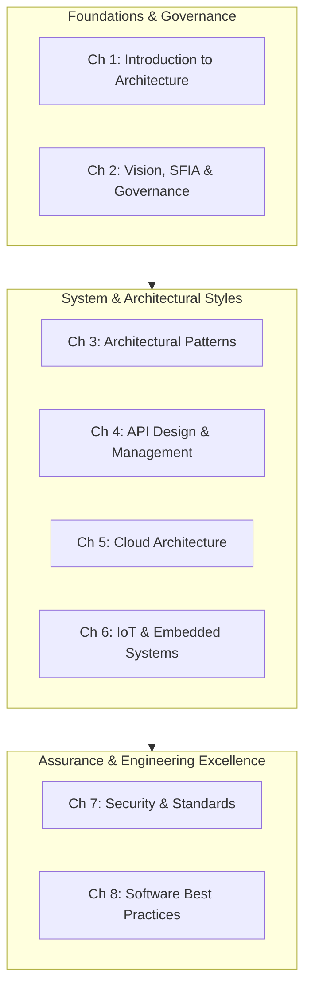

# Architecture Handbook

Welcome to the Systems and Software Architecture Handbook. This Handbook serves as a comprehensive reference manual for architects, technical leaders, and software engineers designing, building, and operating resilient systems across embedded firmware, edge appliances, and enterprise cloud platforms.

## Purpose and Scope

Modern systems rarely operate in isolation. A connected smart device comprises microcontroller firmware, localized mesh networks, edge gateways, cloud ingestion pipelines, and distributed analytics services. 

Designing such systems needs one mental model that spans both ends. At one end are hardware constraints such as CPU cycles, memory and battery budgets. At the other are cloud patterns such as eventual consistency, high availability and API governance.

This Handbook articulates proven engineering principles, architectural patterns, security standards, and governance models developed across 15+ years of strategic technical leadership.

## Chapters

The handbook is organised into eight thematic chapters:

| Chapter | Title | Primary Focus |
| :--- | :--- | :--- |
| **01** | [Introduction to Architecture](01-introduction-to-architecture.md) | Architecture definitions, architect roles, and frameworks (TOGAF, Arc42, 4+1). |
| **02** | [Architecture Vision and Principles](02-architecture-vision-and-principles.md) | Vision articulation, SFIA capability models, governance, and quality metrics (ATAM). |
| **03** | [Architectural Patterns](03-architecture-patterns.md) | Layered, Hexagonal, Modular Monoliths, Microservices, Event-Driven, and Edge IoT topologies. |
| **04** | [API Design and Management](04-api-design-and-management.md) | REST, gRPC, GraphQL, AsyncAPI, binary serialisation (Protobuf, CBOR), and gateways. |
| **05** | [Cloud Architecture](05-cloud-architecture.md) | Multi-cloud strategy, serverless, event streaming (Kafka), and Infrastructure as Code. |
| **06** | [IoT and Embedded Systems](06-iot-and-embedded-systems.md) | Embedded RTOS (FreeRTOS, Zephyr), edge compute, IoT protocols, and hardware security. |
| **07** | [Security and Standards](07-security-and-standards.md) | Threat modelling, ETSI EN 303 645, ISO/IEC 30141, SSDLC, and regulatory compliance (UK PSTI, EU CRA). |
| **08** | [Software Development Best Practices](08-software-development-best-practices.md) | SOLID, DRY, KISS, YAGNI, Agile governance, Docs-as-Code, and CI/CD pipelines. |

[[CAPTION:Table]] Architecture Handbook chapter summary and domain mapping.

[[CAPTION:Figure]] Conceptual architecture of the handbook domains.

## Target Audience

This Handbook is designed for:
- **Lead and Principal Architects**: Establishing enterprise standards, defining capability frameworks, and chairing Architecture Review Boards.
- **Solution and Cloud Architects**: Designing scalable distributed systems, microservices, and event-driven data streaming architectures.
- **Embedded and Firmware Engineers**: Implementing safety-critical, resource-constrained software on microcontrollers and IoT edge gateways.
- **Engineering Managers and Technical Directors**: Aligning technology initiatives with commercial outcomes and building high-performing teams.

## Related Guidelines and Standards

This Handbook operates alongside our core engineering guidelines:
- [ADR Authoring Guide](../guides/decision-records.md)
- [Software Detailed Specification Standard](../guides/software-design-specification.md)
- [Docs-as-Code Standard](../guidelines/documentation-as-code.md)
- [Architecture Review Board Guide](../guides/architecture-review-board.md)
- [Architecture Review Checklist](../templates/architecture-review-checklist.md)
- [Fundamental Software Architecture Principles](../standards/software-architecture-principles.md)
- [API Design and Error Management Standards](../standards/api-design.md)
- [Defect Management and Systematic Debugging Guide](../guides/defect-management-and-debugging.md)
- [C4 Model Guide for Embedded and Connected Systems](../guides/c4-model/index.md)
