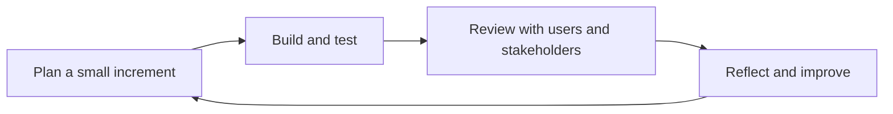

# Agile development

Agile development is a family of ways of working built on short cycles, working software and frequent feedback. Rather than planning everything up front, an agile team delivers a small, usable piece, learns from it, and adjusts. The term comes from the *Manifesto for Agile Software Development*, written in 2001 by seventeen practitioners who had each been developing lighter alternatives to heavyweight processes.

## The values

The manifesto states four preferences. Its authors value the items on the left more, while still valuing those on the right:

- Individuals and interactions over processes and tools.
- Working software over comprehensive documentation.
- Customer collaboration over contract negotiation.
- Responding to change over following a plan.

Twelve principles follow, including delivering working software frequently, welcoming changing requirements, keeping a sustainable pace, and reflecting regularly on how to become more effective. The full text is short and worth reading at [agilemanifesto.org](https://agilemanifesto.org/).

## The cycle

[[CAPTION:Figure]] The feedback loop at the heart of agile work.

## Common practices

- **A prioritised backlog**: one ordered list of work, with the most valuable items at the top, refined continuously.
- **User stories**: small descriptions of value from a user's point of view ("As a field engineer, I want to see a device's last contact time, so that I can tell if it is offline"), each with acceptance criteria.
- **Short iterations** of one to four weeks, or a continuous flow of small items.
- **Definitions of ready and done**: shared checklists for when work can start and when it is truly finished.
- **Daily coordination**: a short meeting on progress towards the goal and anything blocking it.
- **Reviews and retrospectives**: show the work to stakeholders; then discuss how the team itself can improve.
- **Technical practices**: [continuous integration](cicd-pipelines.md), automated [testing](testing-strategies.md), [code review](code-review.md) and refactoring. Without them, short cycles slowly fill with [technical debt](technical-debt.md).

## Frameworks

- **[Scrum and Kanban](scrum-vs-kanban.md)** are the two most common team-level approaches.
- **Extreme Programming (XP)** focuses on engineering practices: pair programming, test-driven development, continuous integration and simple design.
- **Lean software development** applies ideas from Toyota's production system: remove waste, limit work in progress, optimise the whole flow.
- **Scaling frameworks** such as SAFe, LeSS and Nexus coordinate many teams. They add structure and overhead, so use the lightest that works.

## Pitfalls

- **Ceremony without the point**: stand-ups, sprints and story points with no real feedback from users is "agile" in name only. See cargo cult programming in [anti-patterns](anti-patterns.md).
- **No architecture**: agile does not mean no design. Make the decisions that are hard to change early and record them as [ADRs](architecture-decision-records.md).
- **Hardware reality**: physical products have lead times and certification. Iterate on firmware, software and prototypes, and plan hardware milestones explicitly.

## Where next

- [Scrum and Kanban](scrum-vs-kanban.md) compares the two common frameworks.
- The [Templates](../templates/index.md) section has definition of ready and definition of done checklists.
