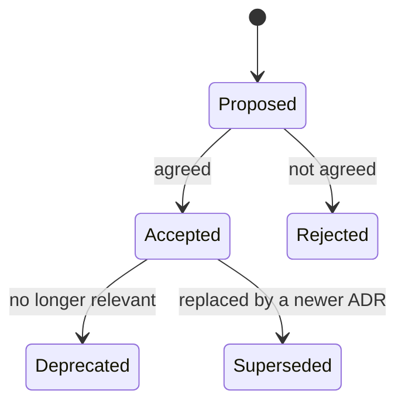

# Architecture decision records

An architecture decision record (ADR) is a short document that captures one significant decision, why it was made and what follows from it. A set of ADRs, kept in order next to the code, becomes the history of how a system got to be the shape it is.

## Why bother

Code shows what was built, but not why. Six months later nobody remembers why the team picked PostgreSQL over a document store, or why the gateway buffers messages rather than dropping them. Without that context, people either repeat old arguments or undo a decision without knowing what it protected. An ADR takes ten minutes to write and saves that.

ADRs also help new joiners: reading the decision log is one of the quickest ways to understand a system.

## What goes in one

Michael Nygard's original format is still the most common, and it is deliberately small:

| Section | What it says |
| --- | --- |
| Title | A short noun phrase, numbered: "ADR 7: Use MQTT for device telemetry" |
| Status | Proposed, accepted, deprecated or superseded (by which ADR) |
| Context | The forces at play: requirements, constraints, what has been tried |
| Decision | What we will do, in active voice: "We will..." |
| Consequences | What becomes easier, what becomes harder, what we now have to do |

[[CAPTION:Table]] The sections of a Nygard-style ADR.

Longer templates such as MADR add the options considered and the pros and cons of each. That is worth doing for a contested decision, and overkill for most.

## Lifecycle

An ADR is never edited once it is accepted, apart from its status. When a decision changes, write a new ADR that supersedes the old one and link the two. The log is append-only, so the reasoning at each point stays visible.

[[CAPTION:Figure]] The states an ADR moves through.

## What deserves an ADR

Write one when a decision is hard to reverse, affects more than one team or component, or was argued about. Typical examples are the choice of a database, a messaging protocol, an authentication scheme, a deployment platform, or a rule such as "all services publish events in CloudEvents format". Do not write one for every library upgrade.

## Practical tips

- Keep ADRs in the repository they describe, in a folder such as `docs/adr/`, numbered in order. Review them in pull requests like code.
- Write them when the decision is made, not afterwards. A proposed ADR is a good way to start the discussion.
- Keep each one to a page. If the context needs more, link to a design document or RFC.
- Tools such as `adr-tools` or `log4brains` help, but a text editor and a template are enough.

## Where next

- The [Templates](../templates/index.md) section has an ADR template ready to copy.
- The [Handbook](../handbook/index.md) covers how ADRs fit into architecture governance and review.
- Michael Nygard's 2011 post, [Documenting architecture decisions](https://cognitect.com/blog/2011/11/15/documenting-architecture-decisions), started the practice.
- [adr.github.io](https://adr.github.io/) collects templates and tools.
