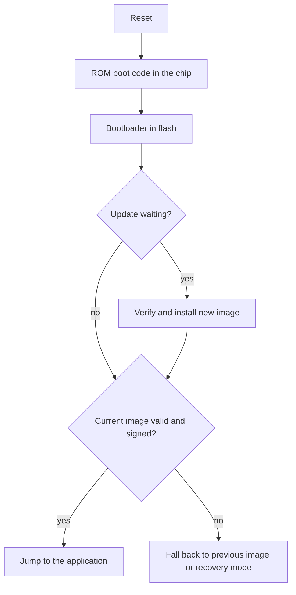

# Bootloaders

A bootloader is the first code that runs when a microcontroller starts. Its job is to check that the application firmware is present and trustworthy, start it, and, when asked, install a new version. Because the bootloader itself is rarely or never updated, it must be small, simple and correct the first time.

## What happens at power-on

[[CAPTION:Figure]] A typical boot sequence.

Many microcontrollers have a ROM bootloader from the vendor that can load firmware over UART or USB in the factory. The bootloader discussed here is your own, in flash, which runs on every start.

## Memory layouts for updates

| Layout | How it works | Trade-off |
| --- | --- | --- |
| Single slot | The bootloader receives the new image and overwrites the old one | Least flash; a failed write leaves the device without an application, so it needs a recovery path |
| Dual slot (A/B) with swap | The new image is written to a second slot; the bootloader swaps the slots and can swap back if the new image fails | Needs twice the space, or external flash for the second slot; safest |
| Dual slot, execute in place | Both slots can run; the bootloader picks the newer valid one | No copying; images must be built for their slot address |

[[CAPTION:Table]] Common flash layouts.

## Secure boot

Secure boot means the device runs only firmware signed by the manufacturer:

- The image is signed with a private key held securely by the build system (an HSM or a signing service).
- The bootloader holds the matching public key, or a hash of it, in memory that cannot be changed (one-time-programmable fuses or protected flash).
- At every start, the bootloader checks the signature (ECDSA P-256 and Ed25519 are common) before running the image.
- The bootloader itself is protected by the chip's own root of trust where the hardware supports it, giving a chain of trust from silicon to application.

Add **anti-rollback** protection with a security counter in the image, so an attacker cannot install an older version with a known vulnerability.

## Good habits

- Keep the bootloader small and its features few. Every feature is code you cannot easily fix.
- Mark a new image as "pending" and confirm it only after the application has started and connected successfully. If it never confirms, revert. This test-then-confirm step turns a bad update into a short outage instead of a dead device.
- Protect against power loss at every step of an update; assume the battery can fail mid-write.
- Enable the [watchdog](watchdog-timers.md) in the bootloader too.
- Use an established open-source bootloader rather than writing your own: MCUboot (used by Zephyr, Mbed and others) supports signing, encryption, A/B slots and rollback protection.

## Where next

- [Firmware over the air](firmware-over-the-air.md) covers getting the image to the device.
- [PKI and certificates](pki-and-certificates.md) and [cryptography basics](cryptography-basics.md) explain the signatures.
- The [MCUboot documentation](https://docs.mcuboot.com/) describes a well-tested design.
