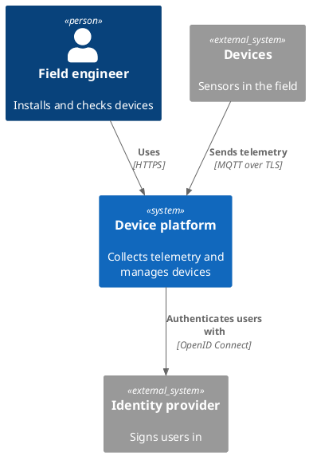

# The C4 model

The C4 model, created by Simon Brown, is a way of drawing software architecture as a set of maps at different levels of zoom. Each level answers a different question for a different reader, and each one is drawn with plain boxes and labelled arrows rather than a special notation.

## The four levels

| Level | Shows | Typical reader |
| --- | --- | --- |
| 1. System context | The system as one box, the people who use it and the other systems it talks to | Everyone, including non-technical stakeholders |
| 2. Container | The separately deployable or runnable parts: web app, API, database, message broker, device firmware | Architects, developers, operations |
| 3. Component | The main building blocks inside one container and how they interact | Developers working on that container |
| 4. Code | Classes, functions or tables inside one component | Rarely drawn by hand; generate it if you need it |

[[CAPTION:Table]] The four levels of the C4 model.

"Container" here means anything that runs or holds data on its own. It has nothing to do with Docker, which confuses people at first.

Most teams find the first two levels give most of the value. Component diagrams are useful for a complex container. Code diagrams go out of date as soon as they are drawn.

## A context diagram

[[CAPTION:Figure]] A level 1 system context diagram drawn with C4-PlantUML.

## Rules that make the diagrams work

- Every box has a name, a type and a one-line description of what it does.
- Every arrow is one-way and labelled with what flows and, at container level, how (protocol or technology).
- Every diagram has a title and a key if it uses colour or shape to mean something.
- One diagram per question. If a diagram needs a scroll bar, split it.

## Supporting diagrams

C4 also allows a few extra views when they help. A system landscape shows all the systems in an organisation; a dynamic diagram shows the sequence for one use case; a deployment diagram shows which containers run on which infrastructure.

## Tools

- **C4-PlantUML** adds C4 shapes to PlantUML. PlantUML's standard library includes it, so `!include <C4/C4_Container>` works without downloading anything.
- **Structurizr** keeps one model in a text file (the Structurizr DSL) and draws every view from it, so the levels never disagree.
- **Mermaid** has experimental C4 support, good enough for simple context diagrams.

## Where next

- [PlantUML and Mermaid](plantuml-and-mermaid.md) introduces diagrams as code.
- The [Handbook](../handbook/index.md) shows how C4 views fit into an architecture description, and the [Templates](../templates/index.md) section has starter diagrams.
- [c4model.com](https://c4model.com/) is the official guide.
