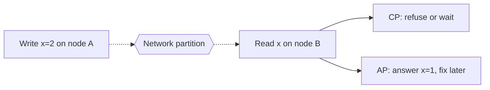

# CAP and PACELC

The CAP theorem and its extension, PACELC, describe the trade-off every replicated data store makes. They are often quoted loosely, so it is worth knowing what they actually say.

## CAP

Eric Brewer stated it as a conjecture in 2000, and Gilbert and Lynch proved it in 2002. A system that keeps copies of data on several nodes can offer at most two of these three at once:

- **Consistency (C)**: every read sees the most recent write, as if there were one copy. (This is linearisability, which is stricter than the C in ACID.)
- **Availability (A)**: every request to a working node gets a response.
- **Partition tolerance (P)**: the system keeps working when the network splits the nodes into groups that cannot reach each other.

Networks do partition, so P is not optional. The real choice is what to do during a partition:

- **CP**: refuse some requests (or time out) so that nobody reads stale data. Examples: etcd, ZooKeeper, a relational database with synchronous replication.
- **AP**: keep answering on both sides of the split and reconcile afterwards. Examples: Cassandra and DynamoDB in their default settings, DNS.

[[CAPTION:Figure]] During a partition, a read on the far side must either wait or risk being stale.

## PACELC

CAP only talks about the partition case, which is rare. Daniel Abadi's PACELC (2012) adds the normal case:

> If there is a **P**artition, choose **A**vailability or **C**onsistency; **E**lse, choose **L**atency or **C**onsistency.

Even with a healthy network, keeping replicas in step means waiting for other nodes before replying. Systems that answer from the nearest copy are faster but may return stale data.

| System (default settings) | During a partition | Normally | Class |
| --- | --- | --- | --- |
| Cassandra, DynamoDB | Availability | Latency | PA/EL |
| MongoDB | Consistency | Latency | PC/EL |
| Spanner, etcd | Consistency | Consistency | PC/EC |

[[CAPTION:Table]] Where some well-known stores sit. Most can be tuned per query.

## Using this in practice

- Decide per piece of data, not per system. An account balance needs consistency; a dashboard counter can be a few seconds stale.
- Read the store's documentation for its actual guarantees and tuning options (quorum reads and writes, read-your-writes sessions).
- If you choose availability, plan how conflicts are resolved: last writer wins, merge rules, or [CRDTs](consistency-models.md).
- IoT devices behave like the AP side by nature: they work offline and sync later. [Device shadows](digital-twins-and-device-shadows.md) are a way of reconciling.

## Where next

- [Consistency models](consistency-models.md) covers the options between "strong" and "eventual".
- Martin Kleppmann's *Designing Data-Intensive Applications* is the best single book on the subject, and his article [Please stop calling databases CP or AP](https://martin.kleppmann.com/2015/05/11/please-stop-calling-databases-cp-or-ap.html) explains the limits of CAP.
