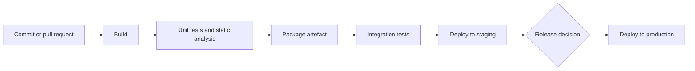

# CI/CD pipelines

CI/CD stands for continuous integration and continuous delivery (or deployment). Together they mean that every change is built, tested and made ready to release automatically, so releasing becomes routine rather than an event.

## The three practices

- **Continuous integration (CI)**: everyone merges small changes into the main branch at least daily, and every merge triggers an automated build and test. Problems show up within minutes, while the change is still fresh in the author's mind.
- **Continuous delivery**: every change that passes the pipeline produces a release candidate that *could* go to production at the press of a button.
- **Continuous deployment**: every change that passes goes to production automatically, with no manual step.

Many teams do continuous delivery for products that need a release decision (firmware, regulated software) and continuous deployment for web services.

## A typical pipeline

[[CAPTION:Figure]] The stages of a typical pipeline.

- **Build once**: produce one artefact (a container image, a firmware image, a package) and promote that same artefact through every environment. Rebuilding for production means testing something different from what you ship.
- **Fail fast**: run the quickest checks first so most failures report in a few minutes.
- **Keep the main branch releasable**: a red build is the team's top priority.

## What belongs in the pipeline

- Compilation and unit tests.
- [Static analysis](static-code-analysis.md), formatting and linting.
- Security checks: dependency vulnerability scanning, secret scanning, container image scanning, a software bill of materials (SBOM).
- Integration, contract and end-to-end tests, as far as they stay reliable. Flaky tests destroy trust in the pipeline, so fix or remove them.
- For embedded products, [hardware-in-the-loop tests](hardware-in-the-loop-testing.md) on real boards, and image signing.
- Deployment, with automatic rollback or a quick manual one.

## Deployment strategies

| Strategy | How it works | Good for |
| --- | --- | --- |
| Rolling | Replace instances a few at a time | Stateless services |
| Blue-green | Run the new version next to the old and switch traffic at once | Fast rollback |
| Canary | Send a small share of traffic (or devices) to the new version first, then widen | Catching problems with real use; firmware rollouts |
| Feature flags | Deploy code switched off; turn it on separately | Separating deployment from release |

[[CAPTION:Table]] Common ways to release a new version.

## Tools

GitHub Actions, GitLab CI, Jenkins and Azure Pipelines are general CI servers; Argo CD and Flux deploy to Kubernetes from Git (GitOps). Pipeline definitions are code: keep them in the repository and review them like any other change.

## Measuring it

The DORA metrics are a good check on whether delivery is improving: deployment frequency, lead time for changes, change failure rate and time to restore service.

## Where next

- [Infrastructure as code](infrastructure-as-code.md) applies the same discipline to environments.
- [Git practices](git-best-practices.md) covers the branching that CI depends on.
- The [Guides](../guides/index.md) section covers CI setup in more detail.
