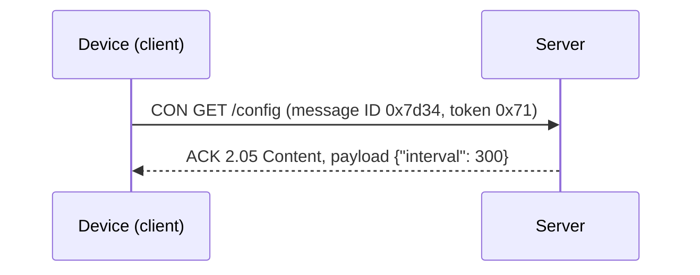

# CoAP

CoAP (the Constrained Application Protocol, RFC 7252) brings the web's request-response model to devices too small or too power-limited for HTTP. It has the same ideas as [REST](rest-apis.md) (resources with URIs, `GET`, `POST`, `PUT`, `DELETE`, response codes and content types) but runs over UDP with a 4-byte fixed header. A complete request often fits in a single small packet.

## Why UDP

TCP needs a handshake before any data flows and keeps state for every connection, which costs time, energy and memory. On a lossy radio link or a cellular modem that sleeps most of the time, that overhead dominates. CoAP over UDP can send one packet, get one reply, and go back to sleep. It adds its own lightweight reliability where needed.

## Messages

| Type | Meaning |
| --- | --- |
| CON (confirmable) | Must be acknowledged; resent with exponential backoff until it is |
| NON (non-confirmable) | Fire and forget, for frequent readings where loss is acceptable |
| ACK | Acknowledges a CON message, and can carry the response with it ("piggybacked") |
| RST (reset) | The receiver could not process the message |

[[CAPTION:Table]] The four CoAP message types.

[[CAPTION:Figure]] A confirmable request with a piggybacked response.

Response codes follow HTTP's classes in a compact form: 2.05 Content, 2.04 Changed, 4.04 Not Found, 5.03 Service Unavailable.

## Features

- **Observe** (RFC 7641): a client registers interest in a resource and the server sends a notification whenever it changes. This gives publish-subscribe behaviour without a broker.
- **Block-wise transfer** (RFC 7959): splits large payloads, such as firmware images, into blocks that fit in small packets.
- **Discovery**: `GET /.well-known/core` lists the resources a device offers.
- **Proxies**: CoAP maps cleanly to HTTP, so a gateway can translate between the two.
- **Content formats**: numeric codes for media types, with [CBOR](cbor.md) and SenML commonly used for payloads.

## Security

CoAP is secured with DTLS (TLS for datagrams), using pre-shared keys, raw public keys or certificates; see [TLS and DTLS](tls-and-dtls.md). DTLS 1.2 Connection ID (RFC 9146) lets a session survive the address changes that happen when a cellular device wakes from sleep, which avoids a full handshake every time. OSCORE (RFC 8613) protects the CoAP message itself, end to end, even through proxies.

## CoAP or MQTT

| | CoAP | [MQTT](mqtt.md) |
| --- | --- | --- |
| Model | Request-response, plus observe | Publish-subscribe through a broker |
| Transport | UDP (TCP and WebSockets also defined) | TCP |
| Best for | Sleepy, battery-powered devices on lossy or cellular links | Devices with steady connections and many-to-many messaging |
| Device management | Through [LwM2M](lwm2m.md) | Your own conventions |

[[CAPTION:Table]] CoAP and MQTT compared.

## Where next

- [LwM2M](lwm2m.md) builds device management on top of CoAP.
- [Cellular LPWAN](cellular-lpwan.md) explains the networks CoAP suits best.
- Libraries include libcoap (C), Californium (Java), aiocoap (Python) and the CoAP support in Zephyr.
