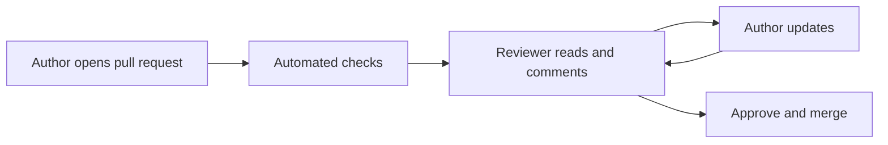

# Code review

Code review is the practice of having someone other than the author read a change before it is merged. It catches defects, but that is not its only or even its main value. It also spreads knowledge of the code across the team, keeps the codebase consistent, and helps people learn from each other.

## What to look for

In rough order of importance:

1. **Does it do the right thing?** Does the change meet its purpose? Are edge cases and errors handled?
2. **Design**: does it fit the architecture? Is it in the right place? Is it simpler than it could be?
3. **Security**: is untrusted input validated? Are secrets kept out? See [secure coding practices](secure-coding-practices.md).
4. **Tests**: are there tests for the new behaviour, and do they test the right things?
5. **Readability**: will the next person understand it? Are names clear? Are comments explaining why, not what?
6. **Consistency** with the conventions of the codebase.

Leave formatting, style and simple bug patterns to tools ([linters, formatters and static analysis](static-code-analysis.md)) in the [CI pipeline](cicd-pipelines.md), so that people review what only people can.

## Making reviews work

**For authors:**

- Keep changes small. Review quality drops sharply once a change passes a few hundred lines.
- Explain what and why in the pull request description, and how you tested it.
- Review your own diff first.
- Separate refactoring from behaviour changes.

**For reviewers:**

- Respond quickly; waiting for review is one of the biggest delays in delivery.
- Be specific and kind. Comment on the code, not the person. Ask questions rather than make demands where you are not sure.
- Label the weight of each comment: a blocking problem, a suggestion, or a nit that the author can ignore.
- Approve when the change makes the code better, even if it is not how you would have written it.

[[CAPTION:Figure]] The usual pull-request review loop.

## Variations

- **Pull-request review**: the usual asynchronous form on GitHub, GitLab or similar.
- **Pair programming**: continuous review while writing the code.
- **Walkthroughs and inspections**: the author presents to a group. Formal inspections (Fagan inspections) with checklists and roles are still used for safety-critical code.
- **Design review**: reviewing an approach before the code exists saves the most rework. Use an [ADR](architecture-decision-records.md) or RFC.

## Measuring it

Watch time to first review and time to merge. Do not count comments or defects found per reviewer: that turns review into a contest.

## Where next

- The [Templates](../templates/index.md) section has a code review checklist and a pull-request template.
- The [Guidelines](../guidelines/index.md) section sets the review rules used here.
- Google's [engineering practices guide to code review](https://google.github.io/eng-practices/review/) is a clear, practical reference.
