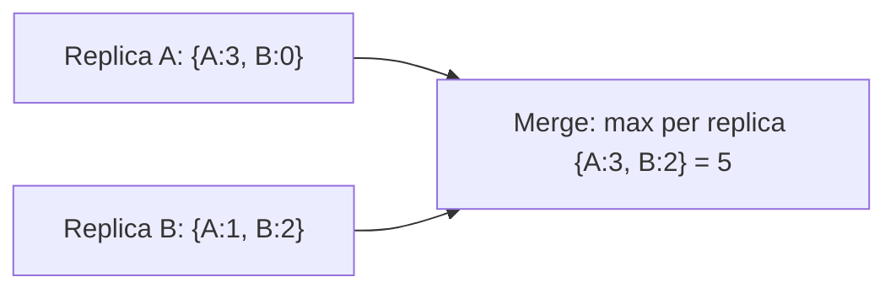

# Consistency models

A consistency model is the contract a data store makes about what a reader can see after a write. Stronger models are easier to write code against and cost more in latency and availability (see [CAP and PACELC](cap-and-pacelc.md)). Weaker models are faster and keep working during failures, but push work onto the application.

## From strongest to weakest

| Model | Guarantee | Typical cost |
| --- | --- | --- |
| Linearisable (strong) | Every read sees the latest write, as if there were one copy | Coordination on every write; unavailable during partitions |
| Sequential | Everyone sees operations in the same order, though not necessarily in real time | Still needs coordination |
| Causal | If one write caused another, everyone sees them in that order; unrelated writes may appear in any order | Track dependencies |
| Read-your-writes | A client always sees its own earlier writes | Session affinity or version tracking |
| Monotonic reads | A client never sees data go backwards in time | Session affinity |
| Eventual | If writes stop, all replicas eventually agree | Cheapest; readers may see stale or conflicting data |

[[CAPTION:Table]] Common consistency models.

The middle models are often the useful ones. "Eventual consistency plus read-your-writes" is enough for most user-facing features: users see their own changes at once, and other people's changes shortly after.

## Living with eventual consistency

- Show that data may be stale ("last updated 30 seconds ago") rather than pretending it is live.
- Make writes [idempotent](idempotency.md) so retries and duplicates are harmless.
- Decide how to resolve conflicts when two replicas accept different writes. Options include last writer wins (simple, loses data), keeping both and asking a person, application-specific merge rules, or CRDTs.

## CRDTs

A conflict-free replicated data type (CRDT) is a data structure whose replicas can be changed independently. They always merge to the same result, whatever order the updates arrive in. No coordination is needed.

Simple examples:

- **G-Counter** (grow-only counter): each replica keeps its own count; the value is the sum; merging takes the maximum per replica.
- **PN-Counter**: two G-Counters, one for increments and one for decrements.
- **OR-Set** (observed-remove set): elements can be added and removed, with adds winning over concurrent removes.
- **LWW-Register**: a single value where the latest timestamp wins.

[[CAPTION:Figure]] Merging a grow-only counter.

CRDTs are used in collaborative editors, shopping carts, offline-first mobile apps and some databases (Riak, Redis Enterprise, Automerge and Yjs libraries). They suit devices that work offline and sync later. Their cost is extra metadata and the need to design the data model around them.

## Where next

- [The saga pattern](saga-pattern.md) handles consistency across services.
- The [Handbook](../handbook/index.md) covers data ownership and replication choices.
- [crdt.tech](https://crdt.tech/) collects papers and implementations.
