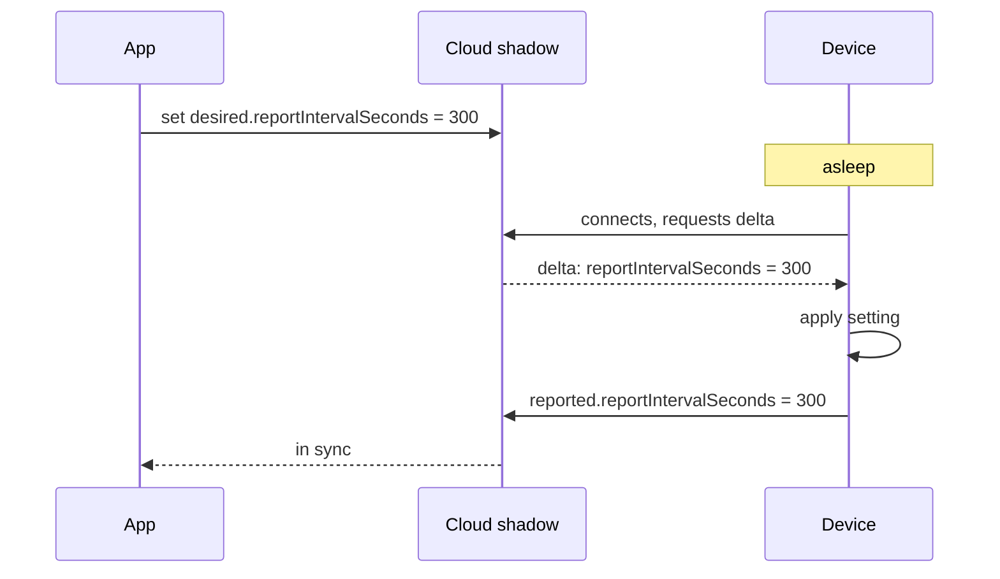

# Digital twins and device shadows

A connected device is often asleep, out of coverage or busy. Applications still need to read its state and change its settings. A device shadow (Microsoft calls it a device twin) solves this with a copy of the device's state in the cloud, which applications can always reach. The device and the shadow catch up with each other whenever the device connects.

A digital twin is the broader idea: a model of a physical thing, kept in step with it, that can be queried, analysed or simulated. A shadow is the simplest kind of digital twin.

## Desired and reported state

The shadow holds two views of the same settings:

- **Desired**: what applications want the device to be. Written by the cloud side.
- **Reported**: what the device says it is. Written only by the device.

The difference between them (the delta) is the work the device still has to do.

```json
{
  "state": {
    "desired":  { "reportIntervalSeconds": 300, "firmware": "2.4.1" },
    "reported": { "reportIntervalSeconds": 900, "firmware": "2.4.0", "battery": 71 }
  },
  "version": 42,
  "timestamp": 1760000000
}
```

[[CAPTION:Figure]] A shadow document with a pending change to two settings.

## The reconciliation loop



[[CAPTION:Figure]] A setting applied the next time the device wakes.

The device applies what it can and reports what it actually did. If a setting is invalid, it reports its real value and, ideally, an error field, so the delta stays visible rather than being silently ignored.

## Getting the details right

- **Versions**: every update carries the version it was based on, and the service rejects stale updates. This stops two writers overwriting each other.
- **Idempotency**: the device may receive the same delta twice. Applying it again must do no harm. See [idempotency](idempotency.md).
- **Size**: keep the shadow to configuration and a small summary of status. Telemetry belongs in a time-series store, not in the shadow.
- **Ownership**: only the device writes `reported`; only applications write `desired`. Mixing them makes the state impossible to reason about.
- **Commands are different**: "reboot now" is not a state. Use a command or job mechanism for one-off actions.

## Implementations

| Option | Notes |
| --- | --- |
| AWS IoT Device Shadow | Shadows over MQTT topics; named shadows for separate concerns |
| Azure IoT Hub device twins | Desired and reported properties, plus tags for querying fleets |
| Eclipse Ditto | Open-source digital twin service for self-hosted platforms |
| LwM2M | The server's view of each device's objects plays the same role; see [LwM2M](lwm2m.md) |
| W3C Web of Things | A standard Thing Description format for describing what a device offers |

[[CAPTION:Table]] Common ways to implement shadows and twins.

## Where next

- [Edge computing for IoT](edge-computing-for-iot.md) covers where the reconciliation logic can run.
- The [Handbook](../handbook/index.md) covers device management architecture in more depth.
