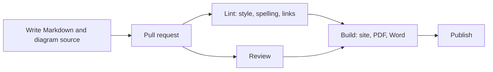

# Docs as code

Docs as code means writing and managing documentation with the same tools and habits as software. The files are plain text in version control, changes go through reviewed pull requests, and a build pipeline checks and publishes them. Documentation then lives next to the code it describes, changes with it, and gets the same care.

This site is built that way: the pages are Markdown in a Git repository, checked by a linter, and built into a website, Word files and PDFs by [py-doc](https://github.com/markbac/py-doc).

## Why it works

- **Close to the code**: the person changing the code can update the docs in the same pull request, and reviewers can see if they did not.
- **History and review**: every change is tracked, attributed and reviewable.
- **Automation**: spelling, style, broken links and diagrams are checked on every change; publishing needs no manual steps.
- **One source, many outputs**: the same Markdown can build a website, a PDF and a Word document.
- **Familiar tools** for developers, so they are more likely to contribute.

## The pieces

[[CAPTION:Figure]] A docs-as-code pipeline.

| Piece | Common choices |
| --- | --- |
| Markup | Markdown (CommonMark or pandoc flavour), AsciiDoc, reStructuredText |
| Diagrams | [PlantUML and Mermaid](plantuml-and-mermaid.md), Structurizr for [C4](c4-model.md) |
| Site generators | MkDocs with the Material theme, Docusaurus, Sphinx, Antora, Astro Starlight |
| Other outputs | pandoc for Word and PDF |
| Style and spelling checks | Vale, markdownlint, cSpell |
| API reference | Generated from [OpenAPI or AsyncAPI](openapi-and-asyncapi.md) descriptions, or from code comments |
| Hosting | GitHub Pages, GitLab Pages, Read the Docs, any static host |

[[CAPTION:Table]] Typical tools for each part.

## Good habits

- **Structure by purpose**. The Diátaxis framework separates four kinds of documentation (tutorials, how-to guides, reference and explanation), because readers need each in a different mood. This site's sections follow similar lines.
- **Write diagrams as text** so they can be reviewed and kept current.
- **Make documentation part of done**: a feature is not finished until its docs are updated.
- **Lint for consistency**: a shared style guide enforced by a tool avoids arguments in review.
- **Keep decisions as [ADRs](architecture-decision-records.md)** in the same repository.
- **Give pages owners**, and review them periodically for accuracy.

## Limits

Non-technical contributors may find Git and Markdown a barrier; a web editor that opens pull requests helps. Highly designed documents, such as marketing material, are better made with other tools.

## Where next

- [Git practices](git-best-practices.md) covers the version control underneath.
- The [Guides](../guides/index.md) section covers how documentation is written and published here.
- [Docs Like Code](https://www.docslikecode.com/) and [diataxis.fr](https://diataxis.fr/) are good starting points.
