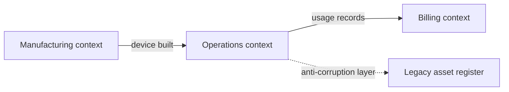

# Domain-driven design

Domain-driven design (DDD), from Eric Evans' 2003 book of the same name, is an approach to building software for complicated business areas. It puts the business domain, and the language the experts use for it, at the centre of the design. It has two halves: strategic design, which is about boundaries between parts of a system, and tactical design, which is about the code inside one part.

## Ubiquitous language

The team (developers and domain experts together) agrees one vocabulary and uses it everywhere: in conversation, in tickets, in class names and in database tables. If the experts say "commissioning" a device, the code has a `commission()` method, not `activateUnit()`. When a word turns out to mean two things, that is a sign there are two contexts.

## Strategic design

- **Bounded context**: a part of the system inside which every term has one meaning. "Device" in the manufacturing context (a serial number, a test result) is not the same as "device" in the operations context (a location, a firmware version, a last-seen time). Each context has its own model and usually its own team and codebase.
- **Context map**: a picture of the bounded contexts and how they relate: which one is upstream, which conforms to which, where an anti-corruption layer translates between models.
- **Subdomains**: the core domain is where the business competes and deserves the best people. Supporting and generic subdomains (billing, user accounts) can often be bought or kept simple.

[[CAPTION:Figure]] A simple context map.

Bounded contexts are the usual starting point for service boundaries. See [modular monolith or microservices](modular-monolith-vs-microservices.md).

## Tactical design

| Building block | What it is |
| --- | --- |
| Entity | An object with an identity that lasts over time (a device, an order) |
| Value object | An object defined only by its values, and immutable (a temperature, an address) |
| Aggregate | A cluster of objects changed together as one unit, with one root that guards its rules |
| Repository | Loads and saves whole aggregates, hiding storage |
| Domain event | A record of something that happened that the business cares about ("Device commissioned") |
| Domain service | Logic that does not belong to any one entity |

[[CAPTION:Table]] The tactical building blocks.

The most useful rule is about aggregates: change only one aggregate per transaction, and refer to other aggregates by their identity. This keeps transactions small and makes it possible to split the system later.

## When it is worth it

DDD pays off when the business rules are complicated and the domain experts are available to talk to. For a simple data-entry application it is too much. Many teams use the strategic ideas (language, contexts) everywhere and the tactical patterns only in the core domain.

## Where next

- [Event storming](event-storming.md) is a workshop for discovering domain events and contexts.
- [Hexagonal architecture](hexagonal-architecture.md) keeps the domain model free of infrastructure.
- The [Handbook](../handbook/index.md) covers domain modelling and service boundaries in more depth.
- Vaughn Vernon's *Domain-Driven Design Distilled* is the shortest good introduction.
