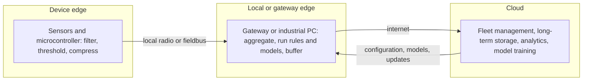

# Edge computing for IoT

Edge computing means processing data close to where it is produced, on the device or on a gateway nearby, rather than sending everything to the cloud. In an IoT system it answers the question of where each piece of logic should run.

## Why process at the edge

- **Latency**: a safety cut-off or a control loop cannot wait for a round trip to a data centre.
- **Bandwidth and cost**: a vibration sensor can produce megabytes a minute. Sending a summary or an alert instead saves airtime, cellular data and cloud storage.
- **Resilience**: a site must keep working when its internet connection fails, and catch up afterwards.
- **Privacy and data rules**: raw video or personal data may need to stay on site, with only anonymised results leaving it.
- **Power**: for battery devices, computing a result locally often uses less energy than transmitting the raw data.

## The tiers

[[CAPTION:Figure]] Where processing can happen.

| Tier | Typical hardware | Good for |
| --- | --- | --- |
| Device | Microcontroller, a few hundred kilobytes of RAM | Filtering, thresholds, simple anomaly detection, small machine-learning models (TinyML) |
| Gateway or on-premises | Linux gateway, industrial PC, small server | Protocol translation, aggregation across devices, local dashboards and control, larger models, store and forward |
| Cloud | Elastic compute and storage | Fleet-wide analytics, training models, history, integration with business systems |

[[CAPTION:Table]] What each tier is good at.

## Patterns

- **Filter and aggregate**: send minimum, maximum and mean per minute instead of every sample; send changes rather than repeated values.
- **Store and forward**: buffer data locally during an outage and upload it, with original timestamps, when the link returns.
- **Local control loop**: the edge acts on its own and reports what it did; the cloud sets the rules.
- **Protocol gateway**: translate local protocols (Modbus, BACnet, Bluetooth LE, Zigbee) into [MQTT](mqtt.md) or [LwM2M](lwm2m.md) for the cloud.
- **Inference at the edge, training in the cloud**: models are trained centrally on fleet data and pushed to the edge.
- **Shadow and reconcile**: the cloud holds the desired configuration and the edge converges on it; see [digital twins and device shadows](digital-twins-and-device-shadows.md).

## The costs

Edge computing moves complexity rather than removing it. Edge software must be deployed, updated, monitored and secured on hardware you may not be able to reach. Plan for:

- Remote software deployment and rollback (containers on gateways; [firmware over the air](firmware-over-the-air.md) on devices).
- Physical security: edge hardware can be stolen or opened. Use secure boot and encrypted storage.
- Clock synchronisation, so data from different devices lines up.
- Monitoring of the edge itself, not just the data it sends.

Platforms such as AWS IoT Greengrass, Azure IoT Edge, KubeEdge, and lightweight Kubernetes distributions (k3s) help run and update software on gateways.

## Where next

- [Embedded systems design](embedded-systems-design.md) covers the device tier.
- The [Handbook](../handbook/index.md) covers edge and platform architecture in more depth.
