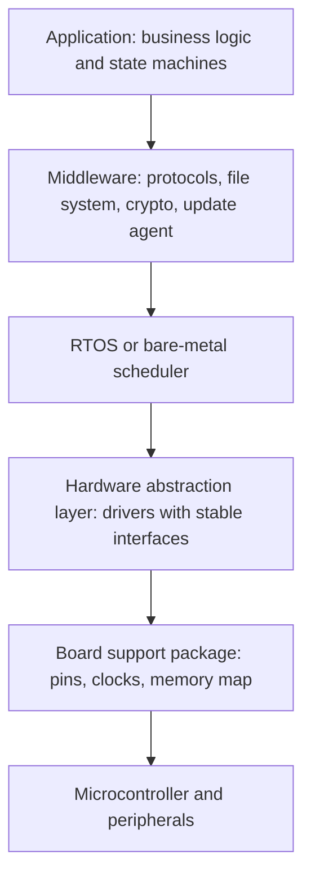

# Embedded systems design

Embedded software runs on hardware chosen for cost, size and power, not for the programmer's convenience. A typical microcontroller has tens or hundreds of kilobytes of RAM, a megabyte or two of flash, no memory management unit and no operating system unless you add one. The design has to fit the hardware, meet deadlines, survive faults on its own and, for many products, run for years on a battery.

## What makes it different

- **Fixed resources**: memory and CPU are fixed at manufacture. Running out is a design failure, not something to fix by adding a server.
- **Real time**: many tasks have deadlines (sample this sensor every millisecond, stop the motor within 10 ms). Being late is as bad as being wrong.
- **Direct hardware access**: the software drives peripherals through registers and interrupts.
- **No one to help**: a device in the field must detect and recover from faults by itself.
- **Long life**: products stay in service for ten years or more, so code must be maintainable and updatable.

## A layered structure

[[CAPTION:Figure]] Typical firmware layers.

The hardware abstraction layer (HAL) is the most important boundary. Application code calls `sensor_read()`, not a register address. That lets the same logic run on a new board, or on a PC for unit tests. It is the embedded form of [hexagonal architecture](hexagonal-architecture.md).

## Bare metal or RTOS

Simple devices run a "superloop": one `while (1)` loop that polls inputs and runs a [state machine](finite-state-machines.md), with interrupts for urgent events. Once there are several independent activities with different timing needs, a real-time operating system makes the design clearer. See [real-time operating systems and FreeRTOS](rtos-and-freertos.md).

## Memory

- Prefer static allocation. `malloc` on a small heap leads to fragmentation and failures that only appear after weeks of running.
- If dynamic allocation is needed, use fixed-size pools.
- Measure stack use per task and leave a margin. Stack overflow is a common cause of odd crashes.
- Know where every buffer lives and how big it can grow.

## Power

Battery life is decided by how long the device sleeps, not by how fast it runs:

- Do the work quickly, then enter the deepest sleep mode the hardware allows.
- Wake on interrupts and timers instead of polling.
- Turn off peripherals and radios when not in use; the radio is usually the biggest consumer.
- Measure current over a whole duty cycle with a power analyser. Estimates are always optimistic.

## Reliability

- Use a [watchdog timer](watchdog-timers.md) to recover from hangs.
- Check every return code; decide what the device does when a peripheral fails.
- Detect brown-outs and protect flash writes from power loss.
- Plan [firmware updates](firmware-over-the-air.md) and a safe [bootloader](bootloaders.md) from the start.
- For safety-related code, follow a coding standard such as MISRA C and use [static analysis](static-code-analysis.md).

## Where next

- [Interrupts and DMA](interrupts-and-dma.md) covers how firmware reacts to hardware.
- The [Guides](../guides/index.md) section has embedded coding guidance, and the [Handbook](../handbook/index.md) covers device architecture.
