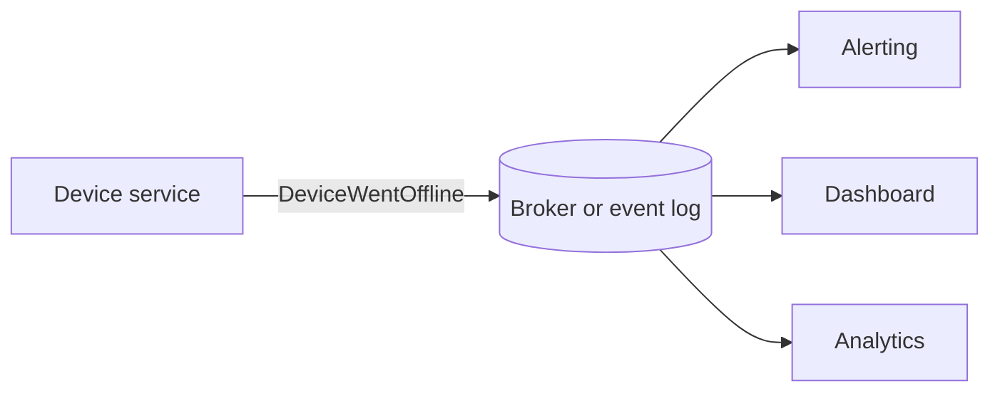

# Event-driven architecture

In an event-driven architecture (EDA), components announce that something has happened, and other components react if they care. The producer of an event does not know who consumes it. That loose coupling is the main benefit, and also the main source of difficulty.

## Events, commands and queries

| Message | Meaning | Example |
| --- | --- | --- |
| Event | A fact about the past; cannot be refused | `DeviceWentOffline` |
| Command | A request for something to happen; can fail or be rejected | `RebootDevice` |
| Query | A request for information | `GetDeviceStatus` |

[[CAPTION:Table]] Three kinds of message.

Name events in the past tense. A message called `UpdateDevice` is a command in disguise, and treating it as an event hides who is responsible for the outcome.

## The building blocks

[[CAPTION:Figure]] One producer, several independent consumers.

- **Producers** publish events.
- **The channel** carries them: a message broker (MQTT, RabbitMQ, a cloud pub/sub service) or an event log ([Kafka](kafka-event-streaming.md)). A log keeps events so new consumers can replay history; a broker usually forgets a message once it is delivered.
- **Consumers** subscribe and react. Each can be deployed, scaled and fail on its own.

## Common patterns

- **Event notification**: the event says only that something changed; the consumer calls back for details. Small events, but more coupling at run time.
- **Event-carried state transfer**: the event carries the data the consumers need, so they keep their own copy and do not call back.
- **Event sourcing**: the events are the system of record. The current state is rebuilt by replaying them. Powerful for audit and debugging, and complicated to run.
- **CQRS (Command Query Responsibility Segregation)**: separate models for writing and reading, often fed by events. Useful when reads and writes have very different shapes or loads.

## What gets harder

- **Consistency**: consumers see changes later than the producer. Design for [eventual consistency](consistency-models.md).
- **Duplicates and order**: most brokers deliver at least once and order only within a partition or topic. Make consumers [idempotent](idempotency.md).
- **Tracing**: a business flow is spread across many services. Use correlation IDs and distributed tracing from the start.
- **Schema change**: events are a public contract. Version them, add fields rather than changing them, and keep a schema registry or [AsyncAPI](openapi-and-asyncapi.md) description.
- **Multi-step workflows**: when several services must all succeed or all undo, use a [saga](saga-pattern.md).

## When it fits

EDA suits systems where many parties react to the same facts: IoT telemetry, notifications, audit trails, integrations between teams. For a simple request that needs an answer now, a direct API call is easier to understand.

## Where next

- [Domain-driven design](domain-driven-design.md) helps find the events that matter.
- The [Handbook](../handbook/index.md) covers messaging and integration patterns.
- Martin Fowler's talk and article [What do you mean by "Event-Driven"?](https://martinfowler.com/articles/201701-event-driven.html) separates the four patterns above.
