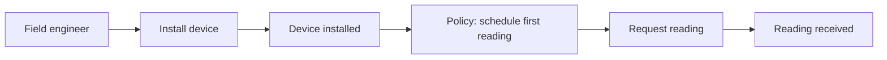

# Event storming

Event storming is a workshop technique, created by Alberto Brandolini, for exploring a business domain quickly with everyone who knows something about it. The group maps out the events that happen in the domain on a long wall using sticky notes of different colours. In a few hours it builds a shared picture that would take weeks of interviews and documents, and it surfaces disagreements and unknowns early.

## Who and what

- **People**: domain experts, developers, testers, product owners, operations, anyone with knowledge or questions. Between six and fifteen people works well.
- **Space**: a long wall with a roll of paper, or an online whiteboard such as Miro.
- **A facilitator** who keeps the energy up and the discussion moving, but does not supply the answers.

## The notes

| Colour (by convention) | Element | Example |
| --- | --- | --- |
| Orange | Domain event: something that happened, in the past tense | Device installed |
| Blue | Command: the action or decision that caused it | Install device |
| Yellow (small) | Actor: who issued the command | Field engineer |
| Lilac | Policy: a rule that reacts to an event ("whenever...") | When a device is installed, schedule a first reading |
| Pink | External system | Mobile network |
| Green | Read model: information someone needs to decide | Job list for today |
| Large yellow | Aggregate: the thing that accepts commands and produces events | Device |
| Red or hot pink | Hot spot: a problem, question or disagreement | "Who confirms the install?" |

[[CAPTION:Table]] The usual sticky-note colours and what they mean.

## The flow of a session

1. **Chaotic exploration**: everyone writes domain events and puts them on the wall, roughly in time order. No discussion yet.
2. **Enforce the timeline**: arrange the events into a single sequence, merge duplicates and argue about the order. This is where the most learning happens.
3. **Mark hot spots** wherever there is confusion or conflict. Do not resolve them all; record them.
4. **Add commands, actors, policies and external systems** to explain what triggers each event.
5. **Find the boundaries**: look for clusters of events that belong together and pivotal events where the language changes. These suggest [bounded contexts](domain-driven-design.md) and possible service boundaries.

[[CAPTION:Figure]] A fragment of a process-level model.

## Levels

- **Big picture**: the whole business flow, to understand the landscape and find the hot spots and boundaries.
- **Process modelling**: one process in detail, with commands, policies and read models.
- **Software design**: aggregates and their rules, ready to drive code.

## Tips

- Start with events, not systems or screens. "What happens?" is easier to answer than "what do we build?".
- Invite the people who disagree.
- Photograph the wall and keep the hot-spot list; the questions are often the most valuable output.
- Follow up with the actual decisions as [ADRs](architecture-decision-records.md).

## Where next

- [Domain-driven design](domain-driven-design.md) and [event-driven architecture](event-driven-architecture.md) turn the results into a design.
- Brandolini's [eventstorming.com](https://www.eventstorming.com/) and his book *Introducing EventStorming* describe the method in full.
