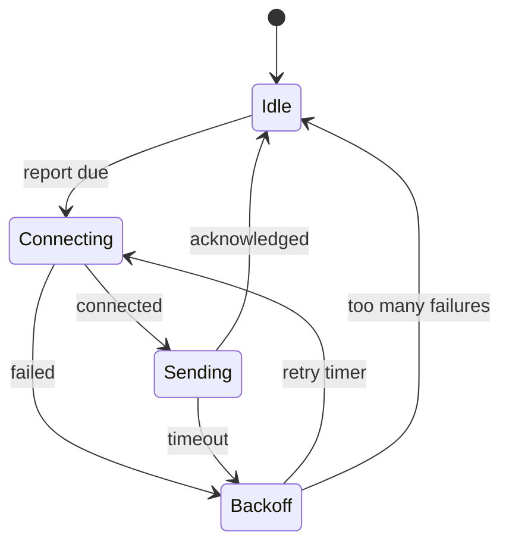

# Finite state machines

A finite state machine (FSM) describes behaviour as a fixed set of states, the events that can happen, and the transitions between states that each event causes. Most embedded devices are state machines whether or not anyone drew one: a device that is booting, connecting, connected, updating or sleeping behaves differently in each case. Making the states explicit replaces a tangle of flags and `if` statements with something you can draw, review and test.

## An example



[[CAPTION:Figure]] The connection logic of a reporting device.

Every combination of state and event has a defined outcome, even if that outcome is "ignore it". Asking "what happens if a timeout arrives while idle?" is how state machines find bugs before the code exists.

## Implementing one in C

The simplest form is a `switch` on the current state, with events passed in:

```c
typedef enum { IDLE, CONNECTING, SENDING, BACKOFF } state_t;
typedef enum { EV_REPORT_DUE, EV_CONNECTED, EV_FAILED, EV_ACK, EV_TIMEOUT, EV_RETRY } event_t;

static state_t state = IDLE;

void fsm_handle(event_t ev)
{
    switch (state) {
    case IDLE:
        if (ev == EV_REPORT_DUE) { modem_connect(); state = CONNECTING; }
        break;
    case CONNECTING:
        if (ev == EV_CONNECTED)   { send_report(); state = SENDING; }
        else if (ev == EV_FAILED) { start_backoff(); state = BACKOFF; }
        break;
    case SENDING:
        if (ev == EV_ACK)          { modem_sleep(); state = IDLE; }
        else if (ev == EV_TIMEOUT) { start_backoff(); state = BACKOFF; }
        break;
    case BACKOFF:
        if (ev == EV_RETRY) { modem_connect(); state = CONNECTING; }
        break;
    }
}
```

[[CAPTION:Figure]] A switch-based state machine.

For larger machines, a table of `{state, event, next state, action}` rows is easier to review, and function pointers (one handler per state) scale better still.

## Variations

- **Moore and Mealy machines**: in a Moore machine, outputs depend only on the state; in a Mealy machine, they depend on the state and the event. Firmware usually mixes both.
- **Hierarchical state machines** (statecharts, from David Harel): states can contain sub-states and share transitions, which avoids repeating "on fault, go to error" in every state. Frameworks such as Quantum Leaps' QP implement them.
- **Entry and exit actions**: code that runs whenever a state is entered or left, such as starting or stopping a timer. This keeps the transitions simple.
- **The state pattern**: the object-oriented version, where each state is a class. See [design patterns](design-patterns.md).

## Good habits

- Drive the machine with events from a queue, so it handles one event at a time and never re-enters itself.
- Keep actions short; long work belongs in another task that posts an event when it finishes.
- Log every transition during development. A trace of state changes explains most field bugs.
- Test each transition, including the "impossible" ones.
- Keep the diagram in the repository next to the code, as [Mermaid or PlantUML](plantuml-and-mermaid.md), so it stays up to date.

## Where next

- [Real-time operating systems and FreeRTOS](rtos-and-freertos.md) shows how state machines fit into tasks.
- Miro Samek's *Practical UML Statecharts in C/C++* covers hierarchical state machines in depth.
