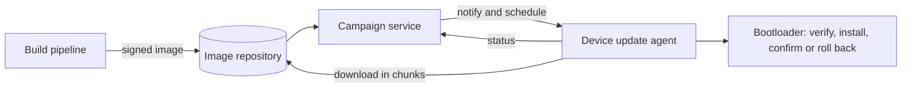

# Firmware over the air

Firmware over the air (FOTA) means updating the software on devices in the field through their network connection. Every connected product needs it: to fix bugs, close security holes and add features without sending someone to each device. Regulations increasingly require it too (see [ETSI EN 303 645](etsi-en-303-645.md)). A badly designed update system is also the quickest way to break a whole fleet at once, so it deserves careful design.

## The pieces

[[CAPTION:Figure]] An end-to-end firmware update system.

- **Build and signing**: the [CI/CD pipeline](cicd-pipelines.md) builds the image, and a signing service signs it with a key kept in an HSM.
- **Repository**: stores images and their metadata (version, target hardware, minimum version it can update from).
- **Campaign service**: decides which devices get which image and when, and tracks progress.
- **Update agent** on the device: downloads, checks and stores the image.
- **[Bootloader](bootloaders.md)**: verifies the signature, installs the image, and rolls back if it fails.

## Getting it to the device

- **Pull or push**: the device can check for updates when it wakes, or the server can notify it. [LwM2M](lwm2m.md) defines both through its firmware update object.
- **Chunks and resume**: download in blocks (HTTP range requests, CoAP block-wise transfer) and resume after a dropped connection rather than starting again.
- **Delta updates**: send only the differences from the installed version. On [NB-IoT](cellular-lpwan.md) and other slow links, a delta of tens of kilobytes instead of a full image of a megabyte makes the difference between practical and impossible. Deltas need the exact base version on the device, so keep full images as a fallback.
- **Compression** of full images helps too.

## Making it safe

- **Verify before installing**: check the signature and the hardware compatibility before touching the running image.
- **A/B slots and rollback**: keep the old image until the new one has started, connected and reported healthy. If it does not confirm, the bootloader reverts.
- **Anti-rollback**: refuse to install versions older than a security minimum.
- **Power and battery**: do not start an update with a low battery, and make every step survive power loss.
- **Encrypt the image** if it contains secrets or valuable intellectual property; signing alone does not hide the contents.

## Rolling out

Never update a whole fleet at once:

1. Internal test devices.
2. A small canary group in the field, perhaps 1 %.
3. Widening waves, with automatic pauses if failure or reset rates rise.

Watch the metrics during each wave: update success rate, reboot counts, connection rate and battery drain. Schedule updates for quiet times and respect devices that are doing something important.

## Standards and tools

- The SUIT manifest format (IETF, RFC 9019 architecture and RFC 9124 information model) describes updates for constrained devices in a standard way.
- MCUboot is a widely used secure bootloader for A/B updates.
- Mender, Memfault, the AWS, Azure and Golioth device services, and Eclipse hawkBit provide campaign management.

## Where next

- [Bootloaders](bootloaders.md) covers the device side in more depth.
- The [Handbook](../handbook/index.md) covers device management architecture.
