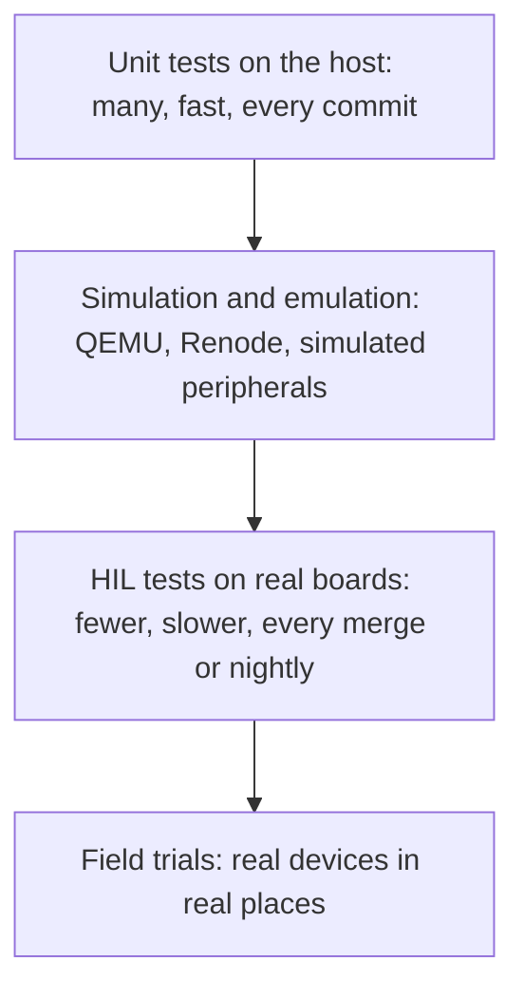

# Hardware-in-the-loop testing

Hardware-in-the-loop (HIL) testing runs real firmware on real hardware, with its inputs and outputs connected to a test rig that a computer controls. The rig can simulate sensors, switch power, disturb the radio and watch every output, so tests that would need a technician at a bench can run automatically, on every change.

Unit tests on a PC catch logic errors cheaply. They cannot catch timing problems, driver bugs, power behaviour or the way a real modem misbehaves. HIL tests can.

## Where it fits

[[CAPTION:Figure]] HIL in the embedded testing pyramid.

## A test bench

A typical bench has:

- **The device under test**, connected through its debug port (SWD or JTAG) so the test can flash firmware and read state.
- **A programmable power supply** to vary voltage, simulate brown-outs and measure current.
- **Signal generation and measurement**: digital and analogue I/O, a logic analyser, perhaps an oscilloscope.
- **Relays and switches** to connect, disconnect or short signals.
- **Radio equipment**: a shielded box, a programmable attenuator, or a network emulator for cellular tests.
- **A host computer** that runs the tests and controls everything. Python with pytest is a common choice; many instruments speak SCPI, which PyVISA can drive.

## Fault injection

The most valuable HIL tests check how the device behaves when things go wrong:

| Fault | How the bench causes it | What the firmware should do |
| --- | --- | --- |
| Brown-out during a flash write | Drop the supply voltage briefly during an update | Reset cleanly; the file system or update recovers without corruption |
| Stuck I2C bus | Hold the data line low during a sensor read | Detect the timeout, clock the bus free, reinitialise the driver |
| Weak or lost radio | Increase attenuation during a connection | Back off, retry with jitter, then sleep without draining the battery |
| Hung task | Trigger a test hook that blocks a task | The [watchdog](watchdog-timers.md) resets the device and the reset cause is reported |
| Clock failure | Disable the external crystal | Fall back to the internal oscillator and report the fault |

[[CAPTION:Table]] Examples of automated fault injection.

## Running it in CI

- Connect benches to the [CI/CD pipeline](cicd-pipelines.md) as self-hosted runners, and run a short smoke suite on every merge and the full suite nightly.
- Make every test start from a known state: flash, power-cycle, reset the instruments.
- Record logs, current traces and serial output as test artefacts.
- Treat benches as shared infrastructure: label them, monitor them, and have a way to reserve one for debugging.
- Keep tests independent of a particular bench where possible, so benches can be added as the suite grows.

Open-source tools such as Labgrid and LAVA help manage benches and boards. Commercial HIL systems exist for automotive and industrial work, where they also simulate whole vehicles or plants.

## Where next

- [Embedded systems design](embedded-systems-design.md) describes the behaviour these tests verify.
- [Testing strategies](testing-strategies.md) covers testing more generally.
- The [Guides](../guides/index.md) section covers setting up a test bench.
