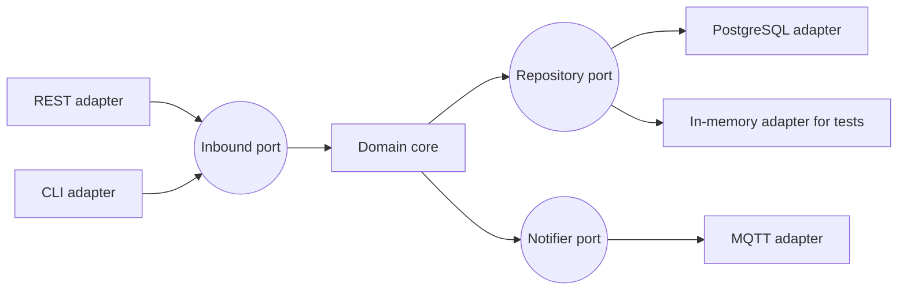

# Hexagonal architecture

Hexagonal architecture, also called ports and adapters, was described by Alistair Cockburn in 2005. Its one idea is that the business logic sits in the middle and knows nothing about the outside world. It does not know about the database, the web framework or the message broker. Everything outside talks to it through ports, and adapters connect those ports to real technology.

The hexagon shape has no meaning. It is just a shape with enough sides to draw several adapters around it.

## The parts

- **The core (domain)** holds the rules of the business: entities, calculations, decisions. It is plain code with no framework imports.
- **Ports** are interfaces that the core defines. A driving port (also called inbound) is how the outside asks the core to do something: `RegisterDevice`. A driven port (outbound) is something the core needs from outside: `DeviceRepository`, `NotificationSender`.
- **Adapters** implement the ports for one technology. A REST controller and a command-line tool can both drive the same inbound port. A PostgreSQL adapter and an in-memory test adapter can both implement the same repository port.

[[CAPTION:Figure]] Adapters on the outside, the domain in the middle.

The dependency arrows always point inwards. That is [dependency inversion](design-principles.md) applied to a whole application.

## Why it helps

- **Testing**: the core can be tested fast, with in-memory adapters and no database or network.
- **Change**: swapping a database or adding a new interface (a queue consumer next to the REST API) touches only an adapter.
- **Clarity**: the business rules are in one place, not scattered across controllers and SQL.

## Relatives

Several later styles share the same idea with different names and layering:

- **Onion architecture** (Jeffrey Palermo) draws the same thing as concentric rings.
- **Clean architecture** (Robert C. Martin) adds explicit rings for entities and use cases, with the same rule that dependencies point inwards.

In practice the differences are mostly vocabulary. Pick one set of names and use it consistently.

## In embedded systems

The same idea appears in firmware as a hardware abstraction layer: application logic talks to a `Sensor` or `Storage` interface, and board-specific drivers implement it. This lets the logic run on a PC in unit tests and move between microcontrollers. See [embedded systems design](embedded-systems-design.md).

## When not to use it

For a small CRUD service with no real business rules, ports and adapters add ceremony for little gain. Use it where the logic is worth protecting.

## Where next

- [Domain-driven design](domain-driven-design.md) is about what goes in the core.
- The [Handbook](../handbook/index.md) covers architectural styles and how to choose between them.
- Cockburn's original article is at [alistair.cockburn.us/hexagonal-architecture](https://alistair.cockburn.us/hexagonal-architecture/).
