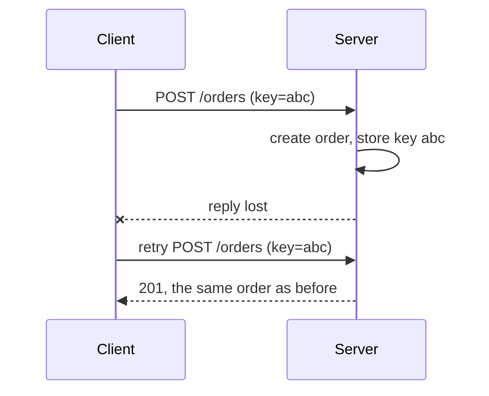

# Idempotency

An operation is idempotent if doing it twice has the same effect as doing it once. Setting a thermostat to 21 °C is idempotent; turning it up by one degree is not. In a distributed system this matters because messages get retried and duplicated, so anything that can be repeated eventually will be.

## Why duplicates happen

- A client sends a request, the server does the work, and the reply is lost. The client cannot tell this from a request that never arrived, so it retries.
- Message brokers usually promise at-least-once delivery. MQTT QoS 1 and most Kafka consumers can see the same message again after a reconnect or a rebalance.
- A device reboots in the middle of an upload and starts again.

"Exactly once" delivery across a network is not possible in general. What systems actually offer is at-least-once delivery plus idempotent processing, which gives exactly-once effects.

## Idempotency in HTTP

| Method | Idempotent? | Notes |
| --- | --- | --- |
| GET, HEAD | Yes | Should not change anything |
| PUT | Yes | Replaces the resource with the given state |
| DELETE | Yes | Deleting twice leaves it deleted (the second call may return 404) |
| POST | No | Usually creates something; repeat it and you get two |
| PATCH | Depends | "Set field to X" is; "append to list" is not |

[[CAPTION:Table]] Which HTTP methods are idempotent by definition.

## Techniques

- **Idempotency keys**: the client generates a unique key per logical operation and sends it with every attempt (for example an `Idempotency-Key` header). The server stores the key with the result and returns the stored result for a repeat. Payment APIs work this way.
- **Natural keys and upserts**: use an identifier from the data itself (device ID plus reading timestamp) and write with "insert or update", so a duplicate overwrites itself.
- **Deduplication on consume**: record the IDs of processed messages and skip ones already seen. Keep the record for longer than the longest retry window.
- **Set, do not increment**: send absolute values ("battery is 71 %") rather than changes ("battery dropped 2 %").
- **Version checks**: apply an update only if it is newer than the stored version. This also handles messages that arrive out of order.

[[CAPTION:Figure]] An idempotency key turns a retried request into a harmless repeat.

## Practical points

- Do the deduplication check and the work in the same transaction where possible; otherwise a crash between them reopens the gap.
- Side effects outside your store (sending an email, calling another API) need their own idempotency, or an outbox that records them first.
- Retries need backoff with jitter, or a fleet of clients retrying at once becomes its own outage.

## Where next

- [The saga pattern](saga-pattern.md) relies on idempotent steps and compensations.
- [MQTT](mqtt.md) and [Kafka](kafka-event-streaming.md) describe the delivery guarantees you are designing for.
