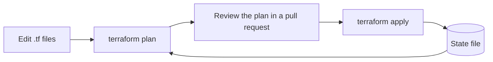

# Infrastructure as code

Infrastructure as code (IaC) means describing servers, networks, databases and permissions in text files kept in version control, and letting a tool create and change the real resources to match. It replaces clicking through a web console, which is quick once and impossible to repeat exactly.

## Why it matters

- **Repeatable**: the same files build development, staging and production, so they really are alike.
- **Reviewable**: infrastructure changes go through pull requests, with a diff and an approver.
- **Recoverable**: if an environment is lost, rebuild it from the files.
- **Documented**: the files are an accurate description of what exists.

## Declarative and imperative

- **Declarative** tools take a description of the desired end state and work out what to change. Terraform and OpenTofu, AWS CloudFormation, Azure Bicep and Kubernetes manifests work this way.
- **Imperative** tools run steps in order. Shell scripts and, partly, Ansible playbooks are like this.
- **General-purpose languages**: Pulumi and the AWS CDK let you write infrastructure in TypeScript, Python or Go, and still produce a declarative plan.

Declarative tools are usually the better default, because running them twice is safe and they can show a plan before changing anything.

## How Terraform works

```hcl
resource "google_pubsub_topic" "telemetry" {
  name = "device-telemetry"
  labels = {
    environment = var.environment
  }
}
```

[[CAPTION:Figure]] A Terraform resource.



[[CAPTION:Figure]] The plan and apply cycle.

Terraform keeps a state file that maps the code to real resources. Store it remotely (an object storage bucket with locking), never in Git, and never edit it by hand.

## Good habits

- Run `plan` and `apply` from the [CI/CD pipeline](cicd-pipelines.md), not from laptops, so every change is recorded.
- Use modules for repeated patterns, but keep them shallow; deeply nested modules are hard to change.
- Keep secrets out of the files. Reference a secrets manager instead.
- Check the files with linters and policy tools (`tflint`, Checkov, Open Policy Agent) to catch insecure settings before they exist.
- Detect drift: schedule a `plan` to spot changes made by hand outside the code.
- Separate configuration management (what is installed on a machine) from provisioning (what machines exist). Better still, build immutable images and replace machines instead of changing them.

## Where next

- [CI/CD pipelines](cicd-pipelines.md) runs IaC changes safely.
- The [Guides](../guides/index.md) section covers environment setup in more detail, and the [Tech Radar](../radar/index.md) shows which IaC tools are recommended.
