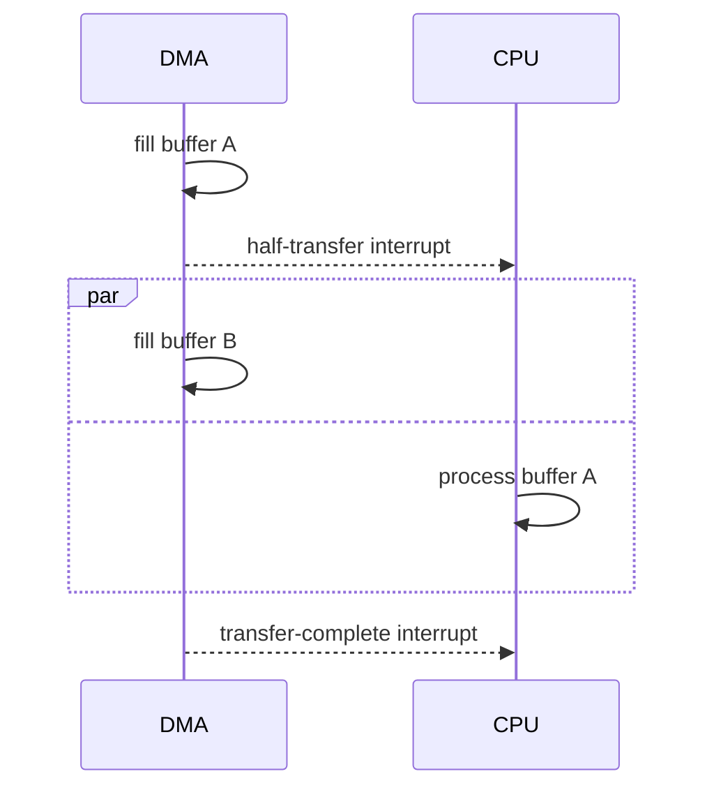

# Interrupts and DMA

Firmware has to respond to hardware: a byte arriving on a serial port, a timer expiring, a button being pressed. Checking each peripheral in a loop (polling) wastes CPU time and power, and can miss events. Interrupts let the hardware tell the CPU that something needs attention. Direct memory access (DMA) goes further, moving data between peripherals and memory with no CPU involvement at all.

## Interrupts

When a peripheral raises an interrupt, the CPU finishes its current instruction, saves its context, and jumps to an interrupt service routine (ISR). When the ISR returns, the interrupted code carries on as if nothing had happened. On Arm Cortex-M parts, the Nested Vectored Interrupt Controller (NVIC) handles priorities, so a more urgent interrupt can pre-empt a less urgent one.

### Rules for interrupt handlers

- **Keep them short**: acknowledge the hardware, capture the data, signal a task or set a flag, and return. Do the processing outside the ISR.
- **No blocking**: never wait, sleep or take a mutex in an ISR. Use only the interrupt-safe API calls of your RTOS (the `FromISR` functions in FreeRTOS).
- **Share data carefully**: variables written by an ISR and read elsewhere must be `volatile`, and multi-byte updates need protection (briefly disabling interrupts, or atomic operations), or the main code can read half-updated values.
- **Clear the interrupt flag**, or the ISR runs again immediately and the system locks up.
- **Set priorities deliberately**: give the most time-critical source the highest priority, and know your worst-case latency.

```c
static volatile uint32_t ticks;
static SemaphoreHandle_t rx_ready;

void USART1_IRQHandler(void)
{
    BaseType_t woken = pdFALSE;
    if (USART1->SR & USART_SR_RXNE) {
        ring_buffer_put(&rx, USART1->DR);          /* reading DR clears the flag */
        xSemaphoreGiveFromISR(rx_ready, &woken);
    }
    portYIELD_FROM_ISR(woken);
}
```

[[CAPTION:Figure]] A serial receive interrupt that defers processing to a task.

## DMA

A DMA controller copies data between memory and peripherals (or memory to memory) on its own, and raises an interrupt when a transfer is complete or half complete. The CPU sets up the transfer and is then free to do other work or to sleep.

Typical uses:

- Receiving serial data into a buffer without an interrupt per byte.
- Streaming ADC samples into memory at a fixed rate.
- Sending a display frame over SPI.
- Moving audio samples to and from a codec.

A common pattern is **double buffering** (or a circular buffer with half-transfer interrupts): DMA fills one half while the CPU processes the other.



[[CAPTION:Figure]] Double buffering with DMA.

### Things to watch

- **Caches**: on cores with a data cache (Cortex-M7, for example), clean the cache before a DMA transfer out of memory and invalidate it after a transfer in, or place DMA buffers in non-cacheable memory.
- **Alignment and placement**: some DMA controllers can only reach certain memory regions or need aligned buffers.
- **Ownership**: never touch a buffer while DMA is using it.
- **Errors**: handle overrun and transfer-error interrupts, not just completion.

## Where next

- [Real-time operating systems and FreeRTOS](rtos-and-freertos.md) shows how ISRs hand work to tasks.
- [Embedded systems design](embedded-systems-design.md) covers power and memory, which interrupts and DMA both help.
