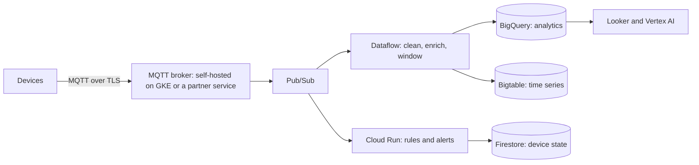

# IoT on Google Cloud

Google Cloud no longer has a dedicated IoT device service. Cloud IoT Core, which handled device registration and MQTT connections, was retired on 16 August 2023. An IoT platform on Google Cloud today is built from its general services, with device connectivity provided by an MQTT broker you run yourself or by a partner. The same pattern applies to any cloud: the provider's own IoT service, where it has one, is only one option.

## A typical architecture

[[CAPTION:Figure]] Device data flowing through Google Cloud services.

| Job | Google Cloud service |
| --- | --- |
| Device connections | An MQTT broker (EMQX, HiveMQ, Mosquitto) on GKE or Compute Engine, or a partner's managed service |
| Ingestion and fan-out | Pub/Sub |
| Stream and batch processing | Dataflow (Apache Beam) |
| Event-driven logic | Cloud Run and Cloud Run functions |
| Analytics | BigQuery |
| High-volume time series | Bigtable |
| Device state and metadata | Firestore or Cloud SQL |
| Machine learning | Vertex AI |
| Edge | Google Distributed Cloud, or your own edge software |

[[CAPTION:Table]] Which service does which job.

## What you now own

Without a managed device service, these jobs are yours:

- **Device identity**: per-device X.509 certificates or keys, issued in manufacturing or at first connection. See [PKI and certificates](pki-and-certificates.md).
- **Registry and shadows**: a database of devices with their configuration and last state. See [digital twins and device shadows](digital-twins-and-device-shadows.md).
- **Firmware updates**: a campaign service and storage for images. See [firmware over the air](firmware-over-the-air.md).
- **Broker operations**: scaling, high availability and patching of the MQTT broker, or a contract with the partner who runs it.

This is more work than a managed service, but it avoids being stranded again if a provider withdraws one.

## Good habits

- Keep the device protocol standard ([MQTT](mqtt.md) or [LwM2M](lwm2m.md)) so the cloud side can change without touching devices in the field.
- Put a bridge between the broker and Pub/Sub, so the cloud processing knows nothing about device connections.
- Partition data by device and time from the start; BigQuery and Bigtable costs depend heavily on it.
- Use [infrastructure as code](infrastructure-as-code.md) for every resource.

## Where next

- [Edge computing for IoT](edge-computing-for-iot.md) covers what to process before data reaches the cloud.
- The [Handbook](../handbook/index.md) covers IoT platform architecture, and Google's [Pub/Sub documentation](https://cloud.google.com/pubsub/docs) is the starting point for the cloud side.
